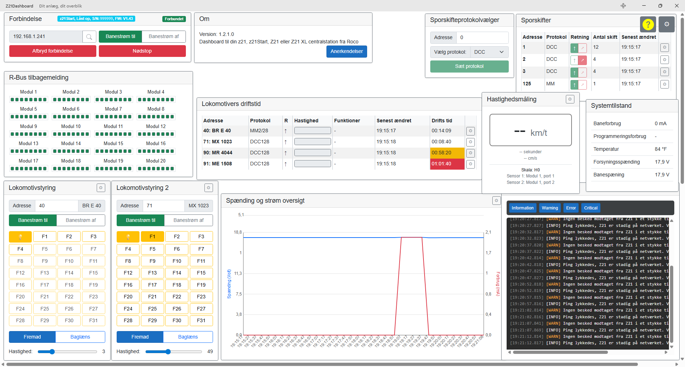
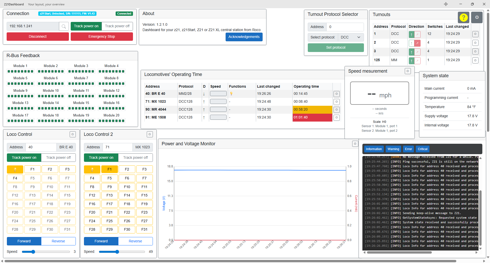

[Click here for English version](#z21dashboard-application-for-windows) 
[Für die deutsche Version hier klicken](#z21dashboard-anwendung-für-windows) 
[Pour la version française, cliquez ici](#application-z21dashboard-pour-windows)

# Z21Dashboard applikation til Windows

En .NET MAUI Blazor Hybrid-applikation til Windows. Den fungerer som et funktionsrigt, brugerkonfigurerbart
dashboard til styring og overvågning af en Roco/Fleischmann Z21-modeljernbane-centralstation. Denne
applikation bruger mit `Z21Client`-biblioteket til at kommunikere med hardwaren.

I dokumentationen benyttes termen "widget". "Widget" dækker funktionalitet der afvikles i sit eget vindue på
dashboardet. 

Z21Client repo findes her:
[https://github.com/J-Wachs/Z21Client](https://github.com/J-Wachs/Z21Client)

Z21Dashboard (og Z21Client) er udvikler efter "AI Pair Programming" metoden.

## Nyheder i denne version 

Version 1.3:

For brugere:

* Tilføjet tysk og fransk lokalisering
* Teksterne på knapperne i log-widget'en er nu lokaliseret (de var tidligere på engelsk)
* Ny widget: "Programmering af lokomotivdekodere", som gør det muligt at oprette et lokomotivregister
  samt programmere lokomotiver og dekodere. Funktionaliteten er ganske omfattende. Widgeten
  understøtter udelukkende CV'er der ikke er indekserede
* Tilføjet et større afsnit til brugermanualen om CV-programmering og programmering af lokomotiver

For udviklere:

* Tilføjet metoden GetStatusAsync(), som sender kommandoen LAN_GET_STATUS til Z21 og returnerer
  svaret som et StatusResponse-objekt i en event
* Koden i Z21Dasboard-projektet er omstruktureret, så koden er opdelt i mapper efter funktionalitetstype
  (f.eks. widgets, services osv.)
* Bemærk: Der er i øjeblikket en fejl i MAUI, som forhindrer projektet i at blive tilføjet til et
  testprojekt ved hjælp af xUnit. Derfor er der ingen unit tests inkluderet i denne release

Fejlrettelser:

* Eventen til modtagelse af RailCom-data blev ikke konfigureret korrekt for firmwareversioner
  under 1.29
* Efter den første forbindelse til Z21 resulterede efterfølgende forbindelser i, at Lokomotivlisten
  ikke viste hastigheden og knapperne korrekt
* Lokomotivernes driftstid blev talt med, selv når strømmen til sporet var slået fra

## Målgruppe for applikationen

Der er to målgrupper for Z21Dashboard:

* Modeltogsentusiasten, der ønsker et overblik, som man ikke får ved at bruge multiMAUS, wlanMAUS eller den
  officielle Z21-app, men på samme tid ikke ønsker en mere kompliceret løsning, som software til at automatisere
  driften på modelbanen.
* Modeltogsentusiasten, der, udover ovenstående, ønsker at udvikle software til Z21, og derfor kan hente inspiration
  i Z21Dashboard eller bruge Z21Dashboard som afsæt til en ny applikation. Et ønske kunne være at udvide med CAN-bus
  og LocoNet-funktionalitet til Z21 (modeller i sort kabinet) centralstationerne.

## Egenskaber

Z21Dashboard tilbyder en moderne og interaktiv brugerflade med følgende nøglefunktioner:

*   **Sprogversionering:** Afvikles applikationen med sprog sat til dansk, tysk eller fransk, vises tekster i disse
    sprog, ellers vises teksterne på engelsk.
*   **Dynamisk "Træk-og-slip"-dashboard:** Brugere kan frit flytte og omarrangere widgets på et "frit lærred"
    for at skabe et personligt layout.
*   **Brugerkonfigurerbart Layout:** Et centralt indstillingspanel giver brugerne mulighed for at vise eller skjule
    individuelle widgets, så de kan skræddersy dashboardet til deres specifikke behov.
*   **Permanent Layout:** Brugerens tilpassede layout, inklusiv widgets positioner og synlighed, gemmes automatisk
    og gendannes mellem applikationens sessioner.
*   **Realtidsovervågning:** De forskellige widgets abonnerer på live datastrømme fra `Z21Client` for at vise
    statusopdateringer i realtid for:
    *   Lokomotivers hastighed, retning og funktioner
    *   Status for banestrøm
    *   Sporskifters position
    *   Overordnet systemstatus, strømforbrug og spænding
    *   R-Bus feedback og RailCom-data
*   **Interaktiv Styring:** Tilbyder en dedikeret "Lokomotivstyring" widget til realtidsstyring af et valgt lokomotivs
    hastighed, retning og funktioner (kræver enten at z21/z21start er låst op, eller en Z21/Z21 XL).
*   **Lagring af Indstillinger:** Nøgleindstillinger, såsom Z21'ens IP-adresse og brugerdefinerede lokomotivnavne,
    gemmes lokalt, hvilket giver en gnidningsfri oplevelse ved efterfølgende opstarter.
*   **Clean Architecture:** Applikationen er bygget ved hjælp af Clean Architecture-principper, hvilket sikrer en klar
    adskillelse af ansvarsområder mellem logik, applikationsinfrastruktur og brugergrænsefladen.

## Dashboard widgets

Dashboardet er sammensat af specialiserede widgets, hver med en specifik funktion. Alle widgets kan flyttes
og skjules af brugeren.

*   **Forbindelses-visning:** Bruges til at etablere og overvåge forbindelsen til Z21. Tilbyder også kontroller for
    skinnestrøm og Nødstop
*   **Lokomotiv-styring:** Lader brugeren vælge og køre samt overvåge et lokomotivs hastighed, retning og funktioner
    (F0-F31). Widget'en bliver opdateret med aktuelle data for det valgte lokomotiv i realtid, hvis det pågældende
    lokomotiv bliver styret fra en multiMAUS, wlanMAUS eller Z21 appen
*   **Lokomotiver med driftstid:** Viser en oversigt med lokomotiver som Z21 centralstationen (alle typer) styrer eller
    tidligere har styret. Den samlede driftstid og nuværende status vises. Brugeren har mulighed for at tildele egne
    navne til lokomotiv-adresser
*   **Diagram med strømforbrug:** En live-opdaterende graf, der overvåger og viser strømforbrug (mA) og skinnespænding
    (V) fra Z21'en
*   **Lokomotiv-slots:** Viser status for de 120 interne lokomotiv-"slots" i Z21-hukommelsen, hvilket giver et
    lav-niveau overblik. Denne komponent er baseret på ikke dokumenterede kald til Z21 centralstationen.
*   **Sporskifter:** En liste, der viser den nuværende position (f.eks. ligeud eller afvigende) for alle sporskifter,
    der for nylig er blevet betjent
*   **Systemstatus (Simpel & Fuld):** To widgets, der viser tekniske data fra Z21. Den simple visning viser nøgletal
    som strøm og spænding, mens den fulde visning giver en detaljeret oversigt over alle status-flag.
*   **R-Bus & RailCom-visninger:** Specialiserede widgets til overvågning af feedback fra R-Bus-moduler og data fra
    RailCom-udstyrede lokomotiver
*   **Hastighedsmåling:** Måler modeltogets hastighed og beregner den til skala 1:1
*   **Programmering af lokomotivdekodere:** Giver mulighed for at oprette et lokomotivregister og programmere
    lokomotiver og dekodere. Funktionaliteten er ganske omfattende

## Hvordan det virker

Z21Dashboard er bygget som en **.NET MAUI Blazor Hybrid**-applikation ved hjælp af **.NET 10**. Denne arkitektur gør
det muligt for en moderne web-baseret brugerflade (bygget med Blazor-komponenter) at køre som en native
desktop-applikation på Windows.

Z21Dashboard modtager hændelser fra Z21 centralstationen, og disse hændelser tolkes og afspejles på dashboardet. Det
betyder, at benytter du Z21 appen, multiMAUS eller wlanMAUS, så afspejles aktiviteten på disse, på dashboardet.

### Kerne-arkitekturkoncepter:

Er du interesseret i applikationens arkitektur og hvordan den er implementeret, så er her nogle af de vigtigste
koncepter:
*   **Dynamisk Komponent-rendering:** Dashboard-lærredet bruger Blazors `<DynamicComponent>` til kun at rendere de
    widgets, som brugeren har valgt at gøre synlige. Dette sikrer optimal ydeevne
*   **Centraliseret Tilstandsstyring:** En singleton-service, `DashboardStateService`, fungerer som den eneste kilde
    til sandhed for dashboardets layout. Den er ansvarlig for at indlæse, flette og gemme brugerens konfiguration
*   **Brugerdefineret Træk-og-slip:** Grundet et kendt problem i .NET MAUI Blazor WebView
    ([dotnet/maui#2205](https://github.com/dotnet/maui/issues/2205)), er en brugerdefineret,
    robust træk-og-slip-mekanisme baseret på fundamentale muse-events (`mousedown`, `mousemove`, `mouseup`) blevet
    implementeret
*   **Event-drevet Brugerflade:** Widgets er afkoblede og reagerer på ændringer ved at abonnere på events fra
    singleton-services (som `IDashboardStateService` og `IZ21Client`).
*   **Lagring af Indstillinger:** Alle brugerindstillinger gemmes i en enkelt `app_data.json`-fil i brugerens lokale
    `AppData/Roaming`-mappe, håndteret af en dedikeret `AppDataService`.

## Kom Godt I Gang

Hvis du vil se og lave din egen version af Z21Dashboard, følg punkterne herunder. Vil du blot have selve
applikationen og bruge den, da skal du downloade den køreklar udgave.

For at udvikle Z21Dashboard-applikationen skal du have .NET 10 SDK installeret.

1.  Klon "repository'et" fra GitHub
2.  Åbn løsningsfilen (`.sln`) i Visual Studio 2026
3.  Sørg for, at `Z21Dashboard`-projektet er sat som opstartsprojekt
4.  Kør applikationen (tryk F5)

## Ofte Stillede Spørgsmål (FAQ)

### Vil Z21Dashboard fungere med Z21 START newGen?

På nuværende tidspunkt, har jeg ikke haft mulighed for at teste Z21Dashboard med Z21 START newGen, og jeg kan 
derfor ikke svare på om de Z21Dashboard virker med Z21 START newGen.

Ej heller er manualen "Z21 LAN Protocol" opdateret til at inkludere de ændringer i Z21 protokollen, der
måtte være nødvendige for Z21 START newGen.

### Kan jeg bruge Z21Dashboard på med min Digikeijs DR5000?

Ja, det kan du. Det forudsætter dog, at du har sat netværksprotolollen til "Z21" i DR5000'ens indstillinger.
Du kan ikke bruge Z21Dashboard med DR5000, hvis du har valgt andre protokoller.

Z21Dashboard er afprøvet med en DR5000 med firmware 1.6.3, og det fungerer fint.

Vær opmærksom på, at Z21 centralstationerne er multiprotokol-enheder, og DR5000 er undelukkende en DCC
centralstation. Da DR5000 firmaware 1.6.3, i Z21 protokollen, svarer at den er en Z21 (i sort kabinet) med
firmware-version 1.29, kan den ikke forespørges om hvilke protokoller der er aktiveret. Du vil derfor se både
DCC og Märklin Motorola protokoller i Z21Dashboard. Valg af Märklin Motorola protokollen til lokomotiver eller
sporskifter vil ikke have nogen effekt.

### Hvorfor bruges en brugerdefineret træk-og-slip-implementering?

Som beskrevet i GitHub-sagen [dotnet/maui#2205](https://github.com/dotnet/maui/issues/2205), bliver standard HTML5
træk-og-slip-events ikke korrekt sendt igennem .NET MAUI Blazor WebView. Den brugerdefinerede implementering via
muse-events giver et pålideligt og højtydende alternativ.

### Hvordan tilføjer jeg en ny widget til dashboardet?

1.  Opret din nye Blazor-komponent
2.  Åbn `DashboardStateService.cs` og tilføj en post for din nye widget i `GetDefaultComponentDefinitions()`-metoden
3.  Hvis nødvendigt, opdater `Dashboard.razor`'s `UpdateComponentParameters()`-metode for at levere parametre til din
    nye widget

Eksisterende brugere vil automatisk se den nye widget i deres indstillingspanel ved næste opstart.

### Hvorfor er der ingen widgets til LocoNet og CAN-bus?

Jeg har en z21start og derfor ingen LocoNet eller CAN-bus enheder jeg kan udvikle til, og teste med. Du er
velkommen til at udvikle den nødvendige funktionalitet i Z21Client og i Z21Dashboard.

## Fundet en fejl?

Opret venligst en "issue" i "repository'et".

# Z21Dashboard application for Windows

A .NET MAUI Blazor Hybrid application for Windows. It functions as a feature-rich,
user-configurable dashboard for controlling and monitoring a Roco/Fleischmann
Z21 model railway central station. This application uses my `Z21Client` library
to communicate with the hardware.

In the documentation, the term "widget" is used. "Widget" refers to functionality
that runs in its own window on the dashboard.

Z21Client repo can be found here:
[https://github.com/J-Wachs/Z21Client](https://github.com/J-Wachs/Z21Client)

Z21Dashboard (and Z21Client) was developed using the "AI Pair Programming" method.

## What's New in This Version

Version 1.3:

For users:
* Added German and French localization
* Caption on buttons on the log widget is now localized (was in English)
* New widget "Programming locomotive decoders" that allows to create a
  locomotive roster and program the locomotives, and decoders. The
  functionality is quite comprehensive. The widget only supports CVs
  that are not indexed
* Added large section to user manual about CV programming and locomotive
  programming

For developers:
* Added method GetStatusAsync() to send command LAN_GET_STATUS to the Z21 and
  return the response as a StatusResponse object in a event
* Restructured the code in the Z21Dasboard project to separate the code into
  folders for each type of functionality (e.g. widgets, services, etc.)
* Info: There is currectly a bug in MAUI that prevent the add the project to a
  testproject using xUnit. Hence no unit tests are included in this release

Bug fixes:
* Receive RailCom data event was not setup correct for firmware versions less than
  1.29
* After initial connect to the Z21, subsequent connects resulted in Locomotive
  List not displaying the speed and buttons correctly
* Locomotive operation time was counting even when the track power was
  switched off

## Target Audience for the Application

There are two target groups for Z21Dashboard:

* The model train enthusiast who wants an overview not provided by multiMAUS,
  wlanMAUS, or the official Z21 app, but does not want a more complex solution
  such as software for automating model railway operations.
* The model train enthusiast who, in addition to the above, wants to develop
  software for the Z21, and can therefore draw inspiration from Z21Dashboard or
  use it as a starting point for a new application. One goal could be to expand
  with CAN-bus and LocoNet functionality for Z21 (black cabinet models) central
  stations.

## Features

Z21Dashboard offers a modern and interactive user interface with the following
key features:

*   **Language Versioning:** If the application is run with language set to
    Danish, Danish texts are displayed; otherwise English texts are shown.
*   **Dynamic Drag-and-Drop Dashboard:** Users can freely move and rearrange
    widgets on a "free canvas" to create a personalized layout.
*   **User-Configurable Layout:** A central settings panel allows users to show
    or hide individual widgets to tailor the dashboard to their needs.
*   **Persistent Layout:** The user's customized layout, including widget
    positions and visibility, is automatically saved and restored between
    sessions.
*   **Clean Architecture:** Built using Clean Architecture principles, ensuring
    a clear separation of concerns between logic, application infrastructure,
    and the user interface.
*   **Real-Time Monitoring:** Widgets subscribe to live data streams from
    `Z21Client` to show real-time status updates for:
    *   Locomotive speed, direction, and functions
    *   Track power status
    *   Switch positions
    *   Overall system status, current, and voltage
    *   R-Bus feedback and RailCom data
*   **Interactive Control:** Provides a dedicated "Locomotive Control" widget
    for real-time control of a selected locomotive's speed, direction, and
    functions (requires either an unlocked z21/z21start, or a Z21/Z21 XL).
*   **Settings Storage:** Key settings, such as the Z21 IP address and
    user-defined locomotive names, are stored locally for a seamless experience
    across restarts.

## Dashboard Widgets

The dashboard consists of specialized widgets, each with a specific function.
All widgets can be moved and hidden by the user.

*   **Connection View:** Used to establish and monitor the connection to Z21.
    Also provides controls for track power and emergency stop.
*   **Locomotive Control:** Allows the user to select, run, and monitor a
    locomotive's speed, direction, and functions (F0-F31). The widget updates
    in real time if the locomotive is controlled from multiMAUS, wlanMAUS, or
    the Z21 app.
*   **Locomotives with Runtime:** Displays an overview of locomotives controlled
    by the Z21 central station (all types) or previously controlled. Shows total
    runtime and current status. Users can assign custom names to locomotive
    addresses.
*   **Power Consumption Chart:** A live-updating graph showing current (mA) and
    track voltage (V) from the Z21.
*   **Locomotive Slots:** Displays the status of the 120 internal locomotive
    slots in Z21 memory, providing a low-level overview. Based on undocumented
    calls to the Z21 central station.
*   **Switches:** A list showing the current positions (e.g., straight or
    diverging) of all recently operated switches.
*   **System Status (Simple & Full):** Two widgets showing technical data from
    Z21. The simple view shows key figures like current and voltage; the full
    view provides a detailed overview of all status flags.
*   **R-Bus & RailCom Views:** Specialized widgets for monitoring feedback
    from R-Bus modules and RailCom-equipped locomotives.
*   **Speed Measurement:** Measures model train speed and calculates full-scale
    speed.
*   **Programming locomotive decoders:** Allows you to create a locomotive
    roster and program locomotives and decoders. The functionality is quite comprehensive.

## How It Works

Z21Dashboard is built as a **.NET MAUI Blazor Hybrid** application using **.NET 10**. 
This architecture allows a modern web-based interface (built with Blazor components)
to run as a native desktop application on Windows.

Z21Dashboard receives events from the Z21 central station, which are interpreted
and reflected on the dashboard. This means activity from the Z21 app, multiMAUS,
or wlanMAUS is mirrored on the dashboard.

### Core Architecture Concepts

For those interested in the application architecture and implementation, here
are some key concepts:

*   **Dynamic Component Rendering:** The dashboard canvas uses Blazor’s
    `<DynamicComponent>` to render only the widgets chosen by the user, ensuring
    optimal performance.
*   **Centralized State Management:** A singleton service, `DashboardStateService`,
    serves as the single source of truth for the dashboard layout. It loads,
    merges, and saves the user's configuration.
*   **Custom Drag-and-Drop:** Due to a known issue in .NET MAUI Blazor WebView
    ([dotnet/maui#2205](https://github.com/dotnet/maui/issues/2205)), a robust,
    custom drag-and-drop mechanism based on fundamental mouse events
    (`mousedown`, `mousemove`, `mouseup`) has been implemented.
*   **Event-Driven UI:** Widgets are decoupled and respond to changes by subscribing
    to events from singleton services (like `IDashboardStateService` and `IZ21Client`).
*   **Settings Storage:** All user settings are saved in a single `app_data.json`
    file in the user's local `AppData/Roaming` folder, managed by a dedicated
    `AppDataService`.

## Getting Started

To develop the Z21Dashboard application, you need the .NET 10 SDK installed.

If you want to view and build your own version of Z21Dashboard, follow the steps
below. To just use the application, download the ready-to-run version.

1.  Clone the repository from GitHub
2.  Open the solution file (`.sln`) in Visual Studio 2026
3.  Make sure the `Z21Dashboard` project is set as the startup project
4.  Run the application (press F5)

## Frequently Asked Questions (FAQ)

### Will Z21Dashboard work with Z21 START newGen?

At present, I have not had the opportunity to test Z21Dashboard with
Z21 START newGen, and therefore I cannot say whether Z21Dashboard works
with Z21 START newGen.

Nor has the "Z21 LAN Protocol" manual been updated to include any changes
to the Z21 protocol that may be necessary for Z21 START newGen.

### Can I use Z21Dashboard with my Digikeijs DR5000?

Yes, you can. However, this requires that you have set the network
protocol to "Z21" in the DR5000's settings. You cannot use Z21Dashboard
with the DR5000 if you have selected other protocols.

Z21Dashboard has been tested with a DR5000 running firmware 1.6.3, and
it works fine.

Please note that the Z21 command stations are multiprotocol devices,
whereas the DR5000 is exclusively a DCC command station. Since DR5000
firmware 1.6.3, when using the Z21 protocol, reports itself as a Z21
(with a black housing) with firmware version 1.29, it cannot be queried
about which protocols are enabled. You will therefore see both DCC and
Märklin Motorola protocols in Z21Dashboard. Selecting the Märklin
Motorola protocol for locomotives or turnouts will have no effect.

### Why use a custom drag-and-drop implementation?

As described in GitHub issue [dotnet/maui#2205](https://github.com/dotnet/maui/issues/2205),
standard HTML5 drag-and-drop events are not properly passed through .NET MAUI Blazor
WebView. The custom implementation using mouse events provides a reliable, high-
performance alternative.

### How do I add a new widget to the dashboard?

1.  Create your new Blazor component
2.  Open `DashboardStateService.cs` and add an entry for your new widget in the
    `GetDefaultComponentDefinitions()` method
3.  If needed, update `Dashboard.razor`'s `UpdateComponentParameters()` method to
    pass parameters to your new widget

Existing users will automatically see the new widget in their settings panel at
next startup.

### Why are there no widgets for LocoNet and CAN-bus?

I have a z21start and therefore no LocoNet or CAN-bus devices to develop and test
with. You are welcome to implement the required functionality in Z21Client and
Z21Dashboard.

## Found a Bug?

Please create an "issue" in the repository.

# Z21Dashboard-Anwendung für Windows

Eine .NET MAUI Blazor Hybrid-Anwendung für Windows. Sie dient als
funktionsreiches, vom Benutzer konfigurierbares Dashboard zur Steuerung und
Überwachung einer Roco/Fleischmann Z21-Modellbahnzentrale. Diese Anwendung
verwendet meine `Z21Client`-Bibliothek zur Kommunikation mit der Hardware.

In der Dokumentation wird der Begriff „Widget“ verwendet. „Widget“ bezeichnet
eine Funktionalität, die in einem eigenen Fenster auf dem Dashboard ausgeführt
wird.

Das Z21Client-Repository ist hier zu finden:
https://github.com/J-Wachs/Z21Client

Z21Dashboard (und Z21Client) wurde mit der Methode „AI Pair Programming“
entwickelt.

## Neu in dieser Version

Version 1.3:

Für Benutzer:

* Deutsche und französische Lokalisierung hinzugefügt
* Die Beschriftungen der Schaltflächen im Log-Widget sind jetzt lokalisiert
  (zuvor waren sie auf Englisch)
* Neues Widget „Lokomotivdecoder programmieren“, mit dem eine
  Lokomotivliste erstellt und Lokomotiven sowie Decoder programmiert werden
  können. Der Funktionsumfang ist recht umfassend. Das Widget unterstützt
  ausschließlich nicht indizierte Lebensläufe
* Ein umfangreicher Abschnitt über CV-Programmierung und
  Lokomotivprogrammierung wurde dem Benutzerhandbuch hinzugefügt

Für Entwickler:

* Die Methode `GetStatusAsync()` wurde hinzugefügt. Sie sendet den Befehl
  `LAN_GET_STATUS` an die Z21 und gibt die Antwort als `StatusResponse`-Objekt
  in einem Event zurück.
* Der Code im Projekt `Z21Dasboard` wurde neu strukturiert. Der Code ist nun
  nach Funktionalität in verschiedene Ordner aufgeteilt (z. B. Widgets,
  Services usw.).
* Hinweis: In MAUI gibt es derzeit einen Fehler, der verhindert, dass das
  Projekt mithilfe von xUnit zu einem Testprojekt hinzugefügt werden kann.
  Daher enthält diese Version keine Unit-Tests.

Fehlerbehebungen:

* Das Event zum Empfangen von RailCom-Daten wurde für Firmwareversionen unter
  1.29 nicht korrekt eingerichtet.
* Nach der ersten Verbindung mit der Z21 führte jede weitere Verbindung dazu,
  dass die Lokomotivliste Geschwindigkeit und Schaltflächen nicht korrekt
  anzeigte.
* Die Betriebszeit der Lokomotiven wurde auch dann weitergezählt, wenn die
  Stromversorgung des Gleises ausgeschaltet war.

## Zielgruppe der Anwendung

Z21Dashboard richtet sich an zwei Zielgruppen:

* Modellbahner, die eine Übersicht wünschen, die von multiMAUS, wlanMAUS oder
  der offiziellen Z21-App nicht bereitgestellt wird, aber keine komplexere
  Lösung wie eine Software zur Automatisierung des Modellbahnbetriebs möchten.
* Modellbahner, die darüber hinaus Software für die Z21 entwickeln möchten und
  sich daher von Z21Dashboard inspirieren lassen oder es als Ausgangspunkt für
  eine neue Anwendung verwenden möchten. Ein Ziel könnte sein, Z21-Zentralen
  (Modelle mit schwarzem Gehäuse) um CAN-Bus- und LocoNet-Funktionalität zu
  erweitern.

## Funktionen

Z21Dashboard bietet eine moderne und interaktive Benutzeroberfläche mit den
folgenden Hauptfunktionen:

* **Sprachversionierung:** Wenn die Anwendung auf Deutsch eingestellt ist,
  werden deutsche Texte angezeigt. Andernfalls werden englische Texte
  angezeigt.
* **Dynamisches Drag-and-Drop-Dashboard:** Benutzer können Widgets auf einer
  „freien Arbeitsfläche“ frei verschieben und neu anordnen, um ein
  individuelles Layout zu erstellen.
* **Vom Benutzer konfigurierbares Layout:** Ein zentrales Einstellungsfenster
  ermöglicht es, einzelne Widgets ein- oder auszublenden und das Dashboard
  an die eigenen Bedürfnisse anzupassen.
* **Persistentes Layout:** Das vom Benutzer angepasste Layout einschließlich
  der Position und Sichtbarkeit der Widgets wird automatisch gespeichert
  und zwischen Sitzungen wiederhergestellt.
* **Saubere Architektur:** Nach den Prinzipien der Clean Architecture
  entwickelt, um eine klare Trennung zwischen Logik, Anwendungsinfrastruktur
  und Benutzeroberfläche zu gewährleisten.
* **Echtzeitüberwachung:** Widgets abonnieren Live-Datenströme von
  `Z21Client`, um Statusänderungen in Echtzeit anzuzeigen:

  * Geschwindigkeit, Fahrtrichtung und Funktionen der Lokomotiven
  * Status der Gleisspannung
  * Stellung der Weichen
  * Gesamtsystemstatus, Stromstärke und Spannung
  * R-Bus-Rückmeldungen und RailCom-Daten
* **Interaktive Steuerung:** Ein eigenes Widget „Lokomotivsteuerung“ ermöglicht
  die Echtzeitsteuerung von Geschwindigkeit, Fahrtrichtung und Funktionen
  einer ausgewählten Lokomotive (erfordert entweder eine entsperrte
  z21/z21start oder eine Z21/Z21 XL).
* **Speicherung der Einstellungen:** Wichtige Einstellungen wie die
  IP-Adresse der Z21 und benutzerdefinierte Lokomotivnamen werden lokal
  gespeichert, sodass sie auch nach einem Neustart verfügbar sind.

## Dashboard-Widgets

Das Dashboard besteht aus spezialisierten Widgets, die jeweils eine bestimmte
Funktion erfüllen. Alle Widgets können vom Benutzer verschoben und ausgeblendet
werden.

* **Verbindungsansicht:** Dient zum Herstellen und Überwachen der Verbindung
  zur Z21. Bietet außerdem Bedienelemente für die Gleisspannung und den
  Nothalt.
* **Lokomotivsteuerung:** Ermöglicht die Auswahl, Steuerung und Überwachung
  von Geschwindigkeit, Fahrtrichtung und Funktionen (F0–F31) einer
  Lokomotive. Das Widget wird in Echtzeit aktualisiert, wenn die Lokomotive
  über multiMAUS, wlanMAUS oder die Z21-App gesteuert wird.
* **Lokomotiven mit Betriebszeit:** Zeigt eine Übersicht der von der
  Z21-Zentrale gesteuerten Lokomotiven (aller Typen) sowie zuvor gesteuerter
  Lokomotiven. Zeigt die Gesamtbetriebszeit und den aktuellen Status.
  Benutzer können den Lokomotivadressen eigene Namen zuweisen.
* **Stromverbrauchsdiagramm:** Ein sich in Echtzeit aktualisierendes Diagramm,
  das die Stromstärke (mA) und die Gleisspannung (V) der Z21 anzeigt.
* **Lokomotiv-Slots:** Zeigt den Status der 120 internen Lokomotiv-Slots im
  Speicher der Z21 und bietet damit eine Übersicht auf niedriger Ebene.
  Basiert auf undokumentierten Aufrufen der Z21-Zentrale.
* **Weichen:** Eine Liste mit den aktuellen Stellungen (z. B. gerade oder
  abzweigend) aller kürzlich betätigten Weichen.
* **Systemstatus (Einfach & Vollständig):** Zwei Widgets mit technischen
  Daten der Z21. Die einfache Ansicht zeigt wichtige Werte wie Strom und
  Spannung, während die vollständige Ansicht eine detaillierte Übersicht
  über alle Statusflags bietet.
* **R-Bus- und RailCom-Ansichten:** Spezialisierte Widgets zur Überwachung
  von Rückmeldungen von R-Bus-Modulen und RailCom-fähigen Lokomotiven.
* **Geschwindigkeitsmessung:** Misst die Geschwindigkeit eines
  Modellzuges und berechnet die maßstabsgetreue Geschwindigkeit.
* **Lokomotivdecoder programmieren:** Ermöglicht das Erstellen einer
  Lokomotivliste sowie das Programmieren von Lokomotiven und Decodern.
  Der Funktionsumfang ist recht umfassend.

## Funktionsweise

Z21Dashboard wurde als **.NET MAUI Blazor Hybrid**-Anwendung mit **.NET 10**
entwickelt. Diese Architektur ermöglicht es, eine moderne webbasierte
Benutzeroberfläche (erstellt mit Blazor-Komponenten) als native
Desktop-Anwendung unter Windows auszuführen.

Z21Dashboard empfängt Events von der Z21-Zentrale, interpretiert diese und
bildet sie auf dem Dashboard ab. Dadurch werden Aktivitäten aus der Z21-App,
multiMAUS oder wlanMAUS auf dem Dashboard gespiegelt.

### Zentrale Architekturkonzepte

Für alle, die sich für die Architektur und Implementierung der Anwendung
interessieren, sind hier einige wichtige Konzepte:

* **Dynamisches Rendern von Komponenten:** Die Dashboard-Arbeitsfläche
  verwendet Blazors `<DynamicComponent>`, um nur die vom Benutzer
  ausgewählten Widgets zu rendern und dadurch eine optimale Leistung zu
  gewährleisten.
* **Zentrale Zustandsverwaltung:** Ein Singleton-Service,
  `DashboardStateService`, dient als zentrale Quelle für den Zustand des
  Dashboard-Layouts. Er lädt, führt zusammen und speichert die
  Benutzerkonfiguration.
* **Individuelles Drag-and-Drop:** Aufgrund eines bekannten Problems in
  .NET MAUI Blazor WebView
  ([dotnet/maui#2205](https://github.com/dotnet/maui/issues/2205)) wurde ein
  robustes, eigenes Drag-and-Drop-Verfahren auf Basis grundlegender
  Mausereignisse (`mousedown`, `mousemove`, `mouseup`) implementiert.
* **Ereignisgesteuerte Benutzeroberfläche:** Die Widgets sind voneinander
  entkoppelt und reagieren auf Änderungen, indem sie Events von
  Singleton-Services (wie `IDashboardStateService` und `IZ21Client`)
  abonnieren.
* **Speicherung der Einstellungen:** Alle Benutzereinstellungen werden in
  einer einzigen Datei `app_data.json` im lokalen Ordner
  `AppData/Roaming` des Benutzers gespeichert. Die Verwaltung erfolgt durch
  einen dedizierten `AppDataService`.

## Erste Schritte

Für die Entwicklung der Z21Dashboard-Anwendung muss das .NET 10 SDK
installiert sein.

Wenn Sie Ihre eigene Version von Z21Dashboard anzeigen und erstellen möchten,
folgen Sie den untenstehenden Schritten. Wenn Sie die Anwendung nur verwenden
möchten, laden Sie die fertige Version herunter.

1. Das Repository von GitHub klonen
2. Die Lösungsdatei (`.sln`) in Visual Studio 2026 öffnen
3. Sicherstellen, dass das Projekt `Z21Dashboard` als Startprojekt festgelegt
   ist
4. Die Anwendung ausführen (F5 drücken)

## Häufig gestellte Fragen (FAQ)

### Wird Z21Dashboard mit Z21 START newGen funktionieren?

Derzeit hatte ich noch keine Möglichkeit, Z21Dashboard mit der
Z21 START newGen zu testen. Daher kann ich nicht sagen, ob Z21Dashboard
mit der Z21 START newGen funktioniert.

Auch das Handbuch "Z21 LAN Protocol" wurde noch nicht aktualisiert, um
die Änderungen am Z21-Protokoll aufzunehmen, die für die
Z21 START newGen möglicherweise erforderlich sind.

### Kann ich Z21Dashboard mit meiner Digikeijs DR5000 verwenden?

Ja, das können Sie. Voraussetzung ist jedoch, dass Sie in den
Einstellungen der DR5000 das Netzwerkprotokoll auf "Z21" eingestellt
haben. Wenn Sie ein anderes Protokoll ausgewählt haben, können Sie
Z21Dashboard nicht mit der DR5000 verwenden.

Z21Dashboard wurde mit einer DR5000 mit Firmware 1.6.3 getestet und
funktioniert einwandfrei.

Bitte beachten Sie, dass die Z21-Zentralen Multiprotokoll-Geräte sind,
während die DR5000 ausschließlich eine DCC-Zentrale ist. Da sich die
DR5000-Firmware 1.6.3 im Z21-Protokoll als eine Z21 (im schwarzen
Gehäuse) mit der Firmware-Version 1.29 meldet, kann nicht abgefragt
werden, welche Protokolle aktiviert sind. Daher werden in Z21Dashboard
sowohl DCC als auch Märklin-Motorola-Protokolle angezeigt. Die Auswahl
des Märklin-Motorola-Protokolls für Lokomotiven oder Weichen hat keine
Auswirkung.

### Warum wird eine eigene Drag-and-Drop-Implementierung verwendet?

Wie im GitHub-Issue
[dotnet/maui#2205](https://github.com/dotnet/maui/issues/2205) beschrieben,
werden standardmäßige HTML5-Drag-and-Drop-Events nicht korrekt durch die
.NET MAUI Blazor WebView weitergeleitet. Die eigene Implementierung auf Basis
von Mausereignissen bietet eine zuverlässige und leistungsfähige Alternative.

### Wie füge ich dem Dashboard ein neues Widget hinzu?

1. Eine neue Blazor-Komponente erstellen
2. `DashboardStateService.cs` öffnen und in der Methode
   `GetDefaultComponentDefinitions()` einen Eintrag für das neue Widget
   hinzufügen
3. Falls erforderlich, die Methode `UpdateComponentParameters()` in
   `Dashboard.razor` aktualisieren, um Parameter an das neue Widget zu
   übergeben

Bestehende Benutzer sehen das neue Widget beim nächsten Start automatisch in
ihrem Einstellungsfenster.

### Warum gibt es keine Widgets für LocoNet und CAN-Bus?

Ich besitze eine z21start und habe daher keine LocoNet- oder CAN-Bus-Geräte,
mit denen ich entwickeln und testen kann. Sie können die erforderliche
Funktionalität gerne in Z21Client und Z21Dashboard implementieren.

## Einen Fehler gefunden?

Bitte erstellen Sie ein „Issue“ im Repository.

# Application Z21Dashboard pour Windows

Une application .NET MAUI Blazor Hybrid pour Windows. Elle fonctionne comme un
tableau de bord riche en fonctionnalités et configurable par l'utilisateur,
pour contrôler et surveiller une centrale ferroviaire miniature
Roco/Fleischmann Z21. Cette application utilise ma bibliothèque `Z21Client`
pour communiquer avec le matériel.

Dans la documentation, le terme « widget » est utilisé. Un « widget » désigne
une fonctionnalité qui s'exécute dans sa propre fenêtre sur le tableau de bord.

Le dépôt Z21Client est disponible ici :
https://github.com/J-Wachs/Z21Client

Z21Dashboard (et Z21Client) a été développé selon la méthode
« AI Pair Programming ».

## Nouveautés de cette version

Version 1.3 :

Pour les utilisateurs :

* Ajout de la localisation allemande et française
* Les légendes des boutons du widget de journal sont maintenant localisées
  (elles étaient auparavant en anglais)
* Nouveau widget « Programmation des décodeurs de locomotives » permettant de
  créer un registre de locomotives et de programmer les locomotives et les
  décodeurs. Les fonctionnalités sont assez complètes. Le widget prend
  uniquement en charge les CV qui ne sont pas indexés
* Ajout d'une section importante au manuel utilisateur concernant la
  programmation des CV et des locomotives

Pour les développeurs :

* Ajout de la méthode `GetStatusAsync()` pour envoyer la commande
  `LAN_GET_STATUS` à la Z21 et retourner la réponse sous forme d'objet
  `StatusResponse` dans un événement
* Restructuration du code du projet `Z21Dasboard` afin de séparer le code dans
  des dossiers correspondant à chaque type de fonctionnalité (par exemple,
  widgets, services, etc.)
* Information : il existe actuellement un problème dans MAUI qui empêche
  d'ajouter le projet à un projet de test utilisant xUnit. Par conséquent,
  aucun test unitaire n'est inclus dans cette version.

Corrections de bugs :

* L'événement de réception des données RailCom n'était pas configuré
  correctement pour les versions de firmware inférieures à 1.29
* Après la connexion initiale à la Z21, les connexions suivantes entraînaient
  un affichage incorrect de la vitesse et des boutons dans la liste des
  locomotives
* Le temps de fonctionnement des locomotives continuait d'être comptabilisé
  même lorsque l'alimentation de la voie était coupée

## Public cible de l'application

Z21Dashboard s'adresse à deux groupes d'utilisateurs :

* Les passionnés de modélisme ferroviaire qui souhaitent disposer d'une vue
  d'ensemble non proposée par multiMAUS, wlanMAUS ou l'application Z21
  officielle, mais qui ne souhaitent pas une solution plus complexe telle
  qu'un logiciel d'automatisation du fonctionnement du réseau miniature.
* Les passionnés de modélisme ferroviaire qui, en plus de ce qui précède,
  souhaitent développer des logiciels pour la Z21 et peuvent donc s'inspirer
  de Z21Dashboard ou l'utiliser comme point de départ pour une nouvelle
  application. L'un des objectifs pourrait être d'ajouter des fonctionnalités
  CAN-bus et LocoNet aux centrales Z21 (modèles à boîtier noir).

## Fonctionnalités

Z21Dashboard offre une interface utilisateur moderne et interactive avec les
fonctionnalités principales suivantes :

* **Gestion des langues** : Si l'application est exécutée avec le français
  comme langue, les textes français sont affichés ; sinon, les textes
  anglais sont affichés.
* **Tableau de bord dynamique avec glisser-déposer** : Les utilisateurs
  peuvent déplacer et réorganiser librement les widgets sur une
  « surface libre » afin de créer une disposition personnalisée.
* **Disposition configurable par l'utilisateur** : Un panneau de paramètres
  central permet d'afficher ou de masquer les différents widgets afin
  d'adapter le tableau de bord aux besoins de l'utilisateur.
* **Disposition persistante** : La disposition personnalisée de l'utilisateur,
  y compris la position et la visibilité des widgets, est automatiquement
  enregistrée et restaurée entre les sessions.
* **Architecture propre** : Construite selon les principes de la Clean
  Architecture, garantissant une séparation claire entre la logique,
  l'infrastructure de l'application et l'interface utilisateur.
* **Surveillance en temps réel** : Les widgets s'abonnent aux flux de données
  en direct de `Z21Client` pour afficher les mises à jour de statut en temps
  réel :

  * Vitesse, direction et fonctions des locomotives
  * État de l'alimentation de la voie
  * Position des aiguillages
  * État général du système, courant et tension
  * Données de rétroaction R-Bus et RailCom
* **Contrôle interactif** : Fournit un widget dédié « Contrôle de locomotive »
  pour contrôler en temps réel la vitesse, la direction et les fonctions
  d'une locomotive sélectionnée (nécessite une z21/z21start déverrouillée ou
  une Z21/Z21 XL).
* **Stockage des paramètres** : Les paramètres importants, tels que
  l'adresse IP de la Z21 et les noms de locomotives définis par l'utilisateur,
  sont stockés localement afin de garantir une expérience fluide après les
  redémarrages.

## Widgets du tableau de bord

Le tableau de bord se compose de widgets spécialisés, chacun ayant une
fonction spécifique. Tous les widgets peuvent être déplacés et masqués par
l'utilisateur.

* **Vue de connexion** : Permet d'établir et de surveiller la connexion à la
  Z21. Elle fournit également des commandes pour l'alimentation de la voie
  et l'arrêt d'urgence.
* **Contrôle de locomotive** : Permet à l'utilisateur de sélectionner,
  piloter et surveiller la vitesse, la direction et les fonctions (F0-F31)
  d'une locomotive. Le widget est mis à jour en temps réel si la locomotive
  est contrôlée depuis multiMAUS, wlanMAUS ou l'application Z21.
* **Locomotives avec temps de fonctionnement** : Affiche un aperçu des
  locomotives contrôlées par la centrale Z21 (tous types) ou précédemment
  contrôlées. Affiche le temps de fonctionnement total et l'état actuel.
  Les utilisateurs peuvent attribuer des noms personnalisés aux adresses
  des locomotives.
* **Graphique de consommation électrique** : Un graphique mis à jour en
  temps réel affichant le courant (mA) et la tension de voie (V) provenant
  de la Z21.
* **Emplacements de locomotives** : Affiche l'état des 120 emplacements
  internes de locomotives dans la mémoire de la Z21, fournissant ainsi une
  vue de bas niveau. Basé sur des appels non documentés à la centrale Z21.
* **Aiguillages** : Une liste affichant les positions actuelles (par exemple
  voie directe ou voie déviée) de tous les aiguillages récemment actionnés.
* **État du système (simple et complet)** : Deux widgets affichant les
  données techniques de la Z21. La vue simple affiche les valeurs
  principales comme le courant et la tension ; la vue complète fournit un
  aperçu détaillé de tous les indicateurs d'état.
* **Vues R-Bus et RailCom** : Widgets spécialisés permettant de surveiller
  les informations de rétroaction provenant des modules R-Bus et des
  locomotives équipées de RailCom.
* **Mesure de vitesse** : Mesure la vitesse d'un train miniature et calcule
  la vitesse à l'échelle réelle.
* **Programmation des décodeurs de locomotives** : Permet de créer un
  registre de locomotives et de programmer les locomotives et les décodeurs.
  Les fonctionnalités sont assez complètes.

## Fonctionnement

Z21Dashboard est conçu comme une application **.NET MAUI Blazor Hybrid**
utilisant **.NET 10**. Cette architecture permet à une interface moderne
basée sur le Web (construite avec des composants Blazor) de fonctionner comme
une application de bureau native sous Windows.

Z21Dashboard reçoit les événements de la centrale Z21, les interprète et les
reflète sur le tableau de bord. Cela signifie que l'activité provenant de
l'application Z21, de multiMAUS ou de wlanMAUS est également reflétée sur le
tableau de bord.

### Concepts fondamentaux de l'architecture

Pour ceux qui s'intéressent à l'architecture et à l'implémentation de
l'application, voici quelques concepts importants :

* **Rendu dynamique des composants** : La surface du tableau de bord utilise
  le `<DynamicComponent>` de Blazor pour afficher uniquement les widgets
  sélectionnés par l'utilisateur, garantissant ainsi des performances
  optimales.
* **Gestion centralisée de l'état** : Un service singleton,
  `DashboardStateService`, sert de source unique de vérité pour la
  disposition du tableau de bord. Il charge, fusionne et enregistre la
  configuration de l'utilisateur.
* **Glisser-déposer personnalisé** : En raison d'un problème connu dans
  .NET MAUI Blazor WebView
  ([dotnet/maui#2205](https://github.com/dotnet/maui/issues/2205)), un mécanisme
  personnalisé et robuste de glisser-déposer basé sur les événements
  fondamentaux de la souris (`mousedown`, `mousemove`, `mouseup`) a été
  implémenté.
* **Interface utilisateur pilotée par les événements** : Les widgets sont
  découplés et réagissent aux changements en s'abonnant aux événements des
  services singleton (tels que `IDashboardStateService` et `IZ21Client`).
* **Stockage des paramètres** : Tous les paramètres utilisateur sont
  enregistrés dans un seul fichier `app_data.json` dans le dossier local
  `AppData/Roaming` de l'utilisateur, géré par un service dédié
  `AppDataService`.

## Premiers pas

Pour développer l'application Z21Dashboard, le SDK .NET 10 doit être installé.

Si vous souhaitez afficher et compiler votre propre version de Z21Dashboard,
suivez les étapes ci-dessous. Pour utiliser simplement l'application,
téléchargez la version prête à l'emploi.

1. Cloner le dépôt depuis GitHub
2. Ouvrir le fichier solution (`.sln`) dans Visual Studio 2026
3. Vérifier que le projet `Z21Dashboard` est défini comme projet de démarrage
4. Exécuter l'application (appuyer sur F5)

## Foire aux questions (FAQ)

### Z21Dashboard fonctionnera-t-il avec la Z21 START newGen ?

À l'heure actuelle, je n'ai pas eu la possibilité de tester Z21Dashboard
avec la Z21 START newGen et je ne peux donc pas dire si Z21Dashboard
fonctionne avec la Z21 START newGen.

Le manuel "Z21 LAN Protocol" n'a pas non plus été mis à jour pour
inclure les modifications du protocole Z21 qui pourraient être
nécessaires pour la Z21 START newGen.

### Puis-je utiliser Z21Dashboard avec ma Digikeijs DR5000 ?

Oui, c'est possible. Cependant, vous devez avoir configuré le protocole
réseau sur "Z21" dans les paramètres de la DR5000. Vous ne pouvez pas
utiliser Z21Dashboard avec la DR5000 si vous avez sélectionné un autre
protocole.

Z21Dashboard a été testé avec une DR5000 équipée du firmware 1.6.3 et
fonctionne correctement.

Veuillez noter que les centrales Z21 sont des appareils multiprotocoles,
alors que la DR5000 est exclusivement une centrale DCC. Comme le
firmware 1.6.3 de la DR5000, avec le protocole Z21, s'identifie comme
une Z21 (dans un boîtier noir) avec la version de firmware 1.29, il n'est
pas possible de lui demander quels protocoles sont activés. Vous verrez
donc à la fois les protocoles DCC et Märklin Motorola dans Z21Dashboard.
La sélection du protocole Märklin Motorola pour les locomotives ou les
aiguillages n'aura aucun effet.

### Pourquoi utiliser une implémentation personnalisée du glisser-déposer ?

Comme décrit dans le problème GitHub
[dotnet/maui#2205](https://github.com/dotnet/maui/issues/2205), les événements
HTML5 standard de glisser-déposer ne sont pas correctement transmis par
.NET MAUI Blazor WebView. L'implémentation personnalisée utilisant les
événements de la souris constitue une alternative fiable et performante.

### Comment ajouter un nouveau widget au tableau de bord ?

1. Créer votre nouveau composant Blazor
2. Ouvrir `DashboardStateService.cs` et ajouter une entrée pour votre nouveau
   widget dans la méthode `GetDefaultComponentDefinitions()`
3. Si nécessaire, mettre à jour la méthode `UpdateComponentParameters()`
   de `Dashboard.razor` afin de transmettre les paramètres à votre nouveau
   widget

Les utilisateurs existants verront automatiquement le nouveau widget dans
leur panneau de paramètres au prochain démarrage.

### Pourquoi n'y a-t-il pas de widgets pour LocoNet et CAN-bus ?

Je possède une z21start et ne dispose donc d'aucun appareil LocoNet ou CAN-bus
pour développer et tester ces fonctionnalités. Vous êtes les bienvenus pour
implémenter les fonctionnalités nécessaires dans Z21Client et Z21Dashboard.

## Vous avez trouvé un bug ?

Veuillez créer une « issue » dans le dépôt.
