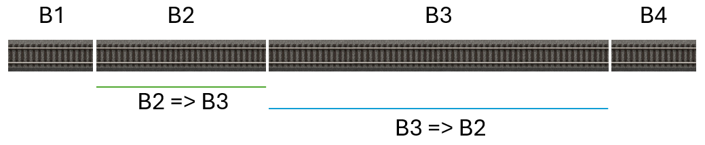

# Brugervejledning til Z21Dashboard

# Indholdsfortegnelse
*   [Indledning](#indledning)
    *   [Nyheder i version 1.30](#nyheder-i-version-1.30)
    *   [Hvorfor Z21Dashboard?](#hvorfor-z21dashboard)
    *   [Målgruppen for applikationen](#målgruppen-for-applikationen)
    *   [Lidt om teknikken](#lidt-om-teknikken)
*   [Z21 familien af centralstationer](#z21-familien-af-centralstationer)
    *   [Brug af protokol](#brug-af-protokol)
    *   [z21/z21start og låst eller ej](#z21z21start-og-låst-eller-ej)
*   [Første gang du starter](#første-gang-du-starter)
*   [Dashboardet](#dashboardet)
    *   [Supermaksimer af dashboardet](#supermaksimer-af-dashboardet)
    *   [Flyt rundt på widgets](#flyt-rundt-på-widgets)
    *   [Tilpas dit dashboard (vis/skjul widgets)](#tilpas-dit-dashboard-visskjul-widgets)
    *   [Widgets forklaret](#widgets-forklaret)
*   [Widgeten Programmering af lokomotivdekodere](#widgeten-programmering-af-lokomotivdekodere)
    *   [Introduktion til CV-programmering](#introduktion-til-cv-programmering)
    *   [Dekodere defineret i applikationen](#dekodere-defineret-i-applikationen)
    *   [Gemte definitioner](#gemte-definitioner)
    *   [Gode råd](#gode-råd)
    *   [Fejl under programmering](#fejl-under-programmering)
    *   [Advarsel](#advarsel)
    *   [Opsætning](#opsætning)
    *   [Sådan bruger du widget’en](#sådan-bruger-du-widgeten)
*   [Kendte problemer](#kendte-problemer)
    *   [Z21Dashboard afvikles i en virtuel Windows maskine i VirtualBox, men visse widgets vises ikke korrekt](#z21dashboard-afvikles-i-en-virtuel-windows-maskine-i-virtualbox-men-visse-widgets-vises-ikke-korrekt)
*   [Z21s begrænsninger](#z21s-begrænsninger)
*   [FAQ (Ofte stillede spørgsmål)](#faq-ofte-stillede-spørgsmål)
    *   [Vil Z21Dashboard fungere med Z21 START newGen?](#vil-z21dashboard-fungere-med-z21-start-newgen)
    *   [Kan jeg bruge Z21Dashboard med min Digikeijs DR5000?](#kan-jeg-bruge-z21dashboard-med-min-digikeijs-dr5000)
    *   [Min Digikeijs DR5000 vil ikke læse CV adresser på hovedsporet](#min-digikeijs-dr5000-vil-ikke-læse-cv-adresser-på-hovedsporet)
    *   [Når jeg klikker på knappen for at søge vises min Z21 ikke](#når-jeg-klikker-på-knappen-for-at-søge-vises-min-z21-ikke)
    *   [Hvad betyder "Låst" (Locked)?](#hvad-betyder-låst-locked)
    *   [Kan navne og adresser fra min multiMAUS eller Z21 app overføres til Z21Dashboard?](#kan-navne-og-adresser-fra-min-multimaus-eller-z21-app-overføres-til-z21dashboard)
    *   [Z21Dashboard kan ikke forbinde til min Z21](#z21dashboard-kan-ikke-forbinde-til-min-z21)
    *   [Vil du implementere widgets til LocoNet- og CAN-bus-funktionalitet?](#vil-du-implementere-widgets-til-loconet--og-can-bus-funktionalitet)
    *   [Jeg har fundet en fejl i Z21Dashboard, hvad gør jeg?](#jeg-har-fundet-en-fejl-i-z21dashboard-hvad-gør-jeg)
    *   [Jeg har ikke en konto på GitHub](#jeg-har-ikke-en-konto-på-github)
    *   [Jeg synes Z21Dashboard er smart men jeg er ikke stærk i netværk etc. så hvad gør jeg?](#jeg-synes-z21dashboard-er-smart-men-jeg-er-ikke-stærk-i-netværk-etc-så-hvad-gør-jeg)

# Indledning

Velkommen til Z21Dashboard. Denne vejledning hjælper dig med at komme i gang med at bruge programmet til at overvåge
og styre din modeljernbane via din Roco/Fleischmann Z21 centralstation.

## Nyheder i version 1.30

For brugere:

* Tilføjet tysk og fransk lokalisering
* Teksterne på knapperne i log-widget'en er nu lokaliseret (de var tidligere på engelsk)
* Ny widget: "Programmering af lokomotivdekodere", som gør det muligt at oprette et lokomotivregister
  samt programmere lokomotiver og dekodere. Funktionaliteten er ganske omfattende. Widgeten
  understøtter udelukkende CV'er der ikke er indekserede
* Tilføjet et større afsnit til brugermanualen om CV-programmering og programmering af lokomotiver

For udviklere:

* Tilføjet metoden GetStatusAsync(), som sender kommandoen LAN_GET_STATUS til Z21 og returnerer
  svaret som et StatusResponse-objekt i en event
* Koden i Z21Dasboard-projektet er omstruktureret, så koden er opdelt i mapper efter funktionalitetstype
  (f.eks. widgets, services osv.)
* Bemærk: Der er i øjeblikket en fejl i MAUI, som forhindrer projektet i at blive tilføjet til et
  testprojekt ved hjælp af xUnit. Derfor er der ingen unit tests inkluderet i denne release

Fejlrettelser:

* Eventen til modtagelse af RailCom-data blev ikke konfigureret korrekt for firmwareversioner
  under 1.29
* Efter den første forbindelse til Z21 resulterede efterfølgende forbindelser i, at Lokomotivlisten
  ikke viste hastigheden og knapperne korrekt
* Lokomotivernes driftstid blev talt med, selv når strømmen til sporet var slået fra

## Hvorfor Z21Dashboard?

Z21Dashboard startede som et "for sjov projekt". Jeg er IT-udvikler, og syntes det kunne være sjovt at
skrive et program til min z21start, så jeg kunne se hvilke lokomotiver og sporskifter jeg styrede på
min togbane.

Så kom alle idéerne og så blev Z21Dashboard til.

## Målgruppen for applikationen

Der er to målgrupper for Z21Dashboard:

* Modeltogsentusiasten, der ønsker et overblik, som man ikke får ved at bruge multiMAUS, wlanMAUS eller den
  officielle Z21-app, men på samme tid ikke ønsker en mere kompliceret løsning, som software til at automatisere
  driften på modelbanen.
* Modeltogsentusiasten, der, udover ovenstående, ønsker at udvikle software til Z21, og derfor kan hente inspiration
  i Z21Dashboard eller bruge Z21Dashboard som afsæt til en ny applikation. Et ønske kunne være at udvide med CAN-bus
  og LocoNet-funktionalitet til Z21 (modeller i sort kabinet) centralstationerne.

## Lidt om teknikken

Z21Dashboard er Open Source software, og det findes i mit GitHub repository, hvor både kildekode og
binære filer er tilgængelige.

Z21Dashboard er udviklet i C# og .NET 10. Det er udviklet som en .NET MAUI Blazor Hybrid Windows desktop
applikation.

# Z21 familien af centralstationer

Du kan forbinde Z21Dashboard til hele familien af Z21 centralstationer fra Roco:

* z21
* z21start
* Z21
* Z21 XL

samt til andre fabrikanters centralstationer, der understøtter Z21 protokollen, f.eks. Digikeijs DR5000.

I denne vejledning bruges termen "Z21" om dem alle, med mindre der er noget særligt for en specifik model.

## Brug af protokol

Normalt forbindes Z21 centralstationerne med styring af 2-skinne modeltogsbaner og protokollen
DCC. Z21 centralstationerne er af typen multiprotokol, da der tillades at benytte både DCC
og Märklin Motorola. mfx (M4) understøttes ikke af Z21 centralstationerne.

Fra ny er Z21 centralstationen sat op til at benytte både DCC og Märklin Motorola. Du eller andre
kan have ændret dette i Z21 ved hjælp af Rocos applikation "Maintenance Tool", hvor man kan angive hvilke
protokoller den skal understøtte.

Selvom du kan skifte mellem protokoller i visse af Z21Dashboards indstillinger (baseret på hvilken version af firmwaren
din Z21 har installeret), kan dette ikke overskrive indstillingen i Z21. Dvs. hvis Z21 er indstillet til kun DCC, så
ændrer det ikke protokollen for et lokomotiv eller sporskifte, at du vælger Märklin Motorola i Z21Dashboard.

## z21/z21start og låst eller ej

Generelt er z21 (hvid kasse, hvor teksten på fronten er "z21", bemærk det lille "z") låst op, dog blev der
tidligere produceret z21 som var låst, ligesom z21start (hvid kasse, hvor teksten på fronten er "z21start")
er det. Der kan købes to forskellige Roco varer med oplåsningskoder, hhv. varenr. 10814 (wifi router og
oplåsningskode) og 10818 (oplåsningskode).

Er din z21/z21start låst, vil det ikke være muligt at styre lokomotiver og sporskifter i Z21Dashboard. Du kan
dog sagtens se tilstanden på dem, i takt med at du styrer dem med din multiMAUS.

Du skal dog være opmærksom på, at hvis du har en låst z21start, og den benytter firmware-version før 1.20, så
vil du ikke kunne se nogen lokomotiver i Z21Dashboard, da z21start kun sender information om de lokomotiver,
man selv har kørt med. Fra og med firmware-version 1.20, vil du kunne se alle lokomotiver, uanset hvem der
kører dem. Derfor, hvis din z21start benytter firmware-version før 1.20, anbefales det, at du opgraderer
firmwaren til en nyere version.

# Første gang du starter

Når Z21Dashboard startes vises widget'en ”Forbindelse”, som lader dig forbinde til din Z21 centralstation. Første gang
vises Z21s standard IP-adresse (192.168.0.111). Har din Z21 en anden IP-adresse retter du IP-adressen til den.
Klik nu på knappen "Forbind" for at oprette forbindelsen. Når du starter Z21Dashboard næste gang, vil den IP-adresse
du indtastede være gemt og stå i feltet.

1.	Find Forbindelses-widgeten: Øverst på skærmen vil du se en widget med titlen "Forbindelse"
2.	Indtast IP-adresse: I feltet er der allerede indtastet en standard-IP-adresse (192.168.0.111). Hvis din Z21 har
en anden adresse på dit netværk, skal du rette den. Programmet husker den adresse, du indtaster, til næste gang.
3.	Klik på den grønne "Forbind"-knap
4.	Hvis Z21Dashboard opnår forbindelse til din Z21, vil status-mærket i øverste højre hjørne af widgeten skifte
til "Forbundet" og blive grønt. Resten af dine dashboard-widgets vil nu blive vist.

Imens Z21Dashboard forsøger at forbinde til din Z21 centralstation, vil der stå "Forbinder" i det lille grå felt, 
øverst til højre i Forbind widgeten. Hvis der ikke opnås forbindelse, vil der efter nogle sekunder igen stå "Ej
forbundet".

## Første gang der er forbindelse
Når du første gang får forbindelse til din Z21 centralstation, vil Z21Dashboard vise alle Widgets. De står lidt forskudt
for hinanden. Du kan starte med at flytte rundt på dem, og herefter klikke på tandhjulsikonet øverst til højre for at få
vist oversigten med widgets. Her kan du skjule de widgets, du ikke ønsker at se.

# Dashboardet

Hele skærmbilledet er dit personlige lærred. Her kan du arrangere de forskellige informations- og
kontrolwidgets, præcis som du ønsker det.

## Supermaksimer af dashboardet
I dashboardets titellinje, øverst til venstre, er der fire knapper:

* Supermaksimer (+)
* Minimer (-)
* Maksimer (to firkanter bag hinanden)
* Luk (X)

De tre sidste er standard Windows-knapper, og de fungerer som du forventer. Supermaksimér-knappen maksimerer dashboardet
til fuld skærm, på tværs af alle dine skærme. Når dashboard vinduet er supermaksimeret, vil et klik på Supermaksimér-knappen igen gendanne
det til den størrelse og position, det havde før supermaksimeringen.

Hvis dashboardvinduet er supermaksimeret når du lukker applikationen, og du starter applikationen igen, så vil dashboardet starte i supermaksimeret
tilstand. Ønsker du herefter at bringe vinduet tilbage til normal størrelse, er du nødt til at gøre det ved at trække i vinduets kanter, da Supermaksimér-
knappen ikke længere kender den tidligere størrelse på vinduet.

## Flyt rundt på widgets

Det er nemt at flytte en widget:
1.	Find headeren: Peg med musen på overskriftslinjen i den widget, du vil flytte
(f.eks. på teksten "Spænding og strøm oversigt"). Din musemarkør vil ændre sig til en "gribe-hånd".
2.	Klik og Træk: Klik og hold museknappen nede, og træk widgeten til en ny position på skærmen.
3.	Slip: Slip museknappen for at placere widgeten. Programmet gemmer automatisk dine widgets' positioner,
så dit layout ser ens ud, næste gang du starter.

## Tilpas dit dashboard (vis/skjul widgets)

Du behøver ikke have alle widgets vist på én gang. Du kan nemt tænde og slukke for dem, du har brug for.
1.	Åbn Indstillinger: Klik på det store tandhjuls-ikon (⚙️) øverst i højre hjørne af applikationsvinduet.
    En popup-menu ved navn "Indstillinger" vil åbne sig.
2.	Tænd/sluk: I menuen ser du en liste over alle tilgængelige widgets med en tænd/sluk-knap ud for hver. Klik
    på knappen for at vise eller skjule en widget. Ændringen sker med det samme på dit dashboard i baggrunden.
3.	Luk Indstillinger: Klik på "Luk" eller krydset for at lukke indstillingsmenuen.

## Widgets forklaret

### Forbindelses-widgeten
Denne widget sørger for at forbinde til din Z21 centralstation, samt at afbryde forbindelsen igen. Den har
følgende muligheder:
* Søge efter Z21 centralstationer på dit netværk
* Oprette og afbryde forbindelsen til din Z21
* Tænde og slukke for skinnestrømmen med "Banestrøm til" og "Banestrøm af"
* Aktivere Nødstop for at stoppe lokomotiver

Når forbundet viser den:
* Typen af Z21 centralstation (z21, z21start, Z21 eller Z21 XL)
* For z21 og z21start vises om den er låst eller ej
* Firmware-versionen på Z21 centralstationen
* Serienummeret på Z21 centralstationen
* Banestrømstatus (til eller fra)

Vær opmærksom på, at Nødstop er implementeret forskelligt i dekoderne. I nogle betyder det at lokomotivet stopper
med det samme, og i andre betyder det at hastigheden sættes til 0 mens bremse-forsinkelse er stadig aktiv. Det kan
anbefales at du tester dine lokomotiver så du ved, om du reelt kan bruge Nødstop. Alternativt kan du bruge "Banestrøm
af" til at stoppe al kørsel på din modeljernbane.

### Lokomotivstyring
Dette er din kørekontrol for lokomotiver (et ad gangen).
1.	Vælg et Lokomotiv: Indtast adressen på det lokomotiv, du vil se eller styre, i "Adresse"-feltet.
2.	Se Live Status: Så snart du har indtastet en adresse, vil widgeten vise lokomotivets nuværende hastighed,
kørselsretning og hvilke funktioner (F0-F31), der er aktive. Denne information opdateres live, også hvis du styrer
lokomotivet fra en anden controller (f.eks. en multiMAUS).
3.	Styr Lokomotivet: Hvis din z21/z21start er "låst op" (se andet sted), kan du bruge slideren til at ændre
hastigheden, klikke på "Fremad"/"Baglæns" for at skifte retning, og klikke på F-knapperne for at tænde/slukke for
funktioner.

For at styre et bestemt lokomotiv, indtast adressen i adressefeltet. Efter nogle sekunder vil lokomotivkontrollen
blive opdateret til at vise lokomotivets hastighed, retning og funktioner. Hvis lokomotivet ikke er i drift,
vil det blive vist med hastighed 0, retning fremad og alle funktioner slukket. Du kan også ændre hastigheden,
retningen og funktionerne (F0-F31) direkte fra widgeten. Dette gælder hvis du bruger en Z21 eller en oplåst
z21/z21start centralstation.

Har du tidligere oprettet en "Lokomotivdefinition" i widget'en "Programmering af lokomotivdekoder" vil kortnavnet
blive vist ud for adressefeltet.
indstillingspopup'en (vises ved klik på ⚙️ i titelbjælken på widget).

Popup vinduet viser en række muligheder. Hvad der vises som valgmuligheder afhænger af typen af Z21 centralstation
og hvis det er en z21/z21start, om den er låst eller låst op.

Låst eller ej, så kan du:
* Give lokomotivet et navn. Dette navn vises herefter i Z21Dashboard sammen med adressen. Har du tidligere oprettet
  en "Lokomotivdefinition" i widget'en "Programmering af lokomotivdekoder" vil kortnavnet blive vist og dette felt
  bruges ikke
* Angive et antal driftstimer før der skal laves service på lokomotivet
* Se hvor lang tid der er til der skal udføres service
* Nulstille service-tidstællerne, når du har udført service

Ej låst:
* Vælge protokol og antallet af hastighedstrin

Låst:
* Vælge protokol. Vil du ændre antallet af hastighedstrin, skal du gøre det på din multiMAUS

Bemærk, hvis du har valgt Märklin Motorola version 1 protokollen, så vil kun
funktionsknappen for lys være aktiv. Har du valgt Märklin Motorola version 2, så
vil funktionsknappen for lys samt F1 - F4 være aktive.

### Lokomotivers driftstid
Denne widget giver et overblik over de lokomotiver, der er i brug. Det viser en liste over alle lokomotiver
og holder styr på, hvor længe hvert enkelt har været i drift. Det er også her, du kan give dine lokomotiver
navne. Har du tidligere oprettet en "Lokomotivdefinition" i widget'en "Programmering af lokomotivdekoder"
vil navnet blive hentet fra denne definition, og feltet bruges ikke i denne widget.

Ud for hvert lokomotiv er en knap med et tandhjul. Dette åbner dialogen med indstillinger for det pågældende 
lokomotiv. Mulighederne i dette vindue afhænger af om din z21/z21start er låst.

Låst eller ej, så kan du:
* Give lokomotivet et navn. Dette navn vises herefter i Z21Dashboard sammen med adressen (dog tages
  navn fra lokomotivdefinition, hvis du tidligere har lavet en sådan)
* Angive et antal driftstimer før der skal laves service på lokomotivet. I oversigten vil driftstiden
  have gul baggrund, når der er mindre end en time til service skal udføres. Baggrunden bliver rød, når service ikke er udført
* Se hvor lang tid der er til der skal udføres service
* Nulstille service-tidstællerne, når du har udført service
* Slette et lokomotiv fra oversigten

Ej låst:
* Vælge protokol og antallet af hastighedstrin

Låst:
* Vælge protokol. Vil du ændre antallet af hastighedstrin, skal du gøre det på din multiMAUS

Bemærk, at drifttiden gemmes på din pc. Næste gang du starter programmet og forbinder til din Z21,
fortsættes optællingen af drifttiden. Kører du med tog uden, at din pc er tændt og Z21Dashboard
startet, så tælles drifttiden ikke op. Med andre ord, drifttiden gemmes *ikke* i Z21
centralstationen.

Driftstid tælles, når hastigheden er forskellig fra 0, uanset lokomotivets retning.

### Sporskifter
Denne widget viser de sporskifter, hvor du har skiftet deres position med din multiMAUS. 
Ud for hvert sporskifte vises der en knap for indstillinger. Når du klikker på den, åbnes en
popup dialog, der lader dig vælge hvilken protokol der skal benyttes til dekoderen i sporskiftet.

I popup kan du vælge mellem "DCC" og "MM" for Märklin Motorola. Du kan også slette sporskiftet fra oversigten.

### Sporskifteprotokolvælger
Denne widget lader dig vælge protokol for sporskifter. Da widget med liste over sporskifter kun
viser tidligere aktiverede sporskifter, skal du bruge denne til at skifte et "nyt" sporskifte, samt
sætte protokollen for sporskiftedekoderen.

Du indtaster sporskiftedekoderens adresse. Efter et par sekunder vises den nuværende protokol for
sporskiftedekoderen. Vælg en anden protokol og klik herefter på knappen "Sæt protokol".

### Spænding og strøm oversigt
Denne widget viser en graf med to linjer; en for spænding og en for strøm, således at du kan følge
hvordan det udvikler sig over tid.

Ved at klikke på knappen med tandhjulet, øverst til højre widget'en, kan du ændre det interval
som grafen opdateres med.

Uanset hvilket interval du vælger, så modtager Z21Dashboard opdateringer løbende fra Z21
centralstationen. Widget'en husker den højeste værdi modtaget, og når intervallet er "udløbet"
skrives den højeste værdi til grafen.

### Hastighedsmåling
Denne widget måler lokomotivets modelhastighed og omregner den til skala 1:1 hastighed. Du kan
samtidig se begge værdier.

For at kunne måle hastighed er det nødvendigt, at du har sensorer på din bane. Sensorer kan være implementeret som
blokke, kontaktskinner eller IR-sensorer. To sensorer udpeges til at måle hastigheden for tog. I denne
widgets indstillinger skal du vælge de to sensorer samt angive, hvilket modul og hvilken port på R-Bussen de er
tilsluttet.

Hastigheden beregnes ved at måle den tid, det tager toget at køre en kendt strækning, og herefter omregne  
tid og afstand til skalahastighed 1:1 ud fra størrelsen på dit modeltog. Modeltogets størrelse angives i  
Z21Dashboards konfiguration.

Termen *start* af en sensor skal i det følgende forstås som sensorens begyndelse set i togets køreretning.

Herefter skal du måle afstanden mellem *start* af sensor 1 og *start* af sensor 2. Den modsatte køreretning  
skal også måles. Uanset om sensorerne er blokke, kontaktskinner eller IR-sensorer, kan afstanden mellem de to  
sensorer være forskellig afhængigt af køreretningen.

Afstanden indtastes med maks 1 decimal, hvis målsystemet er metrisk, og 2 decimaler hvis målsystemet er imperisk.

På billedet vises en strækning inddelt i blokke, hvor blokkene fungerer som sensorer. Bemærk, at afstanden fra  
*start* af blok 2 til *start* af blok 3 er længere end afstanden fra *start* af blok 3 til *start* af blok 2.  
De to blokke behøver ikke nødvendigvis at støde op til hinanden. Med opsætningen i billedet kan du anvende  
blok B2 og B4 som sensorer.

**Bemærk!**  
Da målingen foregår ved at registrere, hvornår en sensor aktiveres (blok optaget eller kontaktskinne/IR-sensor trigget),  
kan systemet ikke afgøre, *hvilket* tog der passerer. Hvis sensorerne er placeret således, at andre tog har mulighed for at  
komme ind på strækningen mens der måles, vil dette give en forkert måling.

Der er indbygget en timeout i målingen. Når den første sensor aktiveres, skal den anden sensor aktiveres  
inden for 10 minutter, ellers annulleres målingen.

**Bemærk!**
Hvis du ændrer målesystemet i Windows, mens Z21Dashboard er åbent, så skal du lukke det, og starte det igen, for at
ændringen træder i kraft i Z21Dashboard.

### Systemstatus komplet og kort
Disse to widgets viser status på selve Z21 centralstationen. Der vises strømforbrug, spænding,
og temperatur. Temperaturskala (C/F) ændres i Z21Dashboards indstillinger. Hvis temperaturen bliver
for høj, vises temperaturen med rød baggrund. Det er signalet til, at centralstationen skal slukkes
og køle af.

Udover ovenstående, viser den komplette systemstatus også information om bl.a. om nødstop er aktiveret, 
om der er en kortslutning, kortslutning i tilsluttede boostere. Fra firmware-version V1.42 vises
endvidere hvilke protokoller der er aktiveret i centralstationen, om RailCom er aktiveret etc.

### R-Bus tilbagemelding

Denne widget viser tilstanden på samtlige tilbagemeldinger en Z21 centralstation understøtter (160 styk).

Widget viser hvert modul med modulets 8 tilbagemeldinger. Det er underordnet hvor mange tilbagemeldinger
der reelt er tilsluttet, da widgeten altid vil vise de 160 mulige tilbagemeldinger.

### RailCom data
Denne widget viser hvilke data der er modtaget af Z21 centralstationen. 

Hvad der vises i kolonnen "Muligheder", kommer an på den pågældende dekoders programmering.

### Vis log
Denne widget viser Z21Dashboards log. Du vil kunne se hvad der rent faktisk sker i Z21Dashboard.
Fx at den sender kommandoer til Z21 centralstationen og modtager data fra centralstationen.

Der er mulighed for at filtrere de beskeder der vises.

### Programmering af lokomotivdekodere
Denne widget lader dig programmere lokomotivdekodere enten via en simpel dialog, hvor du ændrer en
CV-adresse/værdi ad gangen, eller dialoger der omhandler områder, fx Lys, Motor, hvor flere CV-
adresser/værdier ændres på en gang.

Herudover lader denne widget dig oprette lokomotivdefinitioner og widget'en giver dig en oversigt
over dine lokomotiver.

Læs mere om denne widget i kapitlet "Widgeten Programmering af lokomotivdekodere".

# Widgeten Programmering af lokomotivdekodere
Kapitlet beskriver hvordan denne widget skal bruges for at programmere en dekoder. CV-programmering
er rettet mod DCC og multiprotokol dekodere, idet Märklin Motorola dekodere, som udgangspunkt, ikke
kan programmeres med CV-adresser/værdier. Typisk skal Märklin Motorola dekodere programmeres ved at 
sætte switche eller justere trimmere på selve dekoderprintet. Nogle dekodere kan programmeres
ved hjælp af en Märklin 6021 kørekontrol. For den konkrete dekoder må du læse manualen for 
instruktioner.

## Introduktion til CV-programmering
Dette kapitel er for dig, der ikke har (den store) erfaring med CV programmering

### Hvad er en CV?
En Configuration Variable (CV) er en indstilling, der er gemt i lokomotivets dekoder. Hver CV har
et nummer (adresse) og en værdi, som bestemmer en bestemt funktion eller egenskab.

Eksempler på indstillinger, der styres af CV'er, er:

*   Lokomotivets adresse
*   Startspænding
*   Acceleration og bremselængde
*	Maksimal hastighed
*	Lysfunktioner
*	Motorregulering
*	Lydindstillinger (på lyddekodere)

Man kan betragte en dekoder som en lille computer, hvor CV'erne fungerer som hukommelsespladser
med indstillinger.

### Hvordan fungerer CV-programmering?
Når du programmerer en dekoder, sender digitalcentralen en kommando til dekoderen om at ændre en
bestemt CV. Eksempel:

*	CV1 = Lokomotivets adresse.
*	Værdi = 25.

Efter programmeringen vil lokomotivet reagere på adresse 25. Widgeten udfører denne kommunikation
med centralstationen, som herefter kommunikerer med dekoderen.

Ved simpel programmering, angiver du den ønskede CV-adresse og CV-værdi. Benytter du den avancerede
mulighed, skal du normalt kun vælge den ønskede indstilling, mens widget sørger for at oversætte
den til den korrekte CV-adresse og CV-værdi.

### Læsning og skrivning af CV'er
Der findes to grundlæggende handlinger:
*   Læs CV

    Programmet henter den aktuelle værdi fra dekoderen og viser den på skærmen.
    Dette er nyttigt, hvis:
    *   Du vil kontrollere dekoderens indstillinger
    *	Du kender ikke de nuværende værdier
    *	Du vil gemme en sikkerhedskopi af opsætningen.

    For at du kan læse CV-adresserne på hovedsporet kræves det, at din Z21 centralstation har RailCom
    aktiveret, og så kræver det, at dekoderen har RailCom, og at det er aktiveret. Er det ikke tilfældet,
    kan du skrive til CV-adresser, men du kan ikke læse. Dette er et problem ved visse faneblade, da
    CV-værdier skal indlæses inden værdien kan opdateres og skrives tilbage til dekoderen.

    En løsning på dette er at benytte programmeringssporet. Her er det underordnet om Z21
    centralstationen og dekoderen har RailCom aktiveret. Du kan kontrollere om RailCom er aktiveret i
    Z21 centralstationen, i Rocos applikation "Maintenance Tool". Du kan kontrollere om dekodere har
    RailCom aktiveret ved at stille lokomotivet på programmeringssporet og indlæse CV 29. Kig herefter
    på bit 3 (RailCom kommunikation).

*   Skriv CV

    Widget'en sender en ny værdi til dekoderen. Den tidligere værdi overskrives med den nye.

    Nogle dekodere tager ændringen i brug med det samme, mens andre først anvender den efter en
    genstart eller efter at spændingen har været afbrudt.

### Programmeringsspor og hovedspor
Dekodere kan normalt programmeres på to forskellige måder.

*   Programmeringsspor

    Lokomotivet placeres på et særskilt programmeringsspor.

    Fordele:

    *	Sikker programmering
    *	Læse CV-værdier på de fleste systemer/centralstationer, der ikke understøtter RailCom
    *	Ingen risiko for at ændre andre lokomotiver.

    Denne metode anbefales ved første opsætning eller ved større ændringer. Vær opmærksom på, at
    nogle centralstationer, herunder z21 og z21Start, ikke har en separat
    programmeringssporsudgang, og derfor er Hovedspor og Programmeringsspor det samme spor.

*   Programmering på hovedsporet (POM)

    Lokomotivet programmeres direkte på anlægget.

    Fordele:  
    *	Lokomotivet kan blive stående på banen
    *	Ændringer kan testes med det samme.

    Ved programmering på hovedsporet er det en forudsætning, at centralstationen har RailCom, og
    det er aktiveret, samt at dekoderen også har RailCom, og det er aktiveret. Er det ikke tilfældet,
    kan CV'er ikke læses tilbage. Det er dog muligt at skrive CV’er. Der kan desuden være andre
    begrænsninger afhængigt af centralstation og dekoder.

### Standard-CV'er og producent-specifikke CV'er
Organisationen "National Model Railroad Association" (NMRA) har defineret en række standard-CV'er,
som de fleste dekoderproducenter følger.

Eksempler:
*   CV1 – Lokomotivadresse
*	CV2 – Startspænding
*	CV3 – Acceleration
*	CV4 – Bremsning
*	CV5 – Maksimal hastighed
*	CV8 – Producentnummer

Derudover kan hver producent have egne CV'er til særlige funktioner.

Programmet tager højde for disse forskelle og viser kun de funktioner, som den valgte dekoder
understøtter. Udover at have defineret CV-adresser og indhold, har NMRA også defineret hvilke af
CV-adresserne der er krævet af alle dekodere, og hvilke CV-adresser det er valgfri for
fabrikanterne at implementere. Af denne årsag er der to grund-dekoderdefinitioner ”NMRA Maximal
Standard Decoder” og ”NMRA Minimal Standard Decoder”. De indeholder henholdsvis alle CV-adresser
defineret i standarden og kun de krævede CV-adresser. Disse to kan bruges, når du har en dekoder,
der ikke findes en dekoderdefinition til. For at vise beskrivelser til CV-adresser og bits,
indeholder applikationen beskrivelserne af CV-adresser, som defineret i dokumentet ”NMRA Standards
S-9.2.2” fra juli 2012. Du kan læse mere om DCC- og CV-standarder på NMRAs
hjemmeside: https://www.nmra.org.

## Dekodere defineret i applikationen
Applikationen indeholder et antal dekoderdefinitioner, som tager afsæt i de dekodere jeg selv
bruger. Disse er gemt i selve applikationen og ændringer af CV-værdier kan ikke gemmes i selve
dekoderdefinitionen. Du kan sagtens ændre en værdi, skrive den til dekoderen (der evt. er monteret
i et lokomotiv).

### Dekodere du selv definerer
Ved at klikke på knappen ”Gem valgt dekoder som lokal dekoderfil”, kan du lave en kopi af en
dekoder (både dem defineret i applikationen men også af dekoderdefinitioner, der er gemt på din
harddisk). Med en vis portion forsigtighed kan du tilpasse dekoderdefinitionen til andre dekodere.

Dekodere der gemmes lokalt på din harddisk, kan du gemme når du har ændret CV-værdier. 

### Hvorfor viser programmet ikke altid CV-numre?
Mange indstillinger består af flere CV'er eller flere bit i samme CV.
I stedet for at bede brugeren indtaste tal viser programmet:
*	Afkrydsningsfelter
*	Skydeknapper
*	Rullelister
*	Tekstfelter

Når du ændrer en indstilling, beregner programmet automatisk de nødvendige CV-værdier. Det gør
programmeringen lettere og reducerer risikoen for fejl. På alle sider hvor der skal angives
værdier, under fanebladet ”Lokomotivdekodere”, kan du holde musen hen over beskrivelsen af
værdien. Et tooltip vises, hvor CV-adresse og evt. bit vises.

## Gemte definitioner
Programmet kan gemme dekoderens indstillinger som en dekoderdefinitionsfil eller en
lokomotivdefinitionsfil.

En profil kan bruges til:
*	Sikkerhedskopiering af dekoderens CV-adresser/værdier
*	Dokumentation
*	Kopiering af opsætninger til andre lokomotiver
*	Sammenligning af ændringer.

Det anbefales altid at gemme en profil, inden større ændringer foretages.

## Gode råd
Før du programmerer en dekoder/lokomotiv, anbefales det at:
*	Læse de aktuelle CV-værdier
*	Gemme en sikkerhedskopi
*	Ændre få indstillinger ad gangen
*	Afprøve lokomotivet efter hver ændring
*	Notere større ændringer.

På den måde bliver det lettere at vende tilbage til en tidligere opsætning, hvis resultatet ikke
bliver som forventet.

Du behøver ikke kende alle CV-adresser eller deres tekniske opbygning. Programmet oversætter dine
valg til de nødvendige CV-værdier og hjælper dig gennem programmeringen. De mere avancerede emner,
såsom bitfelter, producent-specifikke funktioner og særlige dekoderindstillinger, beskrives senere
i vejledningen.

## Fejl under programmering
Hvis en programmering mislykkes, kan årsagen blandt andet være:
*	Dårlig kontakt mellem hjul og skinner
*	Snavs på programmeringssporet
*	Forkert valgt dekodertype
*	Utilstrækkelig strømforsyning
*	En dekoder, som ikke understøtter den valgte programmeringsmetode

Programmet vil normalt vise en fejlmeddelelse, hvis en CV ikke kan læses eller skrives. Visse
dekodere kræver, at der sættes en belastning på dem, for at det er muligt at læse værdierne.
vil stå i dekoderens manual.

## Advarsel
Ved at ændre værdier i CV-adresser kan man give dekoder og dermed lokomotivet nye funktioner eller
ændre egenskaber så lokomotivet opfører sig mere naturtro eller opfylder ens ønsker til funktioner
(lys, lyd etc).

At ændre CV-værdier, kræver en vis viden om hvad det er du er ved at gøre, og hvad betydningen af
det er. At ændre værdien i CV-adresser, uden indblik i, hvad det er du gør, og hvorfor, kan
resultere i, at du ikke længere kan komme i kontakt med dekoderen, eller du mister muligheden for
at styre dit lokomotiv. Derfor, før du ændrer værdien i en CV-adresse, vær sikker på, at du ved
hvad du er ved at gøre. Skulle det alligevel ske for dig, så må du søge hjælp hos en ven, eller i
din modeltogsklub. Z21Dashboards forfatter kan ikke hjælpe dig med, at få kontakt til dekoderen,
skulle du få programmeret dekoderen således, at det netop ikke er muligt at få kontakt til
dekoderen. Ej heller kan Z21Dashboards forfatter drages til ansvar for dekodere, der ikke længere
er muligt at komme i kontakt med.

Har du en z21 eller z21Start (hvidt kabinet) og vælger du at programmere på programmeringssporet,
så skal du sikre dig, at der kun står dét lokomotiv du vil ændre, på skinnerne. Hvis der står flere
lokomotiver, og du programmerer på programmeringssporet, programmerer du alle lokomotiver på en gang!

## Opsætning
I Z21Dashboards indstillinger (tandhjul øverst til højre i applikationens vindue), skal du under 
fanebladet ”Indstillinger” angive hvilke foldere der skal bruges til at gemme henholdsvis
lokomotiv- og dekoderdefinitionsfiler. 

## Sådan bruger du widget’en

”Programmering af lokomotivdekodere”-widget’en har tre faneblade, der hver giver dig en måde at
programmere CV-adresser og værdier i din dekoder. De gennemgås i de følgende sektioner.

Hvilket af disse faneblade du skal benytte, kommer an på, hvilken opgave du har, og om du ønsker at have
en lokomotivdefinitionsfil til dit lokomotiv.

### Fanebladet "Simpel"

Dette faneblad giver dig mulighed for at læse eller skrive/ændre en enkelt CV-adresse/værdi ad gangen.

Du skal angive, om der skal programmeres på hoved- eller programmeringssporet, evt. lokomotivets adresse, CV-adresse
og ved skrivning en værdi at skrive til CV-adressen. I takt med, at du indtaster CV-adressen, vil der vises
en beskrivelse af CV-adressen, og er det en CV, der består af flag, vil disse flag blive vist med betydningen af de
bits, der kan bruges. Bemærk, at der kun vises CV-adresser, som er defineret af NMRA. Producent-specifikke
CV-adresser vises ikke.

**Eksempel**

Vi forestiller os, at du har købt et lokomotiv, hvor der ikke er dokumentation for, hvilken dekoder
der er installeret. Du har fået oplyst, at lokomotivet har adresse 15. Her kan du benytte
fanebladet ”Simpel”. Sæt lokomotivet på sporet, og vælg ”Hovedsporet”. Indtast lokomotivadressen
og herefter tallet 8 i CV-adressefeltet. Under indtastningsfeltet vises nu teksten ”Producent-ID.
NMRA-tildelt producentidentifikation”. Indtast herefter en værdi i feltet for CV-værdi.
Dette tal angiver, hvem der er fabrikant af dekoderen. Fabrikantens navn vises ved
siden af.

### Fanebladet "Lokomotiver"

Dette faneblad giver dig mulighed for at oprette lokomotivdefinitioner, hvor du kan gemme informationer om det
pågældende lokomotiv, dekodertype og CV-adresser/værdier. Du kan også ændre CV-adresser/værdier. Du kan senere
redigere lokomotivdefinitionen, fx fordi du vil ændre værdien i en CV-adresse, eller fordi du har udskiftet dekoderen
til en lyddekoder. En vigtig årsag til at oprette lokomotivdefinitioner er, at du kan gemme CV-adresser/værdier, som
du har ændret i dit lokomotiv, og så tages kortnavnet og vises i widget’en "Lokomotivstyring" og i widget’en
"Lokomotivers driftstid". Du får selvfølgelig også en oversigt over dine lokomotiver.

Du kan vælge mellem dekodere defineret i Z21Dashboard-applikationen og dekodere, du selv har defineret. Du har
mulighed for at indlæse CV-værdier fra lokomotivets dekoder, og du kan skrive værdier til CV-adresserne. I denne
tilstand er CV-adresserne grupperet efter funktion på faneblade. Dvs. at fx CV’er relateret til motoren findes på
fanebladet ”Motor”. Håndtering af bit-flag og værdier gemt i flere CV-adresser håndteres af widget’en. Når du ændrer
værdier i CV-adresserne, gemmes disse værdier i lokomotivdefinitionen. Den valgte dekoderdefinition bibeholder
sine oprindelige værdier.

Har du tidligere oprettet lokomotivdefinitioner, vises disse i oversigten på billedet. Vil du rette i en
lokomotivdefinition, skal du klikke på den i oversigten og herefter klikke på knappen "Rediger". Herefter gør du
som beskrevet herunder.

For at oprette en lokomotivdefinition skal du klikke på knappen "Tilføj". Fanebladet skifter til "Rediger lokomotiv,
basal". Her angiver du lokomotivets navn, kortnavn, fabrikant, katalognummer, litra og løbenummer. Herunder kan du se
felternes betydning:

| Feltnavn      | Betydning                                                                      | Eksempel                |
| :------------ | :----------------------------------------------------------------------------- | :---------------------- |
| Navn          | Lokomotivets fulde navn. Bruges til information på lokomotivoversigten         | Roco DSB MA 462 med lyd |
| Kortnavn      | Lokomotivets korte navn. Dette bruges til visning i widgets "Lokomotivstyring" | DSB MA 462              |
| Fabrikant     | Lokomotivets fabrikant                                                         | Roco                    |
| Katalognummer | Lokomotivets katalognummer                                                     | 462                     |
| Litra         | Lokomotivets litra                                                             | MA                      |
| Løbenummer    | Lokomotivets løbenummer                                                        | 462                     |

Herefter skal du klikke på fanebladet "Rediger lokomotiv, udvidet". Her angiver du evt. en beskrivelse af lokomotivet,
købsdato, pris, evt. ændringer, du har lavet på lokomotivet, og evt. en bemærkning. Herunder kan du se felternes
betydning:

| Feltnavn    | Betydning                                                            | Eksempel                                              |
| :---------- | :------------------------------------------------------------------- | :---------------------------------------------------- |
| Beskrivelse | En beskrivelse af lokomotivet. Fx noget om lokomotivets historie.    | DSB fik de første MA-lyntog i begyndelsen af 60'erne. |
| Købsdato    | Lokomotivets købsdato.                                               | 15-03-2019                                            |
| Pris        | Den oprindelige pris eller den pris, du har givet, hvis det er brugt | 2895                                                  |
| Ændringer   | Eventuelle ændringer lavet på lokomotivet.                           | Monteret lys og passagerer i alle vogne.              |
| Bemærkning  | Eventuelle bemærkninger, fx om det er en gave.                       | Gave fra min hustru.                                  |

Herefter skal du klikke på fanebladet "Dekoder". Her har du to muligheder. Hvis du ikke ved, hvilken dekoder der er
monteret, kan du få lidt hjælp. Der er i NMRA-standarden *ikke* angivet en CV-adresse, der entydigt kan identificere
dekoderen. Der er i standarden kun angivet en CV-adresse, der identificerer fabrikanten og firmwareversionen (denne
værdi er ofte ikke særlig præcis). Visse producenter har dog defineret en CV-adresse til identifikation af
dekodermodel. For ZIMO-dekodere kan du også få oplyst, hvilken model dekoderen er.

Inden du klikker på knappen "Læs fra lokomotivdekoder", skal du vælge, om du vil læse fra hovedsporet eller
programmeringssporet. Vil du læse fra hovedsporet, skal du sikre dig, at din centralstation er sat op til at
kunne benytte RailCom, og at dekoderen har RailCom aktiveret. Er dette ikke tilfældet, kan du ikke læse CV-værdierne
på hovedsporet.

Vælger du at læse fra hovedsporet, skal Z21Dashboard vide, hvilken adresse lokomotivet har. Du angiver adressen ved at
klikke på fanebladet "Adresse" og herefter indtaste adressen, fx "1103". Når du har indtastet adressen, kan du skifte
tilbage til fanebladet "Dekoder" og herefter klikke på knappen "Læs fra lokomotivdekoder".

I listen over dekodere kan du se de dekodere, der er defineret i applikationen, og de dekodere, du selv har defineret.
Du kan søge efter dekoderen og vælge den. Kan du ikke finde præcist den dekoder, du har installeret i dit lokomotiv, så
vælg en, der ligner, eller en af NMRA-standarddekoderne.

Efter du har klikket på dekoderen, skal du klikke på knappen "Brug valgte dekoder". Herefter skifter fanebladene til
de faneblade, der er defineret for netop denne dekoder.

Du kan klikke på fanebladet "Meta info". Det viser information om den valgte dekoderdefinitionsfil. Klik på fanebladet
"Læs/skriv alle CVer". Dette faneblad giver dig mulighed for at læse alle CV-adresser og værdier fra
lokomotivdekoderen ind i lokomotivdefinitionen, du er ved at oprette. Ved at indlæse alle CV-adresser og værdier har
du det korrekte udgangspunkt til senere at ændre værdierne i lokomotivdefinitionen og skrive dem tilbage til
dekoderen i lokomotivet.

Du kan nu klikke på de forskellige faneblade, der er defineret for den valgte dekoder. Her kan du ændre værdierne i
CV-adresserne. Når du er klar, skal du tilbage på fanebladet "Lokomotiver" og klikke på knappen "Gem". Herefter er
lokomotivdefinitionen gemt, og du kan senere hente den frem og ændre den.

### Fanebladet "Lokomotivdekodere"

Dette faneblad bruges til at vedligeholde information om dekodere. Den første side, der vises, har
en liste med dekodere. Dette dækker både de dekodere, der er defineret i applikationen, og de
dekodere, du eventuelt selv har defineret. Der er også mulighed for at identificere fabrikanten af
dekoderen (ikke for Märklin Motorola-dekodere). Der er i NMRA-CV-standarden desværre ikke defineret
en mulighed for at identificere den specifikke model af dekoder, kun producent og evt. firmware-
version (CV 7). Visse producenter har dog defineret en CV-adresse til identifikation af
dekodermodel (fx har ZIMO brugt CV 250 til dette).

Funktionalitet og betjening er som beskrevet under fanebladet "Lokomotiver".

Hvis dit lokomotiv er udstyret med en ren Märklin Motorola-dekoder, kan der ikke indlæses CV-
adresser og værdier. Der er derfor mulighed for at vælge mellem to generelle Märklin Motorola-
dekodere, en version 1 og en version 2. Der er tekniske forskelle på de to versioner af protokollen,
men den mest synlige er, at version 1 kun har én funktionstast, nemlig F0, som bruges til lys.
Version 2 har op til i alt 5 funktionstaster.

den konkrete type MM-dekoder.

Har du valgt en af MM-dekoderne, vil der kun blive vist et ekstra faneblad kalde

# Kendte problemer

## Z21Dashboard afvikles i en virtuel Windows maskine i Virtualbox, men visse widgets vises ikke korrekt
Typisk er det de to lokomotiv-widgets og sporskifteprotokol-widget, der ikke vises korrekt. Der vises en pil der drejer
samt teksten "Kontrollerer Z21 låsningstilstand".

Dette kan skyldes at der er valgt at "Pointing device" på fanen "System" i Virtualbox er sat til "USB Tablet".
Ændr det til "PS/2 Mouse" og prøv igen.

# Z21s begrænsninger

De samlede begrænsninger for Z21 centralstationerne skal findes i forskellige manualer fra Roco.

Her er et par af de begrænsninger, der er relevante for Z21Dashboard:

| Begrænsning | Beskrivelse | Relevans for Z21Dashboard |
| :--- | :--- | :--- |
| Antal DCC lokomotivadresser der kan styres | 9999 | I Z21Dashboard kan du angive adresser mellem 1 og 9999 til lokomotiver. |
| Antal Märklin Motorola lokomotiver der kan styres | 255 | I Z21Dashboard kan du vælge MM protokollen for adresserne 1 til 255. |
| Antal samtidige lokomotiver | Max 100 | I firmware-versioner under, ikke inkluderende V1.20 kan man kun se de lokomotiver som man selv har kørt med. Fra og med firmware-version V1.20 kan du se alle lokomotiver, uanset hvem der kører dem. |
| Opdatering af lokomotivers status | I firmware-versioner under, ikke inkluderet V1.20 udsender Z21 centralstationerne maksimalt informationer om 16 lokomotiver man har kørt med. | Benytter din Z21 firmware med version mindre end V1.20, vil du kun kunne se op til 16 lokomotiver, du har kørt med i en session. |
| Märklin Motorola, version 1 adresser | 80 | I Z21Dashboard kan du vælge MM version 1 protokollen for adresserne 1 til 80. |
| Märklin Motorola, version 2 adresser | 256 | I Z21Dashboard kan du vælge MM version 2 protokollen for adresserne 1 til 256. |
| RailCom | Se lokomotiver i RailCom widget | I firmware-versioner under, ikke inkluderende V1.29 kan man kun se de lokomotiver som man selv har kørt med. Fra og med firmware-version V1.29 kan du se alle lokomotiver, uanset hvem der kører dem. Der kræves at dekoderne udsender relevante RailCom data som Z21 kan modtage. |
| F-taster | Z21 firmware før 1.42 kunne håndtere F0 til F28. Fra og med firmware V1.42 kan F0-F31 benyttes | I Z21Dashboard kan du vælge F0-F28/F31 for DCC lokomotiver. For Märklin Motorola version 1 kan du kun vælge F0, og for Märklin Motorola version 2 kan du vælge F0-F4. |

# FAQ (Ofte stillede spørgsmål)

## Vil Z21Dashboard fungere med Z21 START newGen?

På nuværende tidspunkt har jeg ikke haft mulighed for at teste Z21Dashboard med Z21 START newGen, og jeg kan 
derfor ikke svare på om Z21Dashboard virker med Z21 START newGen.

Ej heller er manualen "Z21 LAN Protocol" opdateret til at inkludere de ændringer i Z21 protokollen, der
måtte være nødvendige for Z21 START newGen.

## Kan jeg bruge Z21Dashboard med min Digikeijs DR5000?

Ja, det kan du. Det forudsætter dog, at du har sat netværksprotokollen til "Z21" i DR5000'ens indstillinger.
Du kan ikke bruge Z21Dashboard med DR5000, hvis du har valgt andre protokoller.

Z21Dashboard er afprøvet med en DR5000 med firmware 1.6.3, og det fungerer fint.

Vær opmærksom på, at Z21 centralstationerne er multiprotokol-enheder, og DR5000 er udelukkende en DCC
centralstation. Da DR5000 firmware 1.6.3, i Z21 protokollen, svarer til at den er en Z21 (i sort kabinet) med
firmware-version 1.29, kan den ikke forespørges om hvilke protokoller der er aktiveret.
DCC og Märklin Motorola protokoller i Z21Dashboard. Valg af Märklin Motorola protokollen til lokomotiver eller
sporskifter vil ikke have nogen effekt.

## Min Digikeijs DR5000 vil ikke læse CV adresser på hovedsporet

En af forudsætningerne for at kunne læse CV adresser på hovedsporet er, at centralstationen kan kommunikere
med RailCom. Det kan DR5000 ikke, da selve DR5000 ikke understøtter RailCom. Har du tilsluttet en booster af
typen Digikeijs DR5088 er det muligt at læse CV adresser på hovedsporet, forudsat at dit lokomotiv er på en 
strækning som DR5088 leverer strøm til.

Jeg har ikke en DR5088, og har derfor ikke haft mulighed for at teste om det rent faktisk kan lade sig gøre.
Der er flere videoer på YouTube der viser hvordan DR5000 og DR5088 sættes sammen, så man kan læse CV adresser.

## Når jeg klikker på knappen for at søge vises min Z21 ikke

Listen som metoden returnerer er tom, og du får ingen fejl. Du kan forbinde med Z21Client til din Z21 centralstation
(alle modeller), og sende kommandoer og modtage data. At metoden returnerer en tom liste, sker typisk når pc'en er
koblet på netværket trådløst.

For at finde Z21'ere på netværket udsender QueryForZ21s en UDP-broadcast som Z21 centralstationerne skal svare på.
Mange access points og routere blokerer for UDP-broadcasts, og det er derfor muligt, at din Z21 ikke modtager
broadcastet og derfor ikke svarer på det. Det er også muligt, at din pc ikke modtager svaret fra Z21.

Kig i opsætningen af dit access point eller router og se, om der er en indstilling for at blokere for UDP-broadcasts.
Hvis det er tilfældet, skal du slå denne indstilling fra. Visse routere og access points har også en indstilling for
at blokere for UDP-broadcasts på det trådløse net alene. Andre access points og routere har ikke en indstilling, men
blokerer for UDP-broadcasts på det trådløse net som standard. I dette tilfælde kan du prøve at forbinde din pc til
netværket med kabel for at se, om det løser problemet. Hvis det gør det, er det sandsynligt, at dit access point
eller router blokerer for UDP-broadcasts på det trådløse net.

## Hvad betyder "Låst" (Locked)?

Hvis du har en z21start (den hvide model), kan den være "låst" fra fabrikken. Det betyder, at
den ikke tillader kørsel og sporskifte via netværk.
* Hvis LocoControl viser "Låst": Du kan stadig bruge Z21 Dashboard som et overvågningsværktøj.
Du kan se live status for dine lokomotiver, men du kan ikke styre dem fra programmet (knapperne vil være deaktiverede). Du
kan dog skifte protokol for lokomotiver
* Hvis LocoControl viser "Låst op": Alle funktioner i programmet er tilgængelige, og du kan styre dine lokomotiver
direkte

For at låse din z21start op, skal du bruge en oplåsningskode fra Roco (varenummer 10814 eller 10818).

## Kan navne og adresser fra min multiMAUS eller Z21 app overføres til Z21Dashboard?

Det kan desværre ikke lade sig gøre.

## Z21Dashboard kan ikke forbinde til min Z21

Det åbenlyse, tjek at IP-adressen er korrekt angivet. Åbn en kommandoprompt i Windows, og
ping din Z21. Hvis ping ikke får noget svar, så er der et netværksproblem, du skal have løst
først.

Første gang du starter Z21Dashboard, vil Windows' firewall spørge om det er ok, at Z21Dashboard
kommunikerer ud på netværket. Dette skal der svares Ja til. Fik du svaret Nej, så må du ind i 
Windows firewall og give tilladelse til, at Z21Dashboard må kommunikere ud af din pc.

## Vil du implementere widgets til LocoNet- og CAN-bus-funktionalitet?

Det korte svar er nej. Det lange svar er, at jeg ejer en z21start, og derfor har jeg ikke behovet for sådanne
widgets, og jeg kan ikke teste funktionaliteten.

## Jeg har fundet en fejl i Z21Dashboard, hvad gør jeg?

Gå ind på repositoriet, og opret et Issue.

## Jeg har ikke en konto på GitHub

På nuværende tidspunkt er projektets hjemsted mit repository på GitHub, og det er her
dialogen om Z21Dashboard skal være.

## Jeg synes Z21Dashboard er smart men jeg er ikke stærk i netværk etc. så hvad gør jeg?

Du må søge hjælp hos en ven eller eventuelt i din modeltogsklub, for at få den nødvendige hjælp
til at opsætte netværk og eventuelt din router.
