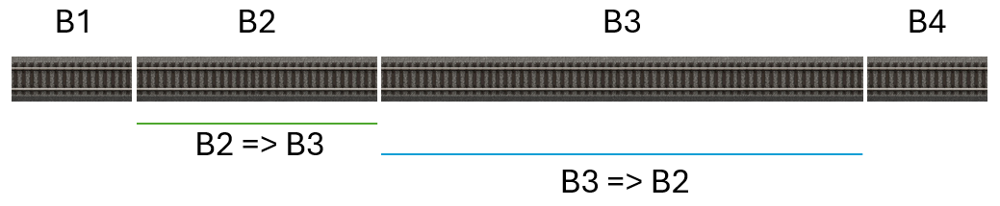

# Benutzerhandbuch für Z21Dashboard

# Inhaltsverzeichnis
*   [Einleitung](#einleitung)
    *   [Neuigkeiten in Version 1.30](#neuigkeiten-in-version-1.30)
    *   [Warum Z21Dashboard?](#warum-z21dashboard)
    *   [Zielgruppe der Anwendung](#zielgruppe-der-anwendung)
    *   [Etwas über die Technik](#etwas-über-die-technik)
*   [Die Z21-Familie der Zentralstationen](#die-z21-familie-der-zentralstationen)
    *   [Verwendung von Protokollen](#verwendung-von-protokollen)
    *   [z21/z21start und gesperrt oder nicht](#z21z21start-und-gesperrt-oder-nicht)
*   [Erster Start](#erster-start)
*   [Das Dashboard](#das-dashboard)
    *   [Dashboard supermaximieren](#dashboard-supermaximieren)
    *   [Widgets verschieben](#widgets-verschieben)
    *   [Dashboard anpassen (Widgets anzeigen/ausblenden)](#dashboard-anpassen-widgets-anzeigenausblenden)
    *   [Widgets erklärt](#widgets-erklärt)
*   [Das Widget „Programmierung von Lokomotivdecodern“](#das-widget-programmierung-von-lokomotivdecodern)
    *   [Einführung in die CV-Programmierung](#einführung-in-die-cv-programmierung)
    *   [In der Anwendung definierte Decoder](#in-der-anwendung-definierte-decoder)
    *   [Gespeicherte Definitionen](#gespeicherte-definitionen)
    *   [Gute Ratschläge](#gute-ratschläge)
    *   [Fehler bei der Programmierung](#fehler-bei-der-programmierung)
    *   [Warnung](#warnung)
    *   [Einrichtung](#einrichtung)
    *   [Verwendung des Widgets](#verwendung-des-widgets)
*   [Bekannte Probleme](#bekannte-probleme)
    *   [Z21Dashboard wird in einer virtuellen Windows-Maschine in VirtualBox ausgeführt, aber bestimmte Widgets werden nicht korrekt angezeigt](#z21dashboard-wird-in-einer-virtuellen-windows-maschine-in-virtualbox-ausgeführt-aber-bestimmte-widgets-werden-nicht-korrekt-angezeigt)
*   [Einschränkungen der Z21](#einschränkungen-der-z21)
*   [FAQ (Häufig gestellte Fragen)](#faq-häufig-gestellte-fragen)
    *   [Funktioniert Z21Dashboard mit Z21 START newGen?](#funktioniert-z21dashboard-mit-z21-start-newgen)
    *   [Kann ich Z21Dashboard mit meiner Digikeijs DR5000 verwenden?](#kann-ich-z21dashboard-mit-meiner-digikeijs-dr5000-verwenden)
    *   [Meine Digikeijs DR5000 kann CV-Adressen auf dem Hauptgleis nicht lesen](#meine-digikeijs-dr5000-kann-cv-adressen-auf-dem-hauptgleis-nicht-lesen)
    *   [Meine Lokomotive ist mit einem Märklin mLD3/mSD3-Decoder ausgestattet und kann auf dem Hauptgleis nicht ausgelesen werden](#meine-lokomotive-ist-mit-einem-märklin-mld3-msd3-decoder-ausgestattet-und-kann-auf-dem-hauptgleis-nicht-ausgelesen-werden)
    *   [Timeout-Fehler beim Auslesen von CVs meiner Lokomotive mit einem Märklin mLD3/mSD3-Decoder](#timeout-fehler-beim-auslesen-von-cvs-meiner-lokomotive-mit-einem-märklin-mld3-msd3-decoder)
    *   [Meine Z21 wird nicht angezeigt, wenn ich auf die Suchschaltfläche klicke](#meine-z21-wird-nicht-angezeigt-wenn-ich-auf-die-suchschaltfläche-klicke)
    *   [Was bedeutet „Gesperrt“ (Locked)?](#was-bedeutet-gesperrt-locked)
    *   [Können Namen und Adressen von meiner multiMAUS oder der Z21-App auf Z21Dashboard übertragen werden?](#können-namen-und-adressen-von-meiner-multimaus-oder-der-z21-app-auf-z21dashboard-übertragen-werden)
    *   [Z21Dashboard kann keine Verbindung zu meiner Z21 herstellen](#z21dashboard-kann-keine-verbindung-zu-meiner-z21-herstellen)
    *   [Wirst du Widgets für LocoNet- und CAN-Bus-Funktionalität implementieren?](#wirst-du-widgets-für-loconet--und-can-bus-funktionalität-implementieren)
    * [Ich habe einen Fehler in Z21Dashboard gefunden. Was soll ich tun?](#ich-habe-einen-fehler-in-z21dashboard-gefunden-was-soll-ich-tun)
    * [Ich habe kein GitHub-Konto](#ich-habe-kein-github-konto)
    * [Ich finde Z21Dashboard praktisch, bin aber nicht besonders gut mit Netzwerken usw. – was soll ich tun?](#ich-finde-z21dashboard-praktisch-bin-aber-nicht-besonders-gut-mit-netzwerken-usw--was-soll-ich-tun)

# Einleitung

Willkommen bei Z21Dashboard. Dieses Handbuch hilft dir dabei, mit dem Programm zu beginnen, um deine Modelleisenbahn über deine Roco/Fleischmann Z21-Zentralstation zu überwachen und zu steuern.

**Hinweis:**

Diese Anleitung wurde mithilfe von KI aus dem Dänischen ins Deutsche übersetzt. Auch wenn die Übersetzung
sorgfältig erstellt wurde, können vereinzelt Ungenauigkeiten oder kleinere sprachliche Fehler vorkommen 😉

## Neuigkeiten in Version 1.30

Für Benutzer:

* Deutsche und französische Lokalisierung hinzugefügt
* Die Texte auf den Schaltflächen im Log-Widget sind jetzt lokalisiert
  (zuvor waren sie auf Englisch)
* Neues Widget: „Programmierung von Lokomotivdecodern“, mit dem ein
  Lokomotivregister erstellt und Lokomotiven und Decoder programmiert werden
  können. Die Funktionalität ist sehr umfangreich. Das Widget unterstützt
  ausschließlich nicht indizierte CVs
* Einen größeren Abschnitt zur CV-Programmierung und zur Programmierung von
  Lokomotiven zum Benutzerhandbuch hinzugefügt

Für Entwickler:

* Die Methode GetStatusAsync() hinzugefügt, die den Befehl LAN_GET_STATUS an
  Z21 sendet und die Antwort als StatusResponse-Objekt in einem Event
  zurückgibt
* Der Code im Z21Dasboard-Projekt wurde umstrukturiert, sodass der Code nach
  Funktionalitätstyp in Ordner aufgeteilt ist (z. B. Widgets, Services usw.)
* Hinweis: Derzeit gibt es einen Fehler in MAUI, der verhindert, dass das
  Projekt mithilfe von xUnit zu einem Testprojekt hinzugefügt werden kann.
  Daher sind in diesem Release keine Unit-Tests enthalten

Fehlerbehebungen:

* Das Event zum Empfangen von RailCom-Daten wurde für Firmwareversionen unter
  1.29 nicht korrekt konfiguriert
* Nach der ersten Verbindung mit Z21 führten nachfolgende Verbindungen dazu,
  dass die Lokomotivliste Geschwindigkeit und Schaltflächen nicht korrekt
  anzeigte
* Die Betriebszeit der Lokomotiven wurde auch dann gezählt, wenn die
  Stromversorgung des Gleises ausgeschaltet war

## Warum Z21Dashboard?

Z21Dashboard begann als ein „Projekt zum Spaß“. Ich bin IT-Entwickler und fand es interessant, ein Programm für meine
z21start zu schreiben, damit ich sehen konnte, welche Lokomotiven und Weichen ich auf meiner Anlage steuerte.

Dann kamen all die Ideen hinzu, und so wurde Z21Dashboard daraus.

## Zielgruppe der Anwendung

Es gibt zwei Zielgruppen für Z21Dashboard:

* Der Modelleisenbahn-Enthusiast, der einen Überblick wünscht, den man bei Verwendung von multiMAUS, wlanMAUS oder
 der offiziellen Z21-App nicht erhält, aber gleichzeitig keine kompliziertere Lösung wie Software zur Automatisierung
 des Betriebs auf der Modellbahnanlage möchte.
* Der Modelleisenbahn-Enthusiast, der zusätzlich zu den oben genannten Punkten Software für die Z21 entwickeln möchte
 und daher Inspiration in Z21Dashboard finden oder Z21Dashboard als Ausgangspunkt für eine neue Anwendung verwenden
 kann. Ein möglicher Wunsch wäre, die Z21-Zentralstationen (Modelle mit schwarzem Gehäuse) um CAN-Bus- und
 LocoNet-Funktionalität zu erweitern.

## Etwas über die Technik

Z21Dashboard ist Open-Source-Software und befindet sich in meinem GitHub-Repository, in dem sowohl der Quellcode als
auch die Binärdateien verfügbar sind.

Z21Dashboard wurde in C# und .NET 10 entwickelt. Es handelt sich um eine .NET-MAUI-Blazor-Hybrid-Windows-Desktopanwendung.

# Die Z21-Familie der Zentralstationen

Du kannst Z21Dashboard mit der gesamten Familie der Z21-Zentralstationen von Roco verbinden:

* z21
* z21start
* Z21
* Z21 XL

sowie mit Zentralstationen anderer Hersteller, die das Z21-Protokoll unterstützen, z. B. Digikeijs DR5000.

In diesem Handbuch wird der Begriff „Z21“ für alle diese Geräte verwendet, sofern es nicht um etwas Besonderes bei
einem bestimmten Modell geht.

## Verwendung von Protokollen

Normalerweise werden Z21-Zentralstationen zur Steuerung von Zweischienen-Modellbahnanlagen mit dem Protokoll DCC
verwendet. Z21-Zentralstationen sind Multiprotokollgeräte, da sowohl DCC als auch Märklin Motorola verwendet werden
können. mfx (M4) wird von den Z21-Zentralstationen nicht unterstützt.

Ab Werk ist die Z21-Zentralstation so eingerichtet, dass sowohl DCC als auch Märklin Motorola verwendet werden. Du
oder andere Benutzer können dies in der Z21 mithilfe der Roco-Anwendung „Maintenance Tool“ geändert haben, in der
festgelegt werden kann, welche Protokolle sie unterstützen soll.

Auch wenn du in bestimmten Einstellungen von Z21Dashboard zwischen Protokollen wechseln kannst (abhängig von der
Firmware-Version deiner Z21), kann dadurch die Einstellung in der Z21 nicht überschrieben werden. Wenn die Z21
beispielsweise so eingestellt ist, dass nur DCC verwendet wird, ändert die Auswahl von Märklin Motorola in
Z21Dashboard nicht das Protokoll für eine Lokomotive oder Weiche.

## z21/z21start und gesperrt oder nicht

Generell ist die z21 (weißes Gehäuse, auf der Vorderseite steht „z21“, beachte das kleine „z“) entsperrt. Allerdings
wurden früher auch gesperrte z21 hergestellt, ebenso wie die z21start (weißes Gehäuse, auf der Vorderseite steht
„z21“start). Für die Entsperrung können zwei verschiedene Roco-Artikel mit Freischaltcodes gekauft werden:
Artikelnummer 10814 (WLAN-Router und Freischaltcode) und 10818 (Freischaltcode).

Ist deine z21/z21start gesperrt, ist es nicht möglich, Lokomotiven und Weichen in Z21Dashboard zu steuern. Du kannst
deren Zustand jedoch problemlos beobachten, während du sie mit deiner multiMAUS steuerst.

Beachte jedoch: Wenn du eine gesperrte z21start hast und diese eine Firmware-Version vor 1.20 verwendet, kannst du in
Z21Dashboard keine Lokomotiven sehen, da die z21start nur Informationen über die Lokomotiven sendet, die du selbst
gefahren hast. Ab Firmware-Version 1.20 kannst du alle Lokomotiven sehen, unabhängig davon, wer sie fährt. Wenn deine
z21start eine Firmware-Version vor 1.20 verwendet, wird daher empfohlen, die Firmware auf eine neuere Version zu
aktualisieren.

# Erster Start

Beim Start von Z21Dashboard wird das Widget „Verbindung“ angezeigt, über das du eine Verbindung zu deiner
Z21-Zentralstation herstellen kannst. Beim ersten Start wird die Standard-IP-Adresse der Z21 (192.168.0.111) angezeigt.
Hat deine Z21 eine andere IP-Adresse, musst du diese ändern.

Klicke nun auf die Schaltfläche „Verbinden“, um die Verbindung herzustellen. Wenn du Z21Dashboard das nächste Mal
startest, wird die eingegebene IP-Adresse gespeichert und im Feld angezeigt.

1. **Verbindungs-Widget finden:** Oben auf dem Bildschirm siehst du ein Widget mit dem Titel „Verbindung“.
2. **IP-Adresse eingeben:** Im Feld ist bereits eine Standard-IP-Adresse (192.168.0.111) eingetragen. Wenn deine Z21
1. eine andere Adresse in deinem Netzwerk hat, musst du diese ändern. Das Programm merkt sich die eingegebene Adresse
1. für das nächste Mal.
3. **Auf die grüne Schaltfläche „Verbinden“ klicken.**
4. **Wenn Z21Dashboard eine Verbindung zu deiner Z21 herstellen kann**, wechselt das Statusfeld in der oberen rechten
1. Ecke des Widgets zu „Verbunden“ und wird grün. Die übrigen Dashboard-Widgets werden nun angezeigt.

Während Z21Dashboard versucht, eine Verbindung zu deiner Z21-Zentralstation herzustellen, wird im kleinen grauen Feld
oben rechts im Verbindungs-Widget „Verbinde“ angezeigt. Wenn keine Verbindung hergestellt werden kann, wird nach
einigen Sekunden wieder „Nicht verbunden“ angezeigt.

## Erster erfolgreicher Verbindungsaufbau

Wenn du zum ersten Mal eine Verbindung zu deiner Z21-Zentralstation herstellst, zeigt Z21Dashboard alle Widgets an.
Sie sind etwas versetzt angeordnet. Du kannst zunächst die Widgets verschieben und anschließend auf das Zahnradsymbol
oben rechts klicken, um die Übersicht der Widgets anzuzeigen. Hier kannst du die Widgets ausblenden, die du nicht
sehen möchtest.

# Das Dashboard

Der gesamte Bildschirm ist deine persönliche Arbeitsfläche. Hier kannst du die verschiedenen Informations- und
Steuerungswidgets genau so anordnen, wie du es möchtest.

## Dashboard supermaximieren

In der Titelleiste des Dashboards oben links befinden sich vier Schaltflächen:

* Super Maximize (+)
* Minimieren (-)
* Maximieren (zwei übereinanderliegende Quadrate)
* Schließen (X)

Die letzten drei sind Standard-Windows-Schaltflächen und funktionieren wie erwartet. Die Schaltfläche „Super Maximize“
maximiert das Dashboard auf Vollbild über alle deine Bildschirme hinweg. Wenn das Dashboardfenster supermaximiert ist,
wird es durch erneutes Klicken auf die Schaltfläche „Super Maximize“ wieder auf die Größe und Position zurückgesetzt,
die es vor der Supermaximierung hatte.

Wenn das Dashboardfenster beim Schließen der Anwendung supermaximiert ist und du die Anwendung erneut startest, wird
das Dashboard wieder im supermaximierten Zustand gestartet. Wenn du das Fenster anschließend auf normale Größe
zurückbringen möchtest, musst du dies durch Ziehen an den Fensterrändern tun, da die Schaltfläche „Super Maximize“
die vorherige Fenstergröße nicht mehr kennt.

## Widgets verschieben

Das Verschieben eines Widgets ist einfach:

1. **Kopfzeile finden:** Bewege den Mauszeiger über die Kopfzeile des Widgets, das du verschieben möchtest (z. B. über
   den Text „Spannungs- und Stromübersicht“). Der Mauszeiger verändert sich zu einer „Greifhand“.
2. **Klicken und ziehen:** Klicke und halte die Maustaste gedrückt und ziehe das Widget an eine neue Position auf dem
   Bildschirm.
3. **Loslassen:** Lasse die Maustaste los, um das Widget zu platzieren. Das Programm speichert die Positionen deiner
   Widgets automatisch, sodass dein Layout beim nächsten Start gleich aussieht.

## Dashboard anpassen (Widgets anzeigen/ausblenden)

Du musst nicht alle Widgets gleichzeitig anzeigen. Du kannst die Widgets, die du benötigst, einfach ein- und
ausschalten.

1. **Einstellungen öffnen:** Klicke auf das große Zahnradsymbol (⚙️) oben rechts im Anwendungsfenster. Ein Popup-Menü
   mit dem Namen „Einstellungen“ wird geöffnet.
2. **Ein-/Ausschalten:** Im Menü siehst du eine Liste aller verfügbaren Widgets mit einem Ein-/Ausschalter daneben.
   Klicke auf den Schalter, um ein Widget anzuzeigen oder auszublenden. Die Änderung wird sofort im Hintergrund auf
   deinem Dashboard vorgenommen.
3. **Einstellungen schließen:** Klicke auf „Schließen“ oder auf das X, um das Einstellungsmenü zu schließen.

## Widgets erklärt

### Verbindungs-Widget

Dieses Widget stellt die Verbindung zu deiner Z21-Zentralstation her und trennt sie wieder. Es bietet folgende
Möglichkeiten:

* Nach Z21-Zentralstationen in deinem Netzwerk suchen
* Verbindung zu deiner Z21 herstellen und trennen
* Gleisspannung mit „Gleisspannung ein“ und „Gleisspannung aus“ ein- und ausschalten
* Nothalt aktivieren, um Lokomotiven anzuhalten

Wenn eine Verbindung besteht, zeigt es:

* Den Typ der Z21-Zentralstation (z21, z21start, Z21 oder Z21 XL)
* Bei z21 und z21start, ob sie gesperrt oder entsperrt ist
* Die Firmware-Version der Z21-Zentralstation
* Die Seriennummer der Z21-Zentralstation
* Den Status der Gleisspannung (ein oder aus)

Beachte, dass der Nothalt in den Decodern unterschiedlich implementiert ist. Bei einigen bedeutet er, dass die
Lokomotive sofort anhält, bei anderen wird die Geschwindigkeit auf 0 gesetzt, während die Bremsverzögerung weiterhin
aktiv ist. Es wird empfohlen, deine Lokomotiven zu testen, damit du weißt, ob du den Nothalt tatsächlich verwenden
kannst. Alternativ kannst du „Gleisspannung aus“ verwenden, um alle Fahrbewegungen auf deiner Modellbahnanlage zu
stoppen.

### Lokomotivsteuerung

Dies ist deine Fahrsteuerung für Lokomotiven (jeweils eine Lokomotive).

1. **Lokomotive auswählen:** Gib die Adresse der Lokomotive, die du sehen oder steuern möchtest, in das Feld
   „Adresse“ ein.
2. **Live-Status anzeigen:** Sobald du eine Adresse eingegeben hast, zeigt das Widget die aktuelle Geschwindigkeit,
   Fahrtrichtung und die aktiven Funktionen (F0–F31) der Lokomotive an. Diese Informationen werden live aktualisiert,
   auch wenn du die Lokomotive von einem anderen Controller (z. B. einer multiMAUS) steuerst.
3. **Lokomotive steuern:** Wenn deine z21/z21start „entsperrt“ ist, kannst du den Schieberegler verwenden, um die
   Geschwindigkeit zu ändern, auf „Vorwärts“/„Rückwärts“ klicken, um die Fahrtrichtung zu ändern, und auf die F-Tasten
   klicken, um Funktionen ein- oder auszuschalten.

Um eine bestimmte Lokomotive zu steuern, gib ihre Adresse in das Adressfeld ein. Nach einigen Sekunden wird die
Lokomotivsteuerung aktualisiert und zeigt Geschwindigkeit, Richtung und Funktionen der Lokomotive an. Wenn die
Lokomotive nicht in Betrieb ist, wird sie mit Geschwindigkeit 0, Fahrtrichtung vorwärts und allen ausgeschalteten
Funktionen angezeigt. Du kannst Geschwindigkeit, Richtung und Funktionen (F0–F31) auch direkt über das Widget ändern.
Dies gilt bei Verwendung einer Z21 oder einer entsperrten z21/z21start-Zentralstation.

Wenn du zuvor im Widget „Programmierung von Lokomotivdecodern“ eine „Lokomotivdefinition“ erstellt hast, wird der
Kurzname neben dem Adressfeld angezeigt.

Das Einstellungs-Popup wird durch Klicken auf ⚙️ in der Titelleiste des Widgets angezeigt.

Das Popup-Fenster zeigt verschiedene Optionen. Welche Optionen angezeigt werden, hängt vom Typ der Z21-Zentralstation
und bei einer z21/z21start davon ab, ob sie gesperrt oder entsperrt ist.

**Unabhängig davon, ob sie gesperrt ist, kannst du:**

* Der Lokomotive einen Namen geben. Dieser Name wird anschließend in Z21Dashboard zusammen mit der Adresse angezeigt.
  Wenn du zuvor eine „Lokomotivdefinition“ im Widget „Programmierung von Lokomotivdecodern“ erstellt hast, wird der
  Kurzname angezeigt und dieses Feld wird nicht verwendet.
* Eine Anzahl von Betriebsstunden angeben, nach denen eine Wartung der Lokomotive durchgeführt werden soll
* Sehen, wie lange es noch bis zur nächsten Wartung dauert
* Die Wartungszeitzähler nach einer durchgeführten Wartung zurücksetzen

**Nicht gesperrt:**

* Protokoll und Anzahl der Fahrstufen auswählen

**Gesperrt:**

* Protokoll auswählen. Wenn du die Anzahl der Fahrstufen ändern möchtest, musst du dies an deiner multiMAUS tun.

Beachte: Wenn du das Protokoll Märklin Motorola Version 1 ausgewählt hast, ist nur die Funktionstaste für das Licht
aktiv. Wenn du Märklin Motorola Version 2 ausgewählt hast, sind die Funktionstaste für das Licht sowie F1–F4 aktiv.

### Betriebszeit der Lokomotiven

Dieses Widget gibt einen Überblick über die Lokomotiven, die in Betrieb sind. Es zeigt eine Liste aller Lokomotiven 
an und verfolgt, wie lange jede einzelne in Betrieb war. Hier kannst du deinen Lokomotiven auch Namen geben. Wenn du
zuvor eine „Lokomotivdefinition“ im Widget „Programmierung von Lokomotivdecodern“ erstellt hast, wird der Name aus
dieser Definition übernommen und das Feld wird in diesem Widget nicht verwendet.

Neben jeder Lokomotive befindet sich eine Schaltfläche mit einem Zahnrad. Dadurch wird der Einstellungsdialog für die
betreffende Lokomotive geöffnet. Die Möglichkeiten in diesem Fenster hängen davon ab, ob deine z21/z21start gesperrt
ist.

**Unabhängig davon, ob sie gesperrt ist, kannst du:**

* Der Lokomotive einen Namen geben. Dieser Name wird anschließend in Z21Dashboard zusammen mit der Adresse angezeigt
  (der Name aus der Lokomotivdefinition wird jedoch verwendet, wenn du zuvor eine solche erstellt hast).
* Eine Anzahl von Betriebsstunden angeben, nach denen eine Wartung der Lokomotive durchgeführt werden soll. In der
  Übersicht erhält die Betriebszeit einen gelben Hintergrund, wenn weniger als eine Stunde bis zur Wartung verbleibt.
  Der Hintergrund wird rot, wenn die Wartung überfällig ist.
* Sehen, wie lange es noch bis zur nächsten Wartung dauert
* Die Wartungszeitzähler nach einer durchgeführten Wartung zurücksetzen
* Eine Lokomotive aus der Übersicht löschen

**Nicht gesperrt:**

* Protokoll und Anzahl der Fahrstufen auswählen

**Gesperrt:**

* Protokoll auswählen. Wenn du die Anzahl der Fahrstufen ändern möchtest, musst du dies an deiner multiMAUS tun.

Beachte, dass die Betriebszeit auf deinem PC gespeichert wird. Wenn du das Programm das nächste Mal startest und eine
Verbindung zu deiner Z21 herstellst, wird die Erfassung der Betriebszeit fortgesetzt. Wenn du mit Zügen fährst, ohne
dass dein PC eingeschaltet und Z21Dashboard gestartet ist, wird die Betriebszeit nicht erfasst. Mit anderen Worten:
Die Betriebszeit wird **nicht** in der Z21-Zentralstation gespeichert.

Die Betriebszeit wird gezählt, wenn die Geschwindigkeit ungleich 0 ist, unabhängig von der Fahrtrichtung der
Lokomotive.

### Weichen

Dieses Widget zeigt die Weichen an, deren Stellung du mit deiner multiMAUS geändert hast.

Neben jeder Weiche wird eine Schaltfläche für die Einstellungen angezeigt. Wenn du darauf klickst, öffnet sich ein 
Popup-Dialog, in dem du auswählen kannst, welches Protokoll für den Decoder der Weiche verwendet werden soll.

Im Popup kannst du zwischen „DCC“ und „MM“ für Märklin Motorola wählen. Du kannst die Weiche auch aus der Übersicht
löschen.

### Weichen-Protokollauswahl

Mit diesem Widget kannst du das Protokoll für Weichen auswählen. Da das Widget mit der Weichenliste nur zuvor
aktivierte Weichen anzeigt, musst du dieses Widget verwenden, um eine „neue“ Weiche zu schalten und das Protokoll
für den Weichendecoder festzulegen.

Du gibst die Adresse des Weichendecoders ein. Nach einigen Sekunden wird das aktuelle Protokoll des Weichendecoders
angezeigt. Wähle ein anderes Protokoll und klicke anschließend auf die Schaltfläche „Protokoll festlegen“.

### Spannungs- und Stromübersicht

Dieses Widget zeigt ein Diagramm mit zwei Linien; eine für Spannung und eine für Strom, sodass du verfolgen kannst,
wie sich diese Werte im Laufe der Zeit entwickeln.

Durch Klicken auf die Zahnradtaste oben rechts im Widget kannst du das Intervall ändern, in dem das Diagramm
aktualisiert wird.

Unabhängig davon, welches Intervall du auswählst, empfängt Z21Dashboard laufend Aktualisierungen von der
Z21-Zentralstation. Das Widget merkt sich den höchsten empfangenen Wert und schreibt diesen höchsten Wert in das
Diagramm, wenn das Intervall abgelaufen ist.

### Geschwindigkeitsmessung

Dieses Widget misst die Modellgeschwindigkeit der Lokomotive und rechnet sie auf die Geschwindigkeit im Maßstab 1:1
um. Du kannst beide Werte gleichzeitig sehen.

Um die Geschwindigkeit messen zu können, benötigst du Sensoren auf deiner Anlage. Sensoren können als Blockabschnitte,
Kontaktschienen oder IR-Sensoren implementiert sein. Zwei Sensoren werden zur Messung der Geschwindigkeit eines Zuges
ausgewählt. In den Einstellungen dieses Widgets musst du die beiden Sensoren auswählen und angeben, an welches Modul
und welchen Anschluss am R-Bus sie angeschlossen sind.

Die Geschwindigkeit wird berechnet, indem die Zeit gemessen wird, die der Zug benötigt, um eine bekannte Strecke
zurückzulegen, und anschließend Zeit und Entfernung anhand der Größe deines Modellzugs in eine Geschwindigkeit im
Maßstab 1:1 umgerechnet werden. Die Größe des Modellzugs wird in der Konfiguration von Z21Dashboard angegeben.

Der Begriff *Start* eines Sensors ist im Folgenden als der Beginn des Sensors aus Sicht der Fahrtrichtung des Zuges
zu verstehen.

Anschließend musst du den Abstand zwischen dem *Start* von Sensor 1 und dem *Start* von Sensor 2 messen. Die Messung
muss auch für die entgegengesetzte Fahrtrichtung durchgeführt werden. Unabhängig davon, ob es sich bei den Sensoren
um Blockabschnitte, Kontaktschienen oder IR-Sensoren handelt, kann der Abstand zwischen den beiden Sensoren je nach
Fahrtrichtung unterschiedlich sein.

Die Entfernung wird mit maximal einer Dezimalstelle eingegeben, wenn das Maßsystem metrisch ist, und mit zwei
Dezimalstellen, wenn das Maßsystem imperial ist.

Auf dem Bild ist ein in Blöcke unterteilter Streckenabschnitt dargestellt, bei dem die Blöcke als Sensoren dienen.
Beachte, dass der Abstand vom *Start* von Block 2 bis zum *Start* von Block 3 länger ist als der Abstand vom *Start*
von Block 3 bis zum *Start* von Block 2.

Die beiden Blöcke müssen nicht unbedingt aneinander angrenzen. Mit der im Bild gezeigten Konfiguration kannst du die
Blöcke B2 und B4 als Sensoren verwenden.

**Hinweis!**

Da die Messung erfolgt, indem registriert wird, wann ein Sensor aktiviert wird (Block belegt oder
Kontaktschiene/IR-Sensor ausgelöst), kann das System nicht feststellen, *welcher* Zug vorbeifährt. Wenn die Sensoren
so angeordnet sind, dass während der Messung andere Züge in den Streckenabschnitt einfahren können, führt dies zu
einer falschen Messung.

Für die Messung ist ein Timeout integriert. Wenn der erste Sensor aktiviert wird, muss der zweite Sensor innerhalb
von 10 Minuten aktiviert werden, andernfalls wird die Messung abgebrochen.

**Hinweis!**

Wenn du das Maßsystem in Windows änderst, während Z21Dashboard geöffnet ist, musst du das Programm schließen und
anschließend neu starten, damit die Änderung in Z21Dashboard wirksam wird.

### Systemstatus vollständig und kurz

Diese beiden Widgets zeigen den Status der Z21-Zentralstation selbst an. Angezeigt werden Stromverbrauch, Spannung
und Temperatur. Die Temperaturskala (C/F) wird in den Einstellungen von Z21Dashboard geändert. Wenn die Temperatur zu
hoch wird, wird die Temperatur mit rotem Hintergrund angezeigt. Dies ist das Signal, dass die Zentralstation
ausgeschaltet werden und abkühlen muss.

Zusätzlich zu den oben genannten Informationen zeigt der vollständige Systemstatus unter anderem an, ob der Nothalt
aktiviert ist, ob ein Kurzschluss vorliegt und ob ein Kurzschluss in angeschlossenen Boostern besteht. Ab
Firmware-Version V1.42 wird außerdem angezeigt, welche Protokolle in der Zentralstation aktiviert sind, ob RailCom
aktiviert ist usw.

### R-Bus-Rückmeldung

Dieses Widget zeigt den Zustand aller Rückmeldungen an, die eine Z21-Zentralstation unterstützt (160 Stück).

Das Widget zeigt jedes Modul mit seinen 8 Rückmeldungen an. Es spielt keine Rolle, wie viele Rückmeldungen
tatsächlich angeschlossen sind, da das Widget immer alle 160 möglichen Rückmeldungen anzeigt.

### RailCom-Daten

Dieses Widget zeigt an, welche Daten von der Z21-Zentralstation empfangen wurden.

Was in der Spalte „Möglichkeiten“ angezeigt wird, hängt von der Programmierung des betreffenden Decoders ab.

### Protokoll anzeigen

Dieses Widget zeigt das Protokoll von Z21Dashboard. Du kannst sehen, was tatsächlich in Z21Dashboard geschieht.

Zum Beispiel, dass es Befehle an die Z21-Zentralstation sendet und Daten von der Zentralstation empfängt.

Die angezeigten Nachrichten können gefiltert werden.

### Programmierung von Lokomotivdecodern

Mit diesem Widget kannst du Lokomotivdecoder entweder über einen einfachen Dialog programmieren, in dem du jeweils
eine CV-Adresse bzw. einen CV-Wert änderst, oder über Dialoge, die bestimmte Bereiche betreffen, z. B. Licht oder
Motor, bei denen mehrere CV-Adressen/-Werte gleichzeitig geändert werden.

Darüber hinaus kannst du mit diesem Widget Lokomotivdefinitionen erstellen und erhältst eine Übersicht über deine
Lokomotiven.

Weitere Informationen zu diesem Widget findest du im Kapitel „Das Widget ‚Programmierung von Lokomotivdecodern‘“.

# Das Widget „Programmierung von Lokomotivdecodern“

Dieses Kapitel beschreibt, wie dieses Widget zur Programmierung eines Decoders verwendet wird. Die CV-Programmierung
richtet sich an DCC- und Multiprotokoll-Decoder, da Märklin-Motorola-Decoder grundsätzlich nicht mit
CV-Adressen/-Werten programmiert werden können. Typischerweise müssen Märklin-Motorola-Decoder durch das Setzen von
Schaltern oder das Einstellen von Trimmern auf der Decoderplatine programmiert werden. Einige Decoder können mithilfe
eines Märklin-6021-Fahrreglers programmiert werden. Für den jeweiligen Decoder musst du die Anleitung bezüglich der
entsprechenden Vorgehensweise lesen.

## Einführung in die CV-Programmierung

Dieses Kapitel richtet sich an dich, wenn du noch nicht über große Erfahrung mit CV-Programmierung verfügst.

### Was ist eine CV?

Eine Configuration Variable (CV) ist eine Einstellung, die im Decoder einer Lokomotive gespeichert ist. Jede CV
besitzt eine Nummer (Adresse) und einen Wert, der eine bestimmte Funktion oder Eigenschaft festlegt.

Beispiele für Einstellungen, die durch CVs gesteuert werden:

* Lokomotivadresse
* Startspannung
* Beschleunigung und Bremsweg
* Höchstgeschwindigkeit
* Lichtfunktionen
* Motorregelung
* Soundeinstellungen (bei Sounddecodern)

Man kann sich einen Decoder wie einen kleinen Computer vorstellen, bei dem die CVs als Speicherplätze mit
Einstellungen dienen.

### Wie funktioniert die CV-Programmierung?

Wenn du einen Decoder programmierst, sendet die Digitalzentrale einen Befehl an den Decoder, um eine bestimmte CV zu
ändern. Beispiel:

* CV1 = Lokomotivadresse.
* Wert = 25.

Nach der Programmierung reagiert die Lokomotive auf Adresse 25. Das Widget führt diese Kommunikation mit der
Zentralstation durch, die anschließend mit dem Decoder kommuniziert.

Bei der einfachen Programmierung gibst du die gewünschte CV-Adresse und den CV-Wert an. Wenn du die erweiterte
Möglichkeit verwendest, musst du normalerweise nur die gewünschte Einstellung auswählen, während das Widget dafür
sorgt, dass sie in die korrekte CV-Adresse und den korrekten CV-Wert übersetzt wird.

### Lesen und Schreiben von CVs

Es gibt zwei grundlegende Aktionen:

* **CV lesen**

    Das Programm ruft den aktuellen Wert aus dem Decoder ab und zeigt ihn auf dem Bildschirm an.

    Dies ist nützlich, wenn:

    * du die Einstellungen des Decoders überprüfen möchtest
    * du die aktuellen Werte nicht kennst
    * du eine Sicherungskopie der Konfiguration speichern möchtest.

    Damit du CV-Adressen auf dem Hauptgleis lesen kannst, muss RailCom in deiner Z21-Zentralstation aktiviert sein.
    Außerdem muss der Decoder RailCom unterstützen und RailCom muss dort aktiviert sein. Ist dies nicht der Fall,
    kannst du CV-Adressen schreiben, aber nicht lesen. Dies ist bei bestimmten Registerkarten ein Problem, da die
    CV-Werte geladen werden müssen, bevor der Wert aktualisiert und zurück in den Decoder geschrieben werden kann.

    Eine Lösung hierfür ist die Verwendung des Programmiergleises. Hier spielt es keine Rolle, ob RailCom in der
    Z21-Zentralstation und im Decoder aktiviert ist. Du kannst überprüfen, ob RailCom in der Z21-Zentralstation
    aktiviert ist, indem du Rocos Anwendung „Maintenance Tool“ verwendest. Ob RailCom im Decoder aktiviert ist,
    kannst du überprüfen, indem du die Lokomotive auf das Programmiergleis stellst und CV 29 ausliest. Überprüfe
    anschließend Bit 3 (RailCom-Kommunikation).

* **CV schreiben**

    Das Widget sendet einen neuen Wert an den Decoder. Der bisherige Wert wird durch den neuen ersetzt.

    Einige Decoder übernehmen die Änderung sofort, während andere sie erst nach einem Neustart oder nachdem die
    Spannung unterbrochen wurde anwenden.

### Programmiergleis und Hauptgleis

Decoder können normalerweise auf zwei verschiedene Arten programmiert werden.

*   Programmiergleis

    Die Lokomotive wird auf ein separates Programmiergleis gestellt.

    Vorteile:

    * Sichere Programmierung
    * Lesen Sie die CV-Werte der meisten Systeme/Zentralbahnhöfe, die RailCom nicht unterstützen
    * Kein Risiko, andere Lokomotiven zu verändern.

    Diese Methode wird bei der Ersteinrichtung oder bei größeren Änderungen empfohlen. Beachte, dass einige
    Zentralstationen, darunter z21 und z21Start, keinen separaten Programmiergleisanschluss besitzen. Daher sind
    Hauptgleis und Programmiergleis dasselbe Gleis.

*   Programmierung auf dem Hauptgleis (POM)

    Die Lokomotive wird direkt auf der Anlage programmiert.

    Vorteile:

    * Die Lokomotive kann auf der Anlage stehen bleiben
    * Änderungen können sofort getestet werden.

    Bei der Programmierung auf dem Hauptgleis ist Voraussetzung, dass die Zentralstation RailCom unterstützt und
    RailCom aktiviert ist. Auch der Decoder muss RailCom unterstützen und RailCom muss aktiviert sein. Ist dies nicht
    der Fall, können CVs nicht zurückgelesen werden. Es ist jedoch möglich, CVs zu schreiben. Abhängig von
    Zentralstation und Decoder kann es außerdem weitere Einschränkungen geben.

### Standard-CVs und herstellerspezifische CVs

Die Organisation „National Model Railroad Association“ (NMRA) hat eine Reihe von Standard-CVs definiert, denen die
meisten Decoderhersteller folgen.

Beispiele:

* CV1 – Lokomotivadresse
* CV2 – Startspannung
* CV3 – Beschleunigung
* CV4 – Bremsen
* CV5 – Höchstgeschwindigkeit
* CV8 – Herstellernummer

Darüber hinaus kann jeder Hersteller eigene CVs für besondere Funktionen besitzen.

Das Programm berücksichtigt diese Unterschiede und zeigt nur die Funktionen an, die vom ausgewählten Decoder
unterstützt werden. Neben der Definition von CV-Adressen und deren Inhalt hat die NMRA auch festgelegt, welche
CV-Adressen von allen Decodern verlangt werden und welche CV-Adressen für die Hersteller optional sind. Aus diesem
Grund gibt es zwei grundlegende Decoderdefinitionen: „NMRA Maximal Standard Decoder“ und „NMRA Minimal Standard
Decoder“. Sie enthalten jeweils alle in der Norm definierten CV-Adressen bzw. nur die vorgeschriebenen CV-Adressen.
Diese beiden Definitionen können verwendet werden, wenn kein passender Decoder definiert ist.

Um Beschreibungen für CV-Adressen und Bits anzuzeigen, enthält die Anwendung die Beschreibungen der CV-Adressen, wie
sie im Dokument „NMRA Standards S-9.2.2“ vom Juli 2012 definiert wurden. Weitere Informationen zu DCC- und
CV-Standards findest du auf der Website der NMRA: https://www.nmra.org.

## In der Anwendung definierte Decoder

Die Anwendung enthält eine Reihe von Decoderdefinitionen, die auf den Decodern basieren, die ich selbst verwende.
Diese sind in der Anwendung selbst gespeichert, und Änderungen von CV-Werten können nicht in der Decoderdefinition
selbst gespeichert werden. Du kannst einen Wert problemlos ändern und ihn in den Decoder schreiben, der
gegebenenfalls in einer Lokomotive eingebaut ist.

### Von dir selbst definierte Decoder

Durch Klicken auf die Schaltfläche „Ausgewählten Decoder als lokale Decoderdatei speichern“ kannst du eine Kopie
eines Decoders erstellen – sowohl von in der Anwendung definierten Decodern als auch von Decoderdefinitionen, die auf
deiner Festplatte gespeichert sind. Mit entsprechender Vorsicht kannst du die Decoderdefinition an andere Decoder
anpassen.

Decoder, die lokal auf deiner Festplatte gespeichert sind, können gespeichert werden, nachdem du CV-Werte geändert
hast.

### Warum zeigt das Programm nicht immer CV-Nummern an?

Viele Einstellungen bestehen aus mehreren CVs oder mehreren Bits innerhalb derselben CV.

Anstatt den Benutzer zur Eingabe von Zahlen aufzufordern, zeigt das Programm:

* Kontrollkästchen
* Schieberegler
* Dropdown-Listen
* Textfelder

Wenn du eine Einstellung änderst, berechnet das Programm automatisch die erforderlichen CV-Werte. Dadurch wird die
Programmierung einfacher und das Fehlerrisiko reduziert.

Auf allen Seiten, auf denen unter der Registerkarte „Lokomotivdecoder“ Werte eingegeben werden müssen, kannst du den
Mauszeiger über die Beschreibung des Wertes bewegen. Ein Tooltip wird angezeigt, in dem die CV-Adresse und
gegebenenfalls das Bit angezeigt werden.

## Gespeicherte Definitionen

Das Programm kann die Einstellungen eines Decoders als Decoderdefinitionsdatei oder Lokomotivdefinitionsdatei
speichern.

Ein Profil kann verwendet werden für:

* Sicherung der CV-Adressen/-Werte des Decoders
* Dokumentation
* Übertragung von Konfigurationen auf andere Lokomotiven
* Vergleich von Änderungen.

Es wird immer empfohlen, vor größeren Änderungen ein Profil zu speichern.

## Gute Ratschläge

Bevor du einen Decoder/eine Lokomotive programmierst, wird empfohlen:

* die aktuellen CV-Werte zu lesen
* eine Sicherungskopie zu speichern
* jeweils nur wenige Einstellungen zu ändern
* die Lokomotive nach jeder Änderung zu testen
* größere Änderungen zu notieren.

Auf diese Weise wird es einfacher, zu einer früheren Konfiguration zurückzukehren, wenn das Ergebnis nicht wie
erwartet ausfällt.

Du musst nicht alle CV-Adressen oder deren technischen Aufbau kennen. Das Programm übersetzt deine Auswahl in die
erforderlichen CV-Werte und unterstützt dich bei der Programmierung. Die fortgeschritteneren Themen wie Bitfelder,
herstellerspezifische Funktionen und spezielle Decodereinstellungen werden später in der Anleitung beschrieben.

## Fehler bei der Programmierung

Wenn eine Programmierung fehlschlägt, kann die Ursache unter anderem sein:

* Schlechter Kontakt zwischen Rädern und Schienen
* Verschmutzung des Programmiergleises
* Falsch ausgewählter Decodertyp
* Unzureichende Stromversorgung
* Ein Decoder, der die ausgewählte Programmiermethode nicht unterstützt

Das Programm zeigt normalerweise eine Fehlermeldung an, wenn eine CV nicht gelesen oder geschrieben werden kann.
Einige Decoder benötigen eine Last, damit die Werte gelesen werden können. Weitere Informationen dazu findest du im
Handbuch des Decoders.

## Warnung

Durch das Ändern von Werten in CV-Adressen können dem Decoder und damit der Lokomotive neue Funktionen gegeben oder
Eigenschaften geändert werden, sodass sich die Lokomotive vorbildgerechter verhält oder deine gewünschten Funktionen
erfüllt (Licht, Sound usw.).

Das Ändern von CV-Werten erfordert ein gewisses Wissen darüber, was du gerade tust und welche Bedeutung die
betreffenden Werte haben. Wenn du den Wert einer CV-Adresse ohne Kenntnis darüber änderst, was du tust und warum,
kann dies dazu führen, dass du nicht mehr mit dem Decoder kommunizieren kannst oder die Möglichkeit verlierst, deine
Lokomotive zu steuern.

Bevor du daher den Wert einer CV-Adresse änderst, solltest du sicherstellen, dass du weißt, was du tust. Sollte dies
trotzdem passieren, musst du bei einem Freund oder in deinem Modelleisenbahnverein Hilfe suchen.

Der Autor von Z21Dashboard kann dir nicht dabei helfen, wieder Kontakt mit einem Decoder herzustellen, wenn du ihn so
programmiert hast, dass dies nicht mehr möglich ist. Ebenso kann der Autor von Z21Dashboard nicht für Decoder
verantwortlich gemacht werden, mit denen keine Kommunikation mehr möglich ist.

Wenn du eine z21 (weißes Gehäuse) hast und im „Service-Modus“ programmieren möchtest, musst du sicherstellen, dass
sich nur die Lokomotive, die du ändern möchtest, auf den Schienen befindet. Wenn sich mehrere Lokomotiven auf den
Schienen befinden und du im „Service-Modus“ programmierst, werden alle Lokomotiven gleichzeitig programmiert!

## Einrichtung

In den Einstellungen von Z21Dashboard (Zahnrad oben rechts im Anwendungsfenster) musst du auf der Registerkarte
„Einstellungen“ angeben, welche Ordner zum Speichern der Lokomotiv- bzw. Decoderdefinitionsdateien verwendet werden
sollen.

## Verwendung des Widgets

Das Widget „Programmierung von Lokdecodern“ verfügt über drei Registerkarten, die jeweils eine Möglichkeit bieten,
CV-Adressen und Werte in Ihrem Decoder zu programmieren. Diese werden in den folgenden Abschnitten beschrieben.

Welche dieser Registerkarten Sie verwenden sollten, hängt davon ab, welche Aufgabe Sie durchführen möchten und ob
Sie eine
Lokomotivdefinitionsdatei für Ihre Lokomotive anlegen möchten.

### Die Registerkarte „Einfach“

Auf dieser Registerkarte können Sie jeweils eine einzelne CV-Adresse bzw. einen einzelnen CV-Wert lesen oder
schreiben/ändern.

Sie müssen angeben, ob die Programmierung auf dem Hauptgleis oder dem Programmiergleis erfolgen soll, gegebenenfalls
die Adresse der Lokomotive, die CV-Adresse und beim Schreiben einen Wert, der in die CV-Adresse geschrieben werden
soll. Während Sie die CV-Adresse eingeben, wird eine Beschreibung der CV-Adresse angezeigt. Wenn es sich um eine CV
handelt, die aus Flags besteht, werden diese Flags zusammen mit der Bedeutung der verwendbaren Bits angezeigt.
Beachten Sie, dass nur CV-Adressen angezeigt werden, die von der NMRA definiert wurden. Herstellerspezifische
CV-Adressen werden nicht angezeigt.

**Beispiel**

Stellen wir uns vor, dass Sie eine Lokomotive gekauft haben, für die keine Dokumentation darüber vorhanden ist,
welcher Decoder installiert ist. Ihnen wurde mitgeteilt, dass die Lokomotive die Adresse 15 hat. In diesem Fall
können Sie die Registerkarte „Einfach“ verwenden. Stellen Sie die Lokomotive auf das Gleis und wählen Sie
„Hauptgleis“. Geben Sie die Lokomotivadresse und anschließend die Zahl 8 in das Feld für die CV-Adresse ein.
Unterhalb des Eingabefeldes wird nun der Text „Hersteller-ID. Von der NMRA zugewiesene Herstelleridentifikation“
angezeigt. Geben Sie einen Wert in das Feld für den CV-Wert ein. Diese Zahl gibt an, wer den Decoder hergestellt hat.
Der Name des Herstellers wird daneben angezeigt.

### Die Registerkarte „Lokomotiven“

Auf dieser Registerkarte können Sie Lokomotivdefinitionen erstellen, in denen Sie Informationen über die betreffende
Lokomotive, den Decodertyp sowie CV-Adressen/Werte speichern können. Sie können auch CV-Adressen/Werte ändern. Sie
können die Lokomotivdefinition später bearbeiten, beispielsweise weil Sie den Wert einer CV-Adresse ändern möchten
oder den Decoder durch einen Sounddecoder ersetzt haben. Ein wichtiger Grund für das Erstellen von
Lokomotivdefinitionen ist, dass Sie CV-Adressen/Werte speichern können, die Sie an Ihrer Lokomotive geändert haben.
Der Kurzname wird dann verwendet und im Widget „Lokomotivsteuerung“ sowie im Widget „Betriebszeit der Lokomotiven“
angezeigt. Außerdem erhalten Sie eine Übersicht über Ihre Lokomotiven.

Sie können zwischen Decodern wählen, die in der Z21Dashboard-Anwendung definiert sind, und Decodern, die Sie selbst
definiert haben. Sie haben die Möglichkeit, CV-Werte aus dem Decoder der Lokomotive auszulesen und Werte in die
CV-Adressen zu schreiben. In diesem Modus sind die CV-Adressen nach Funktionen auf Registerkarten gruppiert.
Beispielsweise befinden sich CVs, die sich auf den Motor beziehen, auf der Registerkarte „Motor“. Die Verarbeitung
von Bit-Flags und Werten, die über mehrere CV-Adressen gespeichert sind, wird vom Widget übernommen. Wenn Sie Werte
in den CV-Adressen ändern, werden diese Werte in der Lokomotivdefinition gespeichert. Die ausgewählte
Decoderdefinition behält ihre ursprünglichen Werte bei.

Wenn Sie bereits Lokomotivdefinitionen erstellt haben, werden diese in der Übersicht angezeigt. Wenn Sie eine
Lokomotivdefinition bearbeiten möchten, klicken Sie in der Übersicht darauf und anschließend auf die Schaltfläche
„Bearbeiten“. Danach gehen Sie wie unten beschrieben vor.

Um eine Lokomotivdefinition zu erstellen, klicken Sie auf die Schaltfläche „Hinzufügen“. Die Registerkarte wechselt
zu „Lokomotive bearbeiten, Basis“. Hier geben Sie den Namen, den Kurznamen, den Hersteller, die Katalognummer, die
Baureihe und die Betriebsnummer der Lokomotive ein. Nachfolgend sehen Sie die Bedeutung der Felder:

| Feldname       | Bedeutung                                                                                      | Beispiel                  |
| :------------- | :--------------------------------------------------------------------------------------------- | :------------------------ |
| Name           | Vollständiger Name der Lokomotive                                                              | Roco DSB MA 462 mit Sound |
| Kurzname       | Kurzname der Lokomotive. Dieser wird zur Anzeige in den Widgets „Lokomotivsteuerung“ verwendet | DSB MA 462                |
| Hersteller     | Hersteller der Lokomotive                                                                      | Roco                      |
| Katalognummer  | Katalognummer der Lokomotive                                                                   | 462                       |
| Baureihe       | Baureihe der Lokomotive                                                                        | MA                        |
| Betriebsnummer | Betriebsnummer der Lokomotive                                                                  | 462                       |

Anschließend klicken Sie auf die Registerkarte „Lokomotive bearbeiten, erweitert“. Hier geben Sie optional eine
Beschreibung der Lokomotive, das Kaufdatum, den Preis, eventuelle Änderungen, die Sie an der Lokomotive vorgenommen
haben, sowie eventuelle Bemerkungen ein. Nachfolgend sehen Sie die Bedeutung der Felder:

| Feldname     | Bedeutung                                                                                   | Beispiel                                                                    |
| :----------- | :------------------------------------------------------------------------------------------ | :-------------------------------------------------------------------------- |
| Beschreibung | Eine Beschreibung der Lokomotive, z. B. etwas über ihre Geschichte.                         | DSB erhielt die ersten MA-Hochgeschwindigkeitszüge Anfang der 1960er-Jahre. |
| Kaufdatum    | Datum, an dem die Lokomotive gekauft wurde                                                  | 15-03-2019                                                                  |
| Preis        | Der ursprüngliche Preis bzw. der von Ihnen gezahlte Preis, wenn sie gebraucht gekauft wurde | 2895                                                                        |
| Änderungen   | An der Lokomotive vorgenommene Änderungen                                                   | Beleuchtung und Fahrgäste in allen Wagen eingebaut.                         |
| Bemerkung    | Eventuelle Bemerkungen, z. B. ob es sich um ein Geschenk handelt.                           | Geschenk von meiner Frau.                                                   |

Anschließend klicken Sie auf die Registerkarte „Decoder“. Hier haben Sie zwei Möglichkeiten. Wenn Sie nicht wissen,
welcher Decoder installiert ist, können Sie Unterstützung erhalten. Der NMRA-Standard definiert *keine* CV-Adresse,
mit der der Decoder eindeutig identifiziert werden kann. Der Standard definiert lediglich eine CV-Adresse, die den
Hersteller und die Firmwareversion identifiziert (dieser Wert ist häufig nicht besonders genau). Einige Hersteller
haben jedoch eine CV-Adresse zur Identifikation des Decoder modells definiert. Bei ZIMO-Decodern können Sie außerdem
feststellen, um welches Modell es sich handelt.

Bevor Sie auf die Schaltfläche „Aus Lokdecoder lesen“ klicken, müssen Sie auswählen, ob Sie vom Hauptgleis oder vom
Programmiergleis lesen möchten. Wenn Sie vom Hauptgleis lesen möchten, müssen Sie sicherstellen, dass Ihre Zentrale
so konfiguriert ist, dass sie RailCom unterstützt, und dass RailCom im Decoder aktiviert ist. Ist dies nicht der Fall,
können Sie keine CV-Werte vom Hauptgleis auslesen.

Wenn Sie das Hauptgleis auswählen, muss Z21Dashboard wissen, welche Adresse die Lokomotive hat. Sie geben die Adresse
ein, indem Sie auf die Registerkarte „Adresse“ klicken und anschließend die Adresse eingeben, beispielsweise „1103“.
Nachdem Sie die Adresse eingegeben haben, können Sie zur Registerkarte „Decoder“ zurückkehren und anschließend auf die
Schaltfläche „Aus Lokdecoder lesen“ klicken.

In der Liste der Decoder sehen Sie die in der Anwendung definierten Decoder sowie die von Ihnen selbst definierten
Decoder. Sie können nach dem Decoder suchen und ihn auswählen. Wenn Sie den exakt in Ihrer Lokomotive installierten
Decoder nicht finden können, wählen Sie einen ähnlichen Decoder oder einen der NMRA-Standarddecoder.

Nachdem Sie den Decoder angeklickt haben, klicken Sie auf die Schaltfläche „Ausgewählten Decoder verwenden“.
Anschließend ändern sich die Registerkarten zu den Registerkarten, die für diesen Decoder definiert sind.

Sie können auf die Registerkarte „Meta-Info“ klicken. Dort werden Informationen über die ausgewählte
Decoderdefinitionsdatei angezeigt. Klicken Sie auf die Registerkarte „Alle CVs lesen/schreiben“. Auf dieser
Registerkarte können Sie alle CV-Adressen und Werte aus dem Lokdecoder in die Lokomotivdefinition einlesen, die Sie
gerade erstellen. Durch das Einlesen aller CV-Adressen und Werte haben Sie die richtige Ausgangsbasis, um später die
Werte in der Lokomotivdefinition zu ändern und sie wieder in den Decoder der Lokomotive zu schreiben.

Sie können nun auf die verschiedenen Registerkarten klicken, die für den ausgewählten Decoder definiert sind. Hier
können Sie die Werte der CV-Adressen ändern. Wenn Sie fertig sind, kehren Sie zur Registerkarte „Lokomotiven“ zurück
und klicken auf die Schaltfläche „Speichern“. Die Lokomotivdefinition ist nun gespeichert und kann später wieder
aufgerufen und geändert werden.

### Die Registerkarte „Lokdecoder“

Diese Registerkarte dient zur Verwaltung von Informationen über Decoder. Auf der ersten angezeigten Seite befindet
sich eine Liste der Decoder. Diese umfasst sowohl die in der Anwendung definierten Decoder als auch die Decoder, die
Sie selbst definiert haben. Außerdem besteht die Möglichkeit, den Hersteller des Decoders zu identifizieren (nicht bei
Märklin-Motorola-Decodern). Der NMRA-CV-Standard definiert leider keine Möglichkeit, das genaue Decoder-Modell zu 
identifizieren, sondern nur den Hersteller und optional die Firmwareversion (CV 7). Einige Hersteller haben jedoch
eine CV-Adresse zur Identifikation des Decodermodells definiert (z. B. verwendet ZIMO dafür CV 250).

Funktionalität und Bedienung entsprechen der Beschreibung unter der Registerkarte „Lokomotiven“.

Wenn Ihre Lokomotive mit einem reinen Märklin-Motorola-Decoder ausgestattet ist, können keine CV-Adressen und Werte
ausgelesen werden. Daher besteht die Möglichkeit, zwischen zwei allgemeinen Märklin-Motorola-Decodern zu wählen,
Version 1 und Version 2. Es gibt technische Unterschiede zwischen den beiden Versionen des Protokolls, der
auffälligste Unterschied besteht jedoch darin, dass Version 1 nur eine Funktionstaste besitzt, nämlich F0, die für
die Beleuchtung verwendet wird. Version 2 verfügt über bis zu 5 Funktionstasten.

den konkreten Typ des MM-Decoders.

Wenn Sie einen der MM-Decoder ausgewählt haben, wird eine zusätzliche Registerkarte mit dem Namen „Märklin Motorola“
angezeigt. Hier können Sie die Adresse des Decoders eingeben. Die Adresse wird verwendet, um die Lokomotive
beispielsweise in den vier Widgets „Lokomotivsteuerung“ zu identifizieren.

### Die Registerkarte „Adresse“ in „Lokomotiven“ und „Lokdecoder“

Eine wichtige Einstellung, die Sie an Ihrer Lokomotive oder Ihrem Decoder ändern können, ist die Adresse. Im
Z21-Protokoll, auf dem Z21Dashboard basiert, ist die Adresse auf einen Wert zwischen 1 und 9999 begrenzt. Da die
Änderung der Adresse das Ändern von bis zu vier CV-Adressen gleichzeitig beinhalten kann, ist das Widget so konzipiert,
dass die Änderung der Adresse auf dem Programmiergleis erfolgen muss. Beachten Sie, ob Ihre Z21-Zentrale (oder ein
kompatibles System) über ein separates Programmiergleis verfügt. Falls nicht, müssen Sie alle anderen Lokomotiven vom
Gleis entfernen. Andernfalls erhalten alle Lokomotiven die neue Adresse.

Beachten Sie außerdem, dass die Vergabe einer Adresse zwischen 100 und 127 voraussetzt, dass die Konfiguration der
Z21-Zentrale so eingestellt ist, dass kurze Adressen von 1 bis 127 reichen. Dies können Sie im Roco-„Maintenance Tool“
auf der Registerkarte „Settings“ bei der Einstellung „Short DCC loco-address“ überprüfen. Z21Dashboard programmiert
Adressen ab 128 als lange Adressen.

Wie bei der Registerkarte „Lokomotiven“ ändern sich die Registerkarten abhängig davon, welchen Decoder Sie
bearbeiten möchten.

Auch wenn Sie die Adresse auf einen Wert zwischen 1 und 9999 ändern können, bestimmen letztlich die Möglichkeiten
Ihres Decoders, welche Adressen ihm tatsächlich zugewiesen werden können.

Beachten Sie, dass Märklin-Motorola-Decoder nicht mithilfe von CV-Adressen und Werten programmiert werden können.

# Bekannte Probleme

## Z21Dashboard wird in einer virtuellen Windows-Maschine in VirtualBox ausgeführt, aber bestimmte Widgets werden nicht korrekt angezeigt

Typischerweise sind die beiden Lokomotiv-Widgets und das Weichen-Protokollauswahl-Widget betroffen. Es wird ein sich
drehender Pfeil sowie der Text „Prüfe Z21-Sperrstatus“ angezeigt.

Dies kann daran liegen, dass bei „Pointing device“ auf der Registerkarte „System“ in VirtualBox „USB Tablet“
ausgewählt ist.

Ändere dies auf „PS/2 Mouse“ und versuche es erneut.

# Einschränkungen der Z21

Die vollständigen Einschränkungen der Z21-Zentralstationen müssen den verschiedenen Handbüchern von Roco entnommen
werden.

Hier sind einige Einschränkungen aufgeführt, die für Z21Dashboard relevant sind:

| Einschränkung | Beschreibung | Relevanz für Z21Dashboard |
| :--- | :--- | :--- |
| Anzahl steuerbarer DCC-Lokomotivadressen | 9999 | In Z21Dashboard kannst du für Lokomotiven Adressen zwischen 1 und 9999 eingeben. |
| Anzahl steuerbarer Märklin-Motorola-Lokomotiven | 255 | In Z21Dashboard kannst du das MM-Protokoll für die Adressen 1 bis 255 auswählen. |
| Anzahl gleichzeitig fahrender Lokomotiven | Max. 100 | Bei Firmware-Versionen unter V1.20, V1.20 nicht eingeschlossen, können nur die Lokomotiven angezeigt werden, die du selbst gefahren hast. Ab Firmware-Version V1.20 kannst du alle Lokomotiven sehen, unabhängig davon, wer sie fährt. |
| Aktualisierung des Lokomotivstatus | Bei Firmware-Versionen unter V1.20, V1.20 nicht eingeschlossen, senden die Z21-Zentralstationen maximal Informationen über 16 Lokomotiven, die du gefahren hast. | Wenn deine Z21 eine Firmware-Version kleiner als V1.20 verwendet, kannst du nur bis zu 16 Lokomotiven sehen, die du während einer Sitzung gefahren hast. |
| Märklin Motorola, Version-1-Adressen | 80 | In Z21Dashboard kannst du das MM-Version-1-Protokoll für die Adressen 1 bis 80 auswählen. |
| Märklin Motorola, Version-2-Adressen | 256 | In Z21Dashboard kannst du das MM-Version-2-Protokoll für die Adressen 1 bis 256 auswählen. |
| RailCom | Lokomotiven im RailCom-Widget anzeigen | Bei Firmware-Versionen unter V1.29, V1.29 nicht eingeschlossen, können nur die Lokomotiven angezeigt werden, die du selbst gefahren hast. Ab Firmware-Version V1.29 kannst du alle Lokomotiven sehen, unabhängig davon, wer sie fährt. Voraussetzung ist, dass die Decoder relevante RailCom-Daten senden, die von der Z21 empfangen werden können. |
| F-Tasten | Z21-Firmware vor 1.42 konnte F0 bis F28 verarbeiten. Ab Firmware V1.42 können F0–F31 verwendet werden. | In Z21Dashboard kannst du F0–F28/F31 für DCC-Lokomotiven auswählen. Für Märklin Motorola Version 1 kannst du nur F0 auswählen, und für Märklin Motorola Version 2 kannst du F0–F4 auswählen. |

# FAQ (Häufig gestellte Fragen)

## Funktioniert Z21Dashboard mit Z21 START newGen?

Derzeit hatte ich noch keine Möglichkeit, Z21Dashboard mit der Z21 START newGen zu testen. Daher kann ich nicht sagen,
ob Z21Dashboard mit der Z21 START newGen funktioniert.

Auch das Handbuch „Z21 LAN Protocol“ wurde noch nicht aktualisiert, um die Änderungen am Z21-Protokoll aufzunehmen,
die für die Z21 START newGen möglicherweise erforderlich sind.

## Kann ich Z21Dashboard mit meiner Digikeijs DR5000 verwenden?

Ja, das kannst du. Voraussetzung ist jedoch, dass du das Netzwerkprotokoll in den Einstellungen der DR5000 auf „Z21“
eingestellt hast.

Du kannst Z21Dashboard nicht mit der DR5000 verwenden, wenn du andere Protokolle ausgewählt hast.

Z21Dashboard wurde mit einer DR5000 mit Firmware 1.6.3 getestet und funktioniert einwandfrei.

Beachte, dass die Z21-Zentralstationen Multiprotokollgeräte sind, während die DR5000 ausschließlich eine
DCC-Zentralstation ist.

Da die DR5000-Firmware 1.6.3 im Z21-Protokoll einer Z21 (schwarzes Gehäuse) mit Firmware-Version 1.29 entspricht,
kann sie nicht abgefragt werden, welche Protokolle aktiviert sind.

DCC- und Märklin-Motorola-Protokolle können in Z21Dashboard ausgewählt werden. Die Auswahl des
Märklin-Motorola-Protokolls für Lokomotiven oder Weichen hat jedoch keine Wirkung.

## Meine Digikeijs DR5000 kann CV-Adressen auf dem Hauptgleis nicht lesen

Eine der Voraussetzungen dafür, CV-Adressen auf dem Hauptgleis lesen zu können, ist, dass die Zentralstation mit
RailCom kommunizieren kann.

Die DR5000 kann dies nicht, da die DR5000 selbst RailCom nicht unterstützt.

Wenn du einen Booster vom Typ Digikeijs DR5088 angeschlossen hast, ist es möglich, CV-Adressen auf dem Hauptgleis zu
lesen, vorausgesetzt, dass sich deine Lokomotive in einem Streckenabschnitt befindet, der vom DR5088 mit Strom
versorgt wird.

Ich besitze keinen DR5088 und hatte daher keine Möglichkeit zu testen, ob dies tatsächlich funktioniert.

Auf YouTube gibt es mehrere Videos, die zeigen, wie DR5000 und DR5088 miteinander verbunden werden, damit CV-Adressen
gelesen werden können.

## Meine Lokomotive ist mit einem Märklin mLD3/mSD3-Decoder ausgestattet und kann auf dem Hauptgleis nicht ausgelesen werden

Die mLD3- und mSD3-Decoder von Märklin können auf dem Hauptgleis nicht ausgelesen werden, da sie
RailCom nicht unterstützen. Sie müssen die Lokomotive auf das Programmiergleis stellen, um die CV-Adressen
auslesen zu können. Wählen Sie anschließend im Z21Dashboard "Programmiergleis", bevor Sie auf die Schaltfläche
"Aus Lokdecoder lesen" klicken.

## Timeout-Fehler beim Auslesen von CVs meiner Lokomotive mit einem Märklin mLD3/mSD3-Decoder

Möglicherweise gibt es ein Timing-Problem zwischen der Z21-Zentrale und dem Märklin mLD3/mSD3-Decoder.
Es kann helfen, das Timing in der Roco-Anwendung "Maintenance Tool" anzupassen. Wählen Sie im "Maintenance
Tool" zunächst "Settings" und anschließend "Advanced settings". Hier können Sie den "ACK threshold" anpassen.
Dies wird im Handbuch von Roco für die Anwendung "Maintenance Tool" beschrieben.

## Meine Z21 wird nicht angezeigt, wenn ich auf die Suchschaltfläche klicke

Die von der Methode zurückgegebene Liste ist leer und du erhältst keine Fehlermeldung.

Du kannst dich mit Z21Client mit deiner Z21-Zentralstation (alle Modelle) verbinden sowie Befehle senden und Daten
empfangen.

Dass die Methode eine leere Liste zurückgibt, geschieht typischerweise, wenn der PC drahtlos mit dem Netzwerk
verbunden ist.

Um Z21-Geräte im Netzwerk zu finden, sendet QueryForZ21s einen UDP-Broadcast, auf den die Z21-Zentralstationen
antworten müssen.

Viele Access Points und Router blockieren UDP-Broadcasts. Daher ist es möglich, dass deine Z21 den Broadcast nicht
empfängt und deshalb nicht darauf antwortet.

Es ist auch möglich, dass dein PC die Antwort der Z21 nicht empfängt.

Überprüfe die Einstellungen deines Access Points oder Routers und suche nach einer Einstellung, die UDP-Broadcasts
blockiert.

Falls dies der Fall ist, musst du diese Einstellung deaktivieren.

Bestimmte Router und Access Points besitzen außerdem eine Einstellung, mit der UDP-Broadcasts ausschließlich im WLAN
blockiert werden können.

Andere Access Points und Router besitzen keine solche Einstellung, blockieren UDP-Broadcasts im WLAN jedoch
standardmäßig.

In diesem Fall kannst du versuchen, deinen PC per Kabel mit dem Netzwerk zu verbinden, um zu sehen, ob das Problem
dadurch behoben wird.

Wenn dies funktioniert, ist es wahrscheinlich, dass dein Access Point oder Router UDP-Broadcasts im WLAN blockiert.

## Was bedeutet „Gesperrt“ (Locked)?

Wenn du eine z21start (das weiße Modell) hast, kann diese ab Werk „gesperrt“ sein. Das bedeutet, dass sie das Fahren
und Schalten von Weichen über das Netzwerk nicht erlaubt.

* Wenn LocoControl „Gesperrt“ anzeigt: Du kannst Z21Dashboard weiterhin als Überwachungswerkzeug verwenden. Du kannst
  den Live-Status deiner Lokomotiven sehen, sie aber nicht aus dem Programm heraus steuern (die Schaltflächen sind
  deaktiviert). Du kannst jedoch das Protokoll für Lokomotiven wechseln.
* Wenn LocoControl „Entsperrt“ anzeigt: Alle Funktionen des Programms sind verfügbar und du kannst deine Lokomotiven
  direkt steuern.

Um deine z21start zu entsperren, benötigst du einen Freischaltcode von Roco (Artikelnummer 10814 oder 10818).

## Können Namen und Adressen von meiner multiMAUS oder der Z21-App auf Z21Dashboard übertragen werden?

Leider ist dies nicht möglich.

## Z21Dashboard kann keine Verbindung zu meiner Z21 herstellen

Das Offensichtliche zuerst: Überprüfe, ob die IP-Adresse korrekt angegeben ist.

Öffne eine Eingabeaufforderung in Windows und führe einen Ping auf deine Z21 aus.

Wenn der Ping keine Antwort erhält, liegt ein Netzwerkproblem vor, das zuerst behoben werden muss.

Wenn du Z21Dashboard zum ersten Mal startest, fragt die Windows-Firewall, ob Z21Dashboard über das Netzwerk
kommunizieren darf.

Dies muss mit „Ja“ beantwortet werden.

Wenn du „Nein“ gewählt hast, musst du in der Windows-Firewall eine Erlaubnis erteilen, damit Z21Dashboard von deinem
PC aus kommunizieren darf.

## Wirst du Widgets für LocoNet- und CAN-Bus-Funktionalität implementieren?

Die kurze Antwort lautet nein.

Die lange Antwort ist, dass ich eine z21start besitze und daher keinen Bedarf für solche Widgets habe und die
Funktionalität nicht testen kann.

## Ich habe einen Fehler in Z21Dashboard gefunden. Was soll ich tun?

Gehe in das Repository und erstelle ein Issue.

## Ich habe kein GitHub-Konto

Derzeit befindet sich das Projekt in meinem GitHub-Repository. Dort soll auch die Kommunikation über Z21Dashboard
stattfinden.

## Ich finde Z21Dashboard praktisch, bin aber nicht besonders gut mit Netzwerken usw. – was soll ich tun?

Du musst einen Freund oder gegebenenfalls deinen Modelleisenbahnverein um Hilfe bitten, um die notwendige
Unterstützung bei der Einrichtung des Netzwerks und gegebenenfalls deines Routers zu erhalten.
