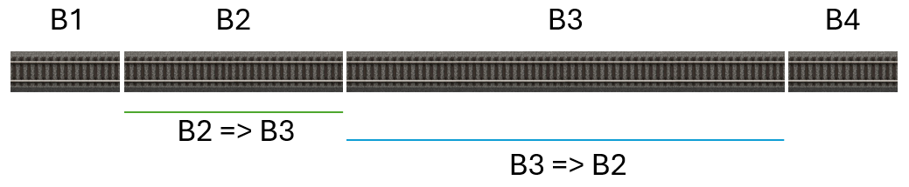

# User manual for Z21Dashboard

# Table of Contents
*   [Introduction](#introduction)
    *   [New in version 1.30](#new-in-version-1.30)
    *   [Why Z21Dashboard?](#why-z21dashboard)
    *   [Target Audience for the Application](#target-audience-for-the-application)
    *   [A Bit About the Technology](#a-bit-about-the-technology)
*   [The Z21 Family of Central Stations](#the-z21-family-of-central-stations)
    *   [Use of Protocol](#use-of-protocol)
    *   [z21/z21Start and Locked or Not](#z21z21start-and-locked-or-not)
*   [First Time You Start](#first-time-you-start)
*   [The Dashboard](#the-dashboard)
    *   [Super Maximize the Dashboard](#super-maximize-the-dashboard)
    *   [Move Windows Around](#move-windows-around)
    *   [Customize Your Dashboard (Show/Hide Windows)](#customize-your-dashboard-showhide-windows)
    *   [Widgets Explained](#widgets-explained)
*   [The CV Decoder Programming Widget](#the-cv-decoder-programming-widget)
*   [Known Issues](#known-issues)
    *   [Z21Dashboard is run in a virtual Windows machine in VirtualBox, but some widgets are not displayed correctly](#z21dashboard-is-run-in-a-virtual-windows-machine-in-virtualbox-but-some-widgets-are-not-displayed-correctly)
*   [Z21 Limitations](#z21-limitations)
*   [FAQ (Frequently Asked Questions)](#faq-frequently-asked-questions)
    *   [Will Z21Dashboard work with Z21 START newGen?](#will-z21dashboard-work-with-z21-start-newgen)
    *   [Can I use Z21Dashboard with my Digikeijs DR5000?](#can-i-use-z21dashboard-with-my-digikeijs-dr5000)
    *   [My Digikeijs DR5000 will not read CV addresses on the main track](#my-digikeijs-dr5000-will-not-read-cv-addresses-on-the-main-track)
    *   [My locomotive is equipped with a Märklin mLD3/mSD3 decoder and cannot be read on the main track](#my-locomotive-is-equipped-with-a-märklin-mld3-msd3-decoder-and-cannot-be-read-on-the-main-track)
    *   [Timeout error when I try to read CVs from my locomotive with a Märklin mLD3/mSD3 decoder](#timeout-error-when-i-try-to-read-cvs-from-my-locomotive-with-a-märklin-mld3-msd3-decoder)
    *   [When I click the button to search, my Z21 is not shown](#when-i-click-the-button-to-search-my-z21-is-not-shown)
    *   [What does 'Locked' mean?](#what-does-locked-mean)
    *   [Can names and addresses from my multiMAUS or Z21 app be transferred to Z21Dashboard?](#can-names-and-addresses-from-my-multimaus-or-z21-app-be-transferred-to-z21dashboard)
    *   [Z21Dashboard Cannot Connect to My Z21](#z21dashboard-cannot-connect-to-my-z21)
    *   [Will you implement widgets for LocoNet and CAN bus functionality?](#will-you-implement-widgets-for-loconet-and-can-bus-functionality)
    *   [I Found a Bug in Z21Dashboard, What Do I Do?](#i-found-a-bug-in-z21dashboard-what-do-i-do)
    *   [I Don't Have a GitHub Account](#i-dont-have-a-github-account)
    *   [I Think Z21Dashboard is Cool, But I'm Not Good at Networking etc., What Do I Do?](#i-think-z21dashboard-is-cool-but-im-not-good-at-networking-etc-what-do-i-do)

# Introduction

Welcome to Z21Dashboard. This guide helps you get started with using the program to monitor and control your
model railway via your Roco/Fleischmann Z21 central station.

**Translation Notice:**
This manual has been translated from Danish into English with the assistance of artificial intelligence (AI).
Although the translation has been carefully prepared, occasional inaccuracies or minor linguistic errors may 
occur.

## New in version 1.30

For users:

* Added German and French localization
* The texts on the buttons in the log widget are now localized (they were
  previously in English)
* New widget: "Locomotive Decoder Programming", which makes it possible to
  create a locomotive registry and program locomotives and decoders. The
  functionality is quite comprehensive. The widget only supports CVs that are
  not indexed
* Added a larger section to the user manual on CV programming and locomotive
  programming

For developers:

* Added the GetStatusAsync() method, which sends the LAN_GET_STATUS command to
  Z21 and returns the response as a StatusResponse object in an event
* The code in the Z21Dasboard project has been restructured so that the code is
  divided into folders by type of functionality (e.g. widgets, services, etc.)
* Note: There is currently a bug in MAUI that prevents the project from being
  added to a test project using xUnit. Therefore, no unit tests are included in
  this release

Bug fixes:

* The event for receiving RailCom data was not configured correctly for
  firmware versions below 1.29
* After the first connection to Z21, subsequent connections caused the
  Locomotive List not to display the speed and buttons correctly
* The locomotives' operating time was counted even when power to the track was
  switched off

## Why Z21Dashboard?

Z21Dashboard started as a 'just for fun project'. I am an IT-developer, and I thought it would be fun to write a
program for my z21Start so I could see which locomotives and turnouts I was controlling on my layout.

Then came all the ideas, and Z21Dashboard was born.

## Target Audience for the Application

There are two target groups for Z21Dashboard:

* The model train enthusiast who wants an overview not provided by multiMAUS,
  wlanMAUS, or the official Z21 app, but does not want a more complex solution
  such as software for automating model railway operations.
* The model train enthusiast who, in addition to the above, wants to develop
  software for the Z21, and can therefore draw inspiration from Z21Dashboard or
  use it as a starting point for a new application. One goal could be to expand
  with CAN-bus and LocoNet functionality for Z21 (black cabinet models) central
  stations.

## A Bit About the Technology

Z21Dashboard is Open Source software, and it can be found in my Github repository, where both source code and
binary files are available.

Z21Dashboard is developed in C# and .NET 10. It is developed as a .NET MAUI Blazor Hybrid Windows application.

# The Z21 Family of Central Stations

You can connect Z21Dashboard to the entire family of Z21 central stations from Roco:

*   z21
*   z21Start
*   Z21
*   Z21 XL

In this guide, the term 'Z21' is used for all of them unless there is something unique to a specific model.

## Use of Protocol

Normally, the Z21 central stations are connected for controlling 2-rail model railways and the protocol DCC. The
Z21 central stations are of the multiprotocol type, as they allow the use of both DCC and Märklin Motorola. mfx (M4)
is not supported by the Z21 central stations.

From new, the Z21 central station is set up to use both DCC and Märklin Motorola. You or others may have changed
this in the Z21 using Roco's application 'Maintenance Tool', where you can specify which protocols it should
support.

Although you can switch between protocols in certain Z21Dashboard settings (based on what version of the firmware
that is installed on your Z21), this cannot overwrite the setting in the Z21. I.e., if the Z21 is set to only DCC,
choosing Märklin Motorola in Z21Dashboard does not change the protocol for a locomotive or turnout.

## z21/z21Start and Locked or Not

Generally, the z21 (white box, where the text on the front is 'z21', notice the lower case 'z') is unlocked, though
z21 units were previously produced that were locked, just as the z21Start (white box, where the text on the
front is 'z21Start') is. Two different Roco items with unlock codes can be purchased, item no. 10814 (wifi router
and unlock code) and 10818 (unlock code).

If your z21/z21Start is locked, it will not be possible to control locomotives and turnouts in Z21Dashboard.
However, you can easily view their status as you control them with your multiMAUS.

Please note that if you have a locked z21Start running a firmware version earlier than 1.20, you will not see any
locomotives in Z21Dashboard, as the z21Start only sends information about the locomotives you have driven yourself.
From firmware version 1.20 onwards, you will see all locomotives, regardless of who is driving them. Therefore, if
your z21Start is running a firmware version earlier than 1.20, it is recommended that you upgrade the firmware to a
newer version.

# First Time You Start

When you open Z21Dashboard, the widget 'Connection', which allows you to connect to your Z21 central station, is
shown. The very first time, the standard IP address of the Z21 is displayed (192.168.0.111). If your Z21 has
another IP address, you must correct the displayed one. Click on the button 'Connect' to connect to your Z21. When
you start Z21Dashboard the next time, the IP address field will be pre-filled with the one you entered.

1.  Find the Connection window: At the top of the screen, you will see a window titled 'Connection'.
2.  Enter IP address: A standard IP address (192.168.0.111) is already entered in the field. If your Z21 has a
different address on your network, you must correct it. The program remembers the address you enter for next time.
3.  Click on the green 'Connect' button.
4.  If Z21Dashboard achieves connection to your Z21, the status badge in the top right corner of the window will
change to 'Connected' and turn green. The rest of your dashboard windows will now be displayed.

While Z21Dashboard attempts to connect to your Z21 central station, it will say 'Connecting' in the small gray
field at the top right of the Connection widget. If a connection is not achieved, it will say 'Not connected' again
after a few seconds.

## First time you connect
When you establish connection to your Z21 central station for the first time, Z21Dashboard will show all available 
widgets. They are slightly offset from each other. You can start by moving them around, and then click on the gear
icon at the top right to see the overview with widgets. Here you can hide the widgets you do not wish to see.

# The Dashboard

The entire area under the 'Connection' window is your personal canvas. Here you can arrange the various information
and control windows (widgets) exactly as you wish.

## Super Maximize the Dashboard

In the dashboard’s title bar, at the top left, there are four buttons:

* Super Maximize
* Minimize
* Maximize
* Close

The last three are standard Windows buttons and behave as you would expect. The Super Maximize button maximizes the
dashboard to full screen across all your monitors. When the dashboard window is super maximized, clicking the Super
Maximize button again will restore it to the size and position it had before it was super maximized.

If the dashboard window is super maximized when you close the application and you start the application again, the
dashboard will start in super maximized mode. If you then want to return the window to its normal size, you must do
so by dragging the edges of the window, since the Super Maximize button no longer knows the previous size of the
window.

## Move Windows Around

It is easy to move a window:
1.  Find the header: Point your mouse at the title bar of the window you want to move (e.g., on the text 'Power
Monitor'). Your mouse cursor will change to a 'grabbing hand'.
2.  Click and Drag: Click and hold the mouse button down, and drag the window to a new position on the screen.
3.  Release: Release the mouse button to place the window. The program automatically saves your window positions,
so your layout looks the same the next time you start.

## Customize Your Dashboard (Show/Hide Windows)

You don't need to have all windows shown at once. You can easily turn on and off the ones you need.
1.  Open Settings: Click on the large gear icon (⚙️) in the top right corner of the program window. A popup menu
named 'Settings' will open.
2.  On/Off: In the menu, you see a list of all available windows with an on/off button next to each. Click the
button to show or hide a window. The change happens immediately on your dashboard in the background.
3.  Close Settings: Click 'Close' or the cross to close the settings menu.

## Widgets Explained

### The Connection Widget
This is your control panel for the connection. From here you can:
*   Search for Z21 central stations on your network
*   Establish and disconnect the connection to your Z21
*   Turn track power on and off with 'Track Power On' and 'Track Power Off'
*   Activate Emergency Stop to stop locomotives

When connected, it shows:
*   The type of Z21 central station (z21, z21Start, Z21 or Z21 XL)
*   For z21 and z21Start, whether it is locked or not
*   The firmware version on the Z21 central station
*   The serial number of the Z21 central station
*   Track power status (on or off)

Be aware that Emergency Stop is implemented differently in decoders.
immediately, and in others, it means the speed is set to 0 while braking delay is still active. It is recommended
that you test your locomotives so you know if you can truly use Emergency Stop. Alternatively, you can always turn
off the track power to stop all driving on your model railway.

### Locomotive Control
This is your digital controller for a single locomotive.
1.  Select a Locomotive: Enter the address of the locomotive you want to view or control in the 'Address' field.
2.  View Live Status: As soon as you have entered an address, the window will show the locomotive's current speed,
direction of travel, and which functions (F0-F31) are active. This information updates live, even if you control the locomotive from another controller (e.g., a MultiMAUS).
3.  Control the Locomotive: If your z21/z21Start is 'unlocked' (see elsewhere), you can use the slider to change
speed, click on 'Forward'/'Backward' to change direction, and click on the F-buttons to turn functions on/off.

If you have previously created a "Locomotive Definition" in the "Decoder Programming" widget, the short name
will be displayed next to the address field. If you have not created a definition, the name you entered in the
settings popup will be displayed (shown by clicking ⚙️ in the widget's title bar).

When you have selected a locomotive (address field is not 0), you can click on the gear in the top right.
window will now appear. The options in this window depend on whether your z21/z21Start is locked.

Locked or not, you can:
*   Give the locomotive a name. This name is then shown in Z21Dashboard together with the address. If you have
    previously created a "Locomotive Definition" in the "Decoder Programming" widget, the short name will be shown
    and this field is not used
*   Specify a number of operating hours before service is required on the locomotive
*   See how long it is until service must be performed
*   Reset the service time counters when you have performed service

Unlocked:
*   Select protocol and the number of speed steps

Locked:
*   Select protocol. If you want to change the number of speed steps, you must do so on your multiMAUS

Note, if you have selected the Märklin Motorola version 1 protocol, only the function button for light will be 
active. If you have selected Märklin Motorola version 2, then the function button for light as well as F1 - F4
will be active.

### Locomotive Operation Time
This widget gives an overview of the locomotives that are in use. It shows a list of all locomotives
and keeps track of how long each one has been in operation. It is also here that you can give your
locomotives names. If you have previously created a "Locomotive Definition" in the "Decoder Programming" widget,
the name will be taken from that definition, and this field is not used in this widget.

Next to each locomotive is a button with a gear. This opens the dialogue with settings for the respective
locomotive. The options in this window depend on whether your z21/z21Start is locked.

Locked or not, you can:
* Give the locomotive a name. This name is then shown in Z21Dashboard together with the address (however, the
  name is taken from the locomotive definition if you have previously created one)
* Specify a number of operating hours before service is required on the locomotive. In the overview, the
  runtime will have a yellow background when there is less than an hour until service must be performed. The
  background becomes red when service has not been performed
* See how long it is until service must be performed
* Reset the service time counters when you have performed service
* Delete a locomotive from the overview

Unlocked:
*   Select protocol and the number of speed steps.

Locked:
*   Select protocol. If you want to change the number of speed steps, you must do so on your multiMAUS.

Note that the runtime is saved on your PC. The next time you start the program and connect to your Z21,
the counting of runtime continues. If you run trains without your PC being turned on and Z21Dashboard
running, the runtime is not counted. In other words, the runtime is *not* stored in the Z21
central station.

Runtime is counted when the speed is different from 0, regardless of the locomotive's direction.

### Turnouts
This widget shows the turnouts where you have changed their position with your multiMAUS.
Next to each turnout, a button for settings is shown. When you click on it, a popup dialogue opens that lets you
choose which protocol should be used for the decoder in the turnout.

In the popup, you can choose between 'DCC' and 'MM' for Märklin Motorola. You can also delete the turnout from the
overview.

### Turnout Protocol Selector
This widget lets you select the protocol for turnouts. Since the widget with the list of turnouts only
shows previously activated turnouts, you need to use this one to switch a "new" turnout, as well as
set the protocol for the turnout decoder.

You enter the turnout decoder's address. After a few seconds, the current protocol for
the turnout decoder is shown. Select a different protocol and then click the "Set Protocol" button.

### Voltage and Current Overview
This window shows a graph with two lines; one for voltage and one for current, so you can follow how it develops
over time.

By clicking on the button with the gear at the top right of the widget, you can change the interval at which the
graph updates.

Regardless of which interval you choose, Z21Dashboard receives updates continuously from the Z21 central station.
The widget remembers the highest value received, and when the interval has 'expired', the highest value is written
to the graph.

### Speed Measurement
This window measures the train's model speed and converts it to real-scale (1:1) speed. Both values are displayed simultaneously.

To measure speed, you need sensors installed on your layout. Sensors can be implemented as blocks, track contacts, or IR sensors. Two sensors are selected to measure a train’s speed. In this widget's settings, choose the two sensors and specify the module and port on the R-Bus they are connected to.

The speed is calculated by measuring the time it takes the train to travel a known distance, then converting  
the time and distance to 1:1 scale speed based on your model train’s size. The model train’s size is configured in  
the Z21Dashboard settings.

The term *start* of a sensor refers to the beginning of the sensor in the train’s direction of travel.

Next, measure the distance between the *start* of sensor 1 and the *start* of sensor 2. Repeat the measurement in the opposite direction.  
Regardless of whether the sensors are blocks, track contacts, or IR sensors, the distance between them may vary depending on the direction of travel.

The distance is entered with a maximum of 1 decimal if the measurement system is metric, and 2 decimals if the measurement system is imperial.

The image below shows a section divided into blocks, where the blocks serve as sensors. Note that the distance from  
the *start* of block 2 to the *start* of block 3 is longer than the distance from the *start* of block 3 to the *start* of block 2.  
The blocks do not need to be directly adjacent. In the setup shown, blocks B2 and B4 can be used as sensors.

**Important!**  
The measurement works by registering when a sensor is **activated** (either a block occupied or a track contact/IR sensor triggered).  
The system cannot determine *which* train is passing. If sensors are positioned so that other trains can enter the section,  
this may result in incorrect measurements.

A timeout is built into the measurement. Once the first sensor is activated, the second sensor must be activated  
within 10 minutes, or the measurement will be canceled.

**Please note!**
If you change the measurement system in Windows while Z21Dashboard is running, you must close it and start it again for
the change to take effect in Z21Dashboard.

### System Status – Complete and Compact
These two widgets show the status of the Z21 central station itself. They display current consumption, voltage,
and temperature. The temperature scale (C/F) is changed in Z21Dashboard's settings. If the temperature becomes
too high, the temperature is shown with a red background. This is the signal that the central station should be
switched off and allowed to cool down.

In addition to the above, the complete system status also shows information about, among other things, whether
emergency stop is activated, whether there is a short circuit, and short circuits in connected boosters. From
firmware version V1.42, it also shows which protocols are enabled in the central station, whether RailCom is
enabled, etc.

### R-Bus Feedback

This widget shows the state of all feedback contacts that a Z21 central station supports (160 in total).

The widget shows each module with the module's 8 feedback contacts. It does not matter how many feedback contacts
are actually connected, as the widget will always show the 160 possible feedback contacts.

### RailCom Data
This widget shows which data has been received by the Z21 central station.

What is shown in the "Options" column depends on the programming of the decoder in question.

### Show Log
This widget shows Z21Dashboard's log. You can see what is actually happening in Z21Dashboard.
For example, it sends commands to the Z21 central station and receives data from the central station.

There is an option to filter the messages that are shown.

### Decoder Programming
This widget lets you program locomotive decoders either via a simple dialog, where you change one
CV address/value at a time, or dialogs that cover areas, e.g. Lights, Motor, where multiple CV
addresses/values are changed at once.

Furthermore, this widget lets you create locomotive definitions, and the widget gives you an overview
of your locomotives.

Read more about this widget in the chapter "The CV Decoder Programming Widget".

# The CV Decoder Programming Widget
This chapter describes how to use this widget to program a decoder. CV programming
is aimed at DCC and multi-protocol decoders, as Märklin Motorola decoders, as a rule,
cannot be programmed with CV addresses/values. Typically, Märklin Motorola decoders must be programmed by
setting switches or adjusting trimmers on the decoder circuit board itself. Some decoders can be programmed
using a Märklin 6021 controller. For the specific decoder, you must consult the manual for
instructions.

## Introduction to CV Programming
This chapter is for those who do not have (much) experience with CV programming.

### What is a CV?
A Configuration Variable (CV) is a setting stored in the locomotive's decoder. Each CV has
a number (address) and a value, which determines a specific function or property.

Examples of settings controlled by CVs:

*   The locomotive's address
*   Starting voltage
*   Acceleration and braking distance
*   Maximum speed
*   Light functions
*   Motor control
*   Sound settings (on sound decoders)

You can think of a decoder as a small computer, where the CVs function as memory locations
with settings.

### How Does CV Programming Work?
When you program a decoder, the digital central station sends a command to the decoder to change a
specific CV. Example:

*   CV1 = The locomotive's address.
*   Value = 25.

After programming, the locomotive will respond to address 25. The widget handles this communication
with the central station, which then communicates with the decoder.

With simple programming, you enter the desired CV address and CV value. If you use the advanced
option, you normally only need to select the desired setting, while the widget translates
it to the correct CV address and CV value.

### Reading and Writing CVs
There are two basic operations:
*   Read CV

    The program retrieves the current value from the decoder and displays it on the screen.
    This is useful if:
    *   You want to check the decoder's settings
    *   You don't know the current values
    *   You want to save a backup of the configuration.

    To read CV addresses on the main track, your Z21 central station must have RailCom
    enabled, and the decoder must also have RailCom, and it must be enabled. Without RailCom, you can
    write to CV addresses, but you cannot read them. This is a problem with certain tabs, as
    CV values must be read before the value can be updated and written back to the decoder.

    A solution to this is to use the programming track. Here it does not matter whether the Z21
    central station and the decoder have RailCom enabled. You can check whether RailCom is enabled in
    the Z21 central station in Roco's "Maintenance Tool" application. You can check whether the decoder has
    RailCom enabled by placing the locomotive on the programming track and reading CV 29. Then look
    at bit 3 (RailCom communication).

*   Write CV

    The program sends a new value to the decoder. The previous value is overwritten with the new one.

    Some decoders apply the change immediately, while others only apply it after a
    restart or after the power has been disconnected.

### Programming Track and Main Track
Decoders can normally be programmed in two different ways.

*   Programming Track

    The locomotive is placed on a dedicated programming track.

    Advantages:

    *   Safe programming
    *   Read CV values on systems/central stations that do not support RailCom
    *   No risk of changing other locomotives.

    This method is recommended for initial setup or major changes. Please note that
    some central stations, including the z21 and z21Start, do not have a separate
    programming track output, and therefore the Main Track and Programming Track are the same track.

*   Programming on the Main Track (POM)

    The locomotive is programmed directly on the layout.

    Advantages:
    *   The locomotive can remain on the track
    *   Changes can be tested immediately.

    When programming on the main track, it is a prerequisite that the central station has RailCom, and
    that it is enabled, and that the decoder also has RailCom and it is enabled. If not, the CVs
    cannot be read back. However, it is possible to write CVs. There may also be other
    limitations depending on the central station and decoder.

### Standard CVs and Manufacturer-Specific CVs
The "National Model Railroad Association" (NMRA) has defined a number of standard CVs,
which most decoder manufacturers follow.

Examples:
*   CV1 – Locomotive address
*   CV2 – Starting voltage
*   CV3 – Acceleration
*   CV4 – Braking
*   CV5 – Maximum speed
*   CV8 – Manufacturer number

In addition, each manufacturer may have its own CVs for special functions.

The program takes these differences into account and only shows the functions that the selected decoder
supports. In addition to defining CV addresses and content, the NMRA has also defined which of the
CV addresses are required by all decoders, and which CV addresses are optional for
manufacturers to implement. For this reason, there are two base decoder definitions: "NMRA Maximal
Standard Decoder" and "NMRA Minimal Standard Decoder". They contain, respectively, all CV addresses
defined in the standard and only the required CV addresses. These two can be used when you have a decoder
for which no decoder definition exists. To display descriptions for CV addresses and bits,
the application includes descriptions of CV addresses as defined in the document "NMRA Standards
S-9.2.2" from July 2012. You can read more about DCC and CV standards on NMRA's
website: https://www.nmra.org.

## Decoders Defined in the Application
The application contains a number of decoder definitions, which are based on the decoders I
use myself. These are stored in the application itself, and changes to CV values cannot be saved in the
decoder definition itself. You can, however, change a value and write it to the decoder (which may be mounted
in a locomotive).

### Decoders You Define Yourself
By clicking the "Save selected decoder as local decoder file" button, you can make a copy of a
decoder (both those defined in the application and decoder definitions stored on your
hard drive). With a certain amount of caution, you can adapt the decoder definition to other decoders.

Decoders saved locally on your hard drive can be saved after you have changed CV values.

### Why Doesn't the Program Always Show CV Numbers?
Many settings consist of multiple CVs or multiple bits in the same CV.
Instead of asking the user to enter numbers, the program shows:
*   Checkboxes
*   Sliders
*   Drop-down lists
*   Text fields

When you change a setting, the program automatically calculates the necessary CV values. This makes
programming easier and reduces the risk of errors. On all pages where values need to be entered,
under the "Locomotive Decoders" tab, you can hover the mouse over the description of
the value. A tooltip will appear showing the CV address and possibly the bit.

## Saved Definitions
The program can save the decoder's settings as a decoder definition file or a
locomotive definition file.

A profile can be used for:
*   Backup of the decoder's CV addresses/values
*   Documentation
*   Copying configurations to other locomotives
*   Comparing changes.

It is always recommended to save a profile before making major changes.

## Good Advice
Before programming a decoder/locomotive, it is recommended to:
*   Read the current CV values
*   Save a backup
*   Change a few settings at a time
*   Test the locomotive after each change
*   Note major changes.

This makes it easier to return to a previous configuration if the result is not
as expected.

You don't need to know all CV addresses or their technical structure. The program translates your
choices into the necessary CV values and guides you through the programming. The more advanced topics,
such as bit fields, manufacturer-specific functions, and special decoder settings, are described later
in the manual.

## Errors During Programming
If a programming operation fails, the cause may be, among other things:
*   Poor contact between wheels and rails
*   Dirt on the programming track
*   Incorrectly selected decoder type
*   Insufficient power supply
*   A decoder that does not support the selected programming method

The program will normally show an error message if a CV cannot be read or written. Certain
decoders require a load to be connected to them in order to read the values. This
will be stated in the decoder's manual.

## Warning
By changing values in CV addresses, you can give the decoder and thus the locomotive new functions or
change characteristics so the locomotive behaves more realistically or meets your wishes for functions
(lights, sound, etc.).

Changing CV values requires a certain knowledge of what you are doing and what the implications
are. Changing the value in CV addresses without insight into what you are doing and why can
result in you no longer being able to communicate with the decoder, or losing the ability
to control your locomotive. Therefore, before changing the value in a CV address, make sure you know
what you are doing. Should it happen to you anyway, you must seek help from a friend or in
your model train club. Z21Dashboard's author cannot help you establish contact with the decoder
should you have programmed the decoder in such a way that it is no longer possible to communicate with
it. Nor can Z21Dashboard's author be held responsible for decoders that it is no longer
possible to communicate with.

If you have a z21 (white cabinet) and choose to program in "service mode", you must ensure
that only the locomotive you want to change is on the rails. If there are multiple locomotives and
you program in "service mode", you are programming all locomotives at once!

## Setup
In Z21Dashboard's settings (gear icon at the top right of the application window), you must under
the "Settings" tab specify which folders should be used to save
locomotive and decoder definition files, respectively.

## How to use the widget

The “Programming locomotive decoders” widget has three tabs, each providing you with a way to
program CV addresses and values in your decoder. They are described in the following sections.

Which of these tabs you should use depends on the task you want to perform and whether you want to have
a locomotive definition file for your locomotive.

### The "Simple" tab

This tab allows you to read or write/change one CV address/value at a time.

You must specify whether programming should be performed on the main track or programming track, optionally the locomotive's address, the CV address,
and, when writing, a value to write to the CV address. As you enter the CV address, a
description of the CV address will be displayed. If the CV consists of flags, these flags will
be displayed together with the meaning of the bits that can be used. Note that only CV addresses
defined by the NMRA are displayed. Manufacturer-specific CV addresses are not displayed.

**Example**

Let's imagine that you have purchased a locomotive for which there is no documentation indicating which decoder
is installed. You have been told that the locomotive has address 15. In this case, you can use
the ”Simple” tab. Place the locomotive on the track and select ”Main track”. Enter the locomotive address
and then enter the number 8 in the CV address field. The text ”Manufacturer ID.
NMRA-assigned manufacturer identification” is now displayed below the input field. Enter a value in the
CV value field. This number indicates who manufactured the decoder. The manufacturer's name is displayed
next to it.

### The "Locomotives" tab

This tab allows you to create locomotive definitions in which you can store information about the
locomotive in question, the decoder type, and CV addresses/values. You can also change CV addresses/values. You can later
edit the locomotive definition, for example because you want to change the value of a CV address, or because you have replaced the decoder with a
sound decoder. An important reason for creating locomotive definitions is that you can store CV addresses/values that you have
changed in your locomotive. The short name is then used and displayed in the "Locomotive Control" widget and in the "Locomotive
Operating Time" widget. You also get an overview of your locomotives.

You can choose between decoders defined in the Z21Dashboard application and decoders that you have defined yourself. You have
the option of reading CV values from the locomotive's decoder, and you can write values to the CV addresses. In this
mode, the CV addresses are grouped by function on tabs. For example, CVs related to the motor are located on the
"Motor" tab. Handling of bit flags and values stored across multiple CV addresses is handled by the widget. When you change
values in the CV addresses, these values are saved in the locomotive definition. The selected decoder definition retains
its original values.

If you have previously created locomotive definitions, these are displayed in the overview. If you want to edit a
locomotive definition, click it in the overview and then click the "Edit" button. Then proceed
as described below.

To create a locomotive definition, click the "Add" button. The tab changes to "Edit locomotive,
basic". Here you enter the locomotive's name, short name, manufacturer, catalogue number, class and running number. Below you can see
the meaning of the fields:

| Field name       | Meaning                                                                                   | Example                    |
| :--------------- | :---------------------------------------------------------------------------------------- | :------------------------- |
| Name             | The locomotive's full name                                                                | Roco DSB MA 462 with sound |
| Short name       | The locomotive's short name. This is used for display in the "Locomotive Control" widgets | DSB MA 462                 |
| Manufacturer     | The locomotive's manufacturer                                                             | Roco                       |
| Catalogue number | The locomotive's catalogue number                                                         | 462                        |
| Class            | The locomotive's class                                                                    | MA                         |
| Running number   | The locomotive's running number                                                           | 462                        |

Next, click the "Edit locomotive, extended" tab. Here you enter an optional description of the locomotive,
purchase date, price, any changes you have made to the locomotive, and any remarks. Below you can see the meaning of the fields:

| Field name    | Meaning                                                                                 | Example                                                         |
| :------------ | :-------------------------------------------------------------------------------------- | :-------------------------------------------------------------- |
| Description   | A description of the locomotive. For example, something about the locomotive's history. | DSB received the first MA high-speed trains in the early 1960s. |
| Purchase date | The date on which the locomotive was purchased                                          | 15-03-2019                                                      |
| Price         | The original price or the price you paid if it was purchased used                       | 2895                                                            |
| Changes       | Any changes made to the locomotive                                                      | Lights and passengers installed in all coaches.                 |
| Remarks       | Any remarks, for example whether it was a gift.                                         | Gift from my wife.                                              |

Next, click the "Decoder" tab. Here you have two options. If you do not know which decoder is
installed, you can get some assistance. The NMRA standard does *not* define a CV address that can uniquely identify
the decoder. The standard only defines a CV address that identifies the manufacturer and firmware version (this
value is often not very precise). However, some manufacturers have defined a CV address for identifying the decoder
model. For ZIMO decoders, you can also find out which model the decoder is.

Before clicking the "Read from locomotive decoder" button, you must select whether you want to read from the main track or
programming track. If you want to read from the main track, you must ensure that your command station is configured to
support RailCom and that RailCom is enabled in the decoder. If this is not the case, you cannot read CV values
on the main track.

If you choose to read from the main track, Z21Dashboard needs to know which address the locomotive has. You specify the address by
clicking the "Address" tab and then entering the address, for example "1103". Once you have entered the address, you can switch
back to the "Decoder" tab and then click the "Read from locomotive decoder" button.

In the list of decoders, you can see the decoders defined in the application and the decoders you have defined yourself.
You can search for the decoder and select it. If you cannot find the exact decoder installed in your locomotive, then
select one that is similar or one of the NMRA standard decoders.

After clicking the decoder, click the "Use selected decoder" button. The tabs will then change to
the tabs defined for this particular decoder.

You can click the "Meta info" tab. It displays information about the selected decoder definition file. Click the
"Read/write all CVs" tab. This tab allows you to read all CV addresses and values from the
locomotive decoder into the locomotive definition you are creating. By loading all CV addresses and values, you
have the correct starting point for later changing the values in the locomotive definition and writing them back to
the decoder in the locomotive.

You can now click the various tabs defined for the selected decoder. Here you can change the values of
the CV addresses. When you are ready, return to the "Locomotives" tab and click the "Save" button. The
locomotive definition is now saved, and you can retrieve it later and make changes.

### The "Locomotive Decoders" tab

This tab is used to maintain information about decoders. The first page displayed contains
a list of decoders. This includes both the decoders defined in the application and the
decoders you have defined yourself. There is also an option to identify the manufacturer of
the decoder (not for Märklin Motorola decoders). Unfortunately, the NMRA CV standard does not define
a way to identify the specific decoder model, only the manufacturer and optionally the firmware
version (CV 7). However, some manufacturers have defined a CV address for identifying the
decoder model (for example, ZIMO uses CV 250 for this).

Functionality and operation are as described under the "Locomotives" tab.

If your locomotive is equipped with a pure Märklin Motorola decoder, CV
addresses and values cannot be read. It is therefore possible to choose between two general Märklin Motorola
decoders, version 1 and version 2. There are technical differences between the two versions of the protocol,
but the most visible difference is that version 1 has only one function key, namely F0, which is used for lights.
Version 2 has up to 5 function keys.

the specific type of MM decoder.

If you have selected one of the MM decoders, an additional tab called "Märklin
Motorola" will be displayed. Here you can enter the address of the decoder. The address is used to identify the locomotive
in, for example, the four "Locomotive Control" widgets.

### The "Address" tab in "Locomotives" and "Locomotive Decoders"

An important thing to be able to change in your locomotive or decoder is its address. In the Z21 protocol, which
Z21Dashboard is based on, the address is limited to a value between 1 and 9999. Since changing
the address may involve changing up to four CV addresses at once, the widget is
designed so that changing the address must be done on the programming track. Be aware of whether your
Z21 command station (or compatible system) has a separate programming track. If not, you must remove
all other locomotives from the track. If you do not, all locomotives will receive the new address.

You should also be aware that if you want to assign an address between 100 and 127, this requires
the Z21 command station configuration to be set so that short addresses range from 1 to 127. You can
see this in Roco's "Maintenance Tool" on the "Settings" tab, under the "Short DCC
loco-address" setting. Z21Dashboard will program addresses from 128 onwards as long addresses.

As with the "Locomotives" tab, the tabs will change depending on which decoder you choose
to work with.

Even though you can change the address to any value between 1 and 9999, the capabilities of your decoder
ultimately determine which addresses it is possible to assign to it.

Note that Märklin Motorola decoders cannot be programmed using CV addresses and values.

# Known Issues

## Z21Dashboard is run in a virtual Windows machine in VirtualBox, but some widgets are not displayed correctly
Typically, it is the two locomotive widgets and turnout protocol widget that are not displayed correctly.
A spinning arrow is shown along with the text 'Checking Z21 lock state'.

This may be due to the "Pointing device" on the "System" tab in VirtualBox being set to "USB Tablet". Change
it to "PS/2 Mouse" and try again.

# Z21 Limitations

The complete limitations for the Z21 central stations can be found in various manuals from Roco.

Here are some of the limitations relevant to Z21Dashboard:

| Limitation | Description | Relevance for Z21Dashboard |
| :--- | :--- | :--- |
| Number of DCC locomotive addresses that can be controlled | 9999 | In Z21Dashboard, you can assign addresses between 1 and 9999 to locomotives. |
| Number of Märklin Motorola locomotives that can be controlled | 255 | In Z21Dashboard, you can select the MM protocol for addresses 1 to 256. |
| Number of simultaneous locomotives | Max 100 | In firmware versions below, not including, V1.20 you can only see the locomotives you have driven yourself. From firmware version V1.20 onwards, you can see all locomotives, regardless of who is driving them. |
| Update of locomotive status | In firmware versions below, not including, V1.20 the Z21 central stations send information about a maximum of 16 locomotives you have driven. | If your Z21 uses firmware with a version lower than V1.20, you will only be able to see up to 16 locomotives you have driven in a session. |
| Märklin Motorola, version 1 addresses | 80 | In Z21Dashboard, you can select the MM version 1 protocol for addresses 1 to 80. |
| Märklin Motorola, version 2 addresses | 256 | In Z21Dashboard, you can select the MM version 2 protocol for addresses 1 to 256. |
| RailCom | See locomotives in RailCom widget | In firmware versions below, not including, V1.29 you can only see the locomotives you have driven yourself. From firmware version V1.29 onwards, you can see all locomotives, regardless of who is driving them. It requires that the decoders send relevant RailCom data that the Z21 can receive. |
| F-keys | Z21 firmware before 1.42 could handle F0 to F28. From firmware V1.42 onwards, F0-F31 can be used | In Z21Dashboard, you can select F0-F28/F31 for DCC locomotives. For Märklin Motorola version 1, you can only select F0, and for Märklin Motorola version 2, you can select F0-F4. |

# FAQ (Frequently Asked Questions)

## Will Z21Dashboard work with Z21 START newGen?

At present, I have not had the opportunity to test Z21Dashboard with Z21 START newGen, and I
therefore cannot answer whether Z21Dashboard works with Z21 START newGen.

Nor has the "Z21 LAN Protocol" manual been updated to include the changes to the Z21 protocol that
may be necessary for Z21 START newGen.

## Can I use Z21Dashboard with my Digikeijs DR5000?

Yes, you can. However, it requires that you have set the network protocol to "Z21" in the DR5000's settings.
You cannot use Z21Dashboard with the DR5000 if you have selected other protocols.

Z21Dashboard has been tested with a DR5000 running firmware 1.6.3, and it works fine.

Please note that the Z21 central stations are multi-protocol devices, and the DR5000 is exclusively a DCC
central station. Since DR5000 firmware 1.6.3, in the Z21 protocol, corresponds to it being a Z21 (in black cabinet) with
firmware version 1.29, it cannot be queried about which protocols are enabled. You will therefore see both
DCC and Märklin Motorola protocols in Z21Dashboard. Selecting the Märklin Motorola protocol for locomotives or
turnouts will have no effect.

## My Digikeijs DR5000 will not read CV addresses on the main track

One of the prerequisites for being able to read CV addresses on the main track is that the central station can
communicate with RailCom. The DR5000 cannot do this, as the DR5000 itself does not support RailCom. If you have
connected a booster of the type Digikeijs DR5088, it is possible to read CV addresses on the main track, provided
that your locomotive is on a section that the DR5088 supplies power to.

I do not have a DR5088, and have therefore not had the opportunity to test whether it actually works.
There are several videos on YouTube showing how the DR5000 and DR5088 are connected so that CV addresses can be read.

My locomotive is equipped with a Märklin mLD3/mSD3 decoder and cannot be read on the main track
Timeout error when I try to read CVs from my locomotive with a Märklin mLD3/mSD3 decoder
## My locomotive is equipped with a Märklin mLD3/mSD3 decoder and cannot be read on the main track

Märklin's mLD3 and mSD3 decoders cannot be read on the main track because they do not support RailCom.
You must place the locomotive on the programming track to read the CV addresses. Then select "Programming
Track" in Z21Dashboard before clicking the "Read from locomotive decoder" button.

## Timeout error when I try to read CVs from my locomotive with a Märklin mLD3/mSD3 decoder

There may be a timing issue between the Z21 central station and the Märklin mLD3/mSD3 decoder. It may help
to adjust the timing in Roco's "Maintenance Tool" application. In "Maintenance Tool", select "Settings"
and then "Advanced settings". Here you can adjust the "ACK threshold". This is described in Roco's manual
for the "Maintenance Tool" application.

## When I click the button to search, my Z21 is not shown

The list returned by the method is empty, and you get no error. You can connect with Z21Client to your Z21 central station
(all models), and send commands and receive data. The method returning an empty list typically happens when the PC is
connected to the network wirelessly.

To find Z21 devices on the network, QueryForZ21s sends a UDP broadcast that the Z21 central stations must respond
to. Many access points and routers block UDP broadcasts, which may prevent your Z21 from receiving the broadcast and
responding. It is also possible that your PC does not receive the response from the Z21.

Check the configuration of your access point or router to see if there is a setting that blocks UDP broadcasts. If so,
disable this setting. Some routers and access points also have a setting to block UDP broadcasts on the wireless
network only. Other routers and access points do not have such a setting but block UDP broadcasts on the wireless
network by default. In that case, you can try connecting your PC to the network using a cable to see if that resolves
the problem. If it does, it is likely that your access point or router blocks UDP broadcasts on the wireless network.

## What does 'Locked' mean?

If you have a z21start (the white model), it may be 'locked' from the factory. This means that it does not allow
driving and switching via the network.
*   If LocoControl shows 'Locked': You can still use Z21 Dashboard as a monitoring tool. You can see live status
for your locomotives, but you cannot control them from the program (buttons will be disabled). You can, however,
change protocol for locomotives.
*   If LocoControl shows 'Unlocked': All functions in the program are available, and you can control your
locomotives directly.
To unlock your z21start, you need an unlock code from Roco (item number 10818 or 10814).

## Can names and addresses from my multiMAUS or Z21 app be transferred to Z21Dashboard?

Unfortunately, that is not possible.

## Z21Dashboard Cannot Connect to my Z21

The obvious one: check that the IP address is entered correctly. Open a command prompt in Windows, and ping your
Z21. If the ping does not get a reply, then there is a network problem you need to solve first.

The first time you start Z21Dashboard, Windows' firewall will ask if it is okay that Z21Dashboard communicates out
on the network. You must answer Yes to this. If you answered No, then you must go into the Windows firewall and
give permission for Z21Dashboard to communicate out of your PC.

## Will you implement widgets for LocoNet and CAN bus functionality?

The short answer is no. The long answer is that I own a z21Start, and therefore I do not have the need for such
widgets, and I cannot test the functionality.

## I Found a Bug in Z21Dashboard, What Do I Do?

Go to the repository and create an Issue.

## I Don't Have a GitHub Account

At present, the home of the project is my repository on GitHub, and that is where the dialogue about Z21Dashboard
needs to be.

## I Think Z21Dashboard is Cool, But I'm Not Good at Networking etc., What Do I Do?

You must seek help from a friend or possibly in your model train club to get the necessary help to set up the
network and possibly your router.
