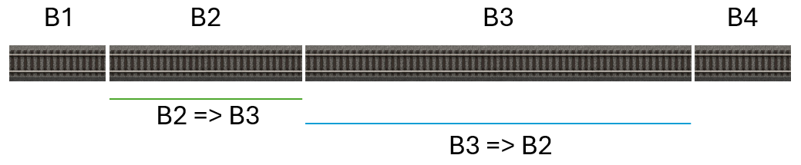

# Manuel d’utilisation de Z21Dashboard

# Table des matières

* [Introduction](#introduction)
  * [Nouveautés de la version 1.30](#nouveautés-de-la-version-1.30)
  * [Pourquoi Z21Dashboard ?](#pourquoi-z21dashboard)
  * [Public cible de l’application](#public-cible-de-lapplication)
  * [Quelques mots sur la technologie](#quelques-mots-sur-la-technologie)
* [La famille des centrales Z21](#la-famille-des-centrales-z21)
  * [Utilisation des protocoles](#utilisation-des-protocoles)
  * [z21/z21Start : verrouillée ou non](#z21z21start--verrouillée-ou-non)
* [Premier démarrage](#premier-démarrage)
* [Le tableau de bord](#le-tableau-de-bord)
  * [Maximisation étendue du tableau de bord](#maximisation-étendue)
  * [Déplacer les fenêtres](#déplacer-les-fenêtres)
  * [Personnaliser le tableau de bord](#personnaliser-le-tableau-de-bord)
  * [Explication des widgets](#explication-des-widgets)
* [Le widget de programmation des décodeurs CV](#le-widget-de-programmation)
* [Problèmes connus](#problèmes-connus)
  * [Z21Dashboard dans VirtualBox](#z21dashboard-dans-virtualbox)
* [Limitations de la Z21](#limitations-de-la-z21)
* [FAQ](#faq)
  * [Z21Dashboard fonctionne-t-il avec Z21 START newGen ?](#z21-start-newgen)
  * [Puis-je utiliser Z21Dashboard avec mon Digikeijs DR5000 ?](#dr5000)
  * [Mon DR5000 ne lit pas les CV sur la voie principale](#dr5000-cv)
  * [Ma locomotive est équipée d'un décodeur Märklin mLD3/mSD3 et ne peut pas être lue sur la voie principale](#ma-locomotive-est-équipée-dun-décodeur-märklin-mld3msd3-et-ne-peut-pas-être-lue-sur-la-voie-principale)
  * [Erreur de délai d'attente lors de la lecture des CV de ma locomotive équipée d'un décodeur Märklin mLD3/mSD3](#erreur-de-délai-dattente-lors-de-la-lecture-des-cv-de-ma-locomotive-équipée-dun-décodeur-märklin-mld3msd3)
  * [Ma Z21 n’apparaît pas lors de la recherche](#z21-napparaît-pas)
  * [Que signifie « Locked » ?](#locked)
  * [Les noms et adresses peuvent-ils être transférés ?](#transfert)
  * [Z21Dashboard ne peut pas se connecter à ma Z21](#connexion)
  * [Widgets LocoNet et bus CAN ?](#loconet-can)
  * [J’ai trouvé un bug](#bug)
  * [Je n’ai pas de compte GitHub](#github)
  * [Je ne suis pas à l’aise avec les réseaux](#réseaux)

# Introduction

Bienvenue dans Z21Dashboard. Ce guide vous aide à commencer à utiliser le
programme pour surveiller et commander votre réseau ferroviaire miniature
via votre centrale Z21 Roco/Fleischmann.

**Avis concernant la traduction** :

Ce manuel a été traduit du danois vers le français avec l’aide de
l’intelligence artificielle (IA).

Bien que la traduction ait été préparée avec soin, quelques imprécisions ou
erreurs linguistiques mineures peuvent subsister.

## Nouveautés de la version 1.30

Pour les utilisateurs :

* Ajout de la localisation allemande et française
* Les textes des boutons du widget de journalisation sont désormais localisés
  (ils étaient auparavant en anglais)
* Nouveau widget : « Programmation des décodeurs de locomotives », permettant
  de créer un registre de locomotives ainsi que de programmer les locomotives
  et les décodeurs. Les fonctionnalités sont assez étendues. Le widget prend
  uniquement en charge les CV qui ne sont pas indexés
* Ajout d'une section plus importante au manuel d'utilisation sur la
  programmation des CV et la programmation des locomotives

Pour les développeurs :

* Ajout de la méthode GetStatusAsync(), qui envoie la commande LAN_GET_STATUS
  à Z21 et retourne la réponse sous forme d'un objet StatusResponse dans un
  événement
* Le code du projet Z21Dasboard a été restructuré afin de répartir le code
  dans des dossiers selon le type de fonctionnalité (par exemple, widgets,
  services, etc.)
* Remarque : il existe actuellement un problème dans MAUI qui empêche
  d'ajouter le projet à un projet de test à l'aide de xUnit. Par conséquent,
  aucun test unitaire n'est inclus dans cette version

Corrections de bugs :

* L'événement de réception des données RailCom n'était pas configuré
  correctement pour les versions du firmware antérieures à la 1.29
* Après la première connexion à Z21, les connexions suivantes entraînaient un
  affichage incorrect de la vitesse et des boutons dans la liste des
  locomotives
* Le temps de fonctionnement des locomotives était comptabilisé même lorsque
  l'alimentation de la voie était coupée

## Pourquoi Z21Dashboard ?

Z21Dashboard a commencé comme un projet « juste pour le plaisir ». Je suis
développeur informatique et je trouvais amusant d’écrire un programme pour
ma z21Start afin de voir quelles locomotives et quels aiguillages je
commandais sur mon réseau.

Puis les idées se sont multipliées et Z21Dashboard est né.

## Public cible de l’application

Z21Dashboard s’adresse à deux groupes :

* Le passionné de trains miniatures qui souhaite une vue d’ensemble que
  n’offrent pas la multiMAUS, la wlanMAUS ou l’application Z21 officielle,
  mais qui ne souhaite pas une solution plus complexe telle qu’un logiciel
  d’automatisation d’un réseau ferroviaire miniature.
* Le passionné qui, en plus de cela, souhaite développer des logiciels pour
  la Z21 et peut donc s’inspirer de Z21Dashboard ou l’utiliser comme point
  de départ pour une nouvelle application. L’un des objectifs possibles
  serait d’ajouter la prise en charge du bus CAN et de LocoNet pour les
  centrales Z21 à boîtier noir.

## Quelques mots sur la technologie

Z21Dashboard est un logiciel Open Source. Il est disponible dans mon dépôt
GitHub, où se trouvent le code source et les fichiers binaires.

Z21Dashboard est développé en C# et .NET 10. Il s’agit d’une application
Windows .NET MAUI Blazor Hybrid.

# La famille des centrales Z21

Vous pouvez connecter Z21Dashboard à toute la famille des centrales Z21
de Roco :

* z21
* z21Start
* Z21
* Z21 XL

Dans ce guide, le terme « Z21 » désigne toutes ces centrales, sauf lorsqu’un
modèle particulier possède une caractéristique spécifique.

## Utilisation des protocoles

Normalement, les centrales Z21 sont utilisées pour commander des réseaux
ferroviaires à deux rails avec le protocole DCC.

Les centrales Z21 sont de type multiprotocole et permettent donc d’utiliser
DCC ainsi que Märklin Motorola. Le protocole mfx (M4) n’est pas pris en
charge par les centrales Z21.

À l’origine, une centrale Z21 est configurée pour utiliser DCC et
Märklin Motorola. Vous ou une autre personne avez peut-être modifié ce
réglage dans l’application « Maintenance Tool » de Roco, où vous pouvez
indiquer les protocoles qu’elle doit prendre en charge.

Bien que vous puissiez changer de protocole dans certains paramètres de
Z21Dashboard, selon la version du firmware installée sur votre Z21, cela
ne peut pas remplacer le réglage de la Z21.

Par exemple, si la Z21 est configurée pour n’utiliser que DCC, sélectionner
Märklin Motorola dans Z21Dashboard ne change pas le protocole de la
locomotive ou de l’aiguillage.

## z21/z21Start : verrouillée ou non

En général, la z21 (boîtier blanc portant « z21 » avec un « z » minuscule)
est déverrouillée.

Certaines z21 produites auparavant étaient toutefois verrouillées, tout
comme la z21Start (boîtier blanc portant « z21Start »).

Deux articles Roco permettant le déverrouillage peuvent être achetés :
10814 (routeur Wi-Fi et code de déverrouillage) et 10818
(code de déverrouillage).

Si votre z21/z21Start est verrouillée, il ne sera pas possible de commander
les locomotives et les aiguillages avec Z21Dashboard.

Vous pouvez cependant facilement consulter leur état tout en les commandant
avec votre multiMAUS.

Notez que si vous possédez une z21Start verrouillée avec un firmware
antérieur à la version 1.20, aucune locomotive ne sera affichée dans
Z21Dashboard, car la z21Start n’envoie des informations que sur les
locomotives que vous avez vous-même conduites.

À partir du firmware 1.20, toutes les locomotives sont visibles,
indépendamment de la personne qui les commande.

Si votre z21Start utilise un firmware antérieur à 1.20, il est donc
recommandé de mettre à jour le firmware.

# Premier démarrage

Lorsque vous ouvrez Z21Dashboard, le widget « Connection » permettant de
vous connecter à votre centrale Z21 est affiché.

Lors du tout premier démarrage, l’adresse IP standard de la Z21 est affichée :
192.168.0.111.

Si votre Z21 possède une autre adresse IP, vous devez corriger l’adresse
affichée.

Cliquez sur le bouton « Connect » pour vous connecter à votre Z21.

Lors du prochain démarrage de Z21Dashboard, le champ d’adresse IP sera
prérempli avec l’adresse que vous avez saisie.

1. **Trouver la fenêtre Connection :** en haut de l’écran, vous trouverez
   une fenêtre intitulée « Connection ».
2. **Saisir l’adresse IP :** l’adresse standard 192.168.0.111 est déjà
   saisie. Si votre Z21 possède une autre adresse sur votre réseau,
   corrigez-la. Le programme mémorise l’adresse saisie.
3. **Cliquer sur « Connect » :** cliquez sur le bouton vert « Connect ».
4. **Vérifier la connexion :** si Z21Dashboard se connecte à votre Z21,
   l’indicateur d’état en haut à droite de la fenêtre passe à
   « Connected » et devient vert. Les autres fenêtres du tableau de bord
   sont alors affichées.

Pendant que Z21Dashboard tente de se connecter à la centrale Z21, le petit
champ gris en haut à droite du widget Connection affiche « Connecting ».

Si la connexion n’est pas établie, il affiche de nouveau « Not connected »
après quelques secondes.

## Première connexion

Lorsque vous établissez une connexion avec votre centrale Z21 pour la
première fois, Z21Dashboard affiche tous les widgets disponibles.

Ils sont légèrement décalés les uns par rapport aux autres.

Vous pouvez commencer par les déplacer, puis cliquer sur l’icône
d’engrenage en haut à droite pour afficher l’aperçu des widgets.

Vous pouvez alors masquer les widgets que vous ne souhaitez pas voir.

# Le tableau de bord

Toute la zone située sous la fenêtre « Connection » constitue votre espace
de travail personnel.

Vous pouvez y disposer les différentes fenêtres d’information et de
commande, appelées widgets, exactement comme vous le souhaitez.

## Maximisation étendue du tableau de bord

Dans la barre de titre du tableau de bord, en haut à gauche, se trouvent
quatre boutons :

* Super Maximize
* Minimize
* Maximize
* Close

Les trois derniers sont des boutons Windows standard et fonctionnent comme
prévu.

Le bouton « Super Maximize » agrandit le tableau de bord en plein écran sur
tous vos moniteurs.

Lorsque la fenêtre est en mode « Super Maximize », cliquer de nouveau sur
ce bouton restaure la taille et la position qu’elle avait auparavant.

Si le tableau de bord est en mode « Super Maximize » lorsque vous fermez
l’application et la redémarrez, il démarre de nouveau dans ce mode.

Si vous souhaitez alors revenir à sa taille normale, vous devez faire
glisser les bords de la fenêtre, car le bouton « Super Maximize » ne connaît
plus la taille précédente de la fenêtre.

## Déplacer les fenêtres

Il est facile de déplacer une fenêtre :

1. **Trouver l’en-tête :** placez la souris sur la barre de titre de la
   fenêtre à déplacer, par exemple sur « Power Monitor ».
   Le curseur prend la forme d’une main.
2. **Cliquer et faire glisser :** maintenez le bouton de la souris enfoncé
   et faites glisser la fenêtre vers une nouvelle position.
3. **Relâcher :** relâchez le bouton pour placer la fenêtre.

Le programme enregistre automatiquement les positions des fenêtres afin
que votre disposition soit conservée au prochain démarrage.

## Personnaliser le tableau de bord

Vous n’êtes pas obligé d’afficher toutes les fenêtres simultanément.

Vous pouvez facilement activer ou désactiver celles dont vous avez besoin.

1. **Ouvrir les paramètres :** cliquez sur la grande icône d’engrenage
   (⚙️) en haut à droite de la fenêtre. Un menu contextuel nommé
   « Settings » s’ouvre.
2. **Activer/désactiver :** le menu contient la liste des fenêtres
   disponibles avec un bouton marche/arrêt pour chacune. Cliquez sur le
   bouton pour afficher ou masquer une fenêtre. La modification apparaît
   immédiatement sur le tableau de bord.
3. **Fermer les paramètres :** cliquez sur « Close » ou sur la croix pour
   fermer le menu.

## Explication des widgets

### Widget Connection

Il s’agit de votre panneau de commande pour la connexion.

Vous pouvez notamment :

* rechercher les centrales Z21 présentes sur votre réseau ;
* établir et interrompre la connexion avec votre Z21 ;
* activer et désactiver l’alimentation de la voie avec
  « Track Power On » et « Track Power Off » ;
* activer « Emergency Stop » pour arrêter les locomotives.

Une fois connecté, le widget affiche :

* le type de centrale Z21 (z21, z21Start, Z21 ou Z21 XL) ;
* pour les z21 et z21Start, si elle est verrouillée ou non ;
* la version du firmware de la centrale Z21 ;
* le numéro de série de la centrale Z21 ;
* l’état de l’alimentation de la voie.

Notez que l’arrêt d’urgence est implémenté différemment selon les
décodeurs.

Sur certains décodeurs, la locomotive s’arrête immédiatement. Sur d’autres,
la vitesse est réglée à zéro alors que le délai de freinage reste actif.

Il est recommandé de tester vos locomotives afin de savoir si vous pouvez
réellement utiliser l’arrêt d’urgence.

Vous pouvez également toujours couper l’alimentation de la voie afin
d’arrêter tous les trains de votre réseau miniature.

### Locomotive Control

Il s’agit de votre commande numérique pour une seule locomotive.

1. **Sélectionner une locomotive :** saisissez l’adresse de la locomotive
   à afficher ou commander dans le champ « Address ».
2. **Afficher l’état en temps réel :** dès que vous avez saisi une adresse,
   la fenêtre affiche la vitesse actuelle, le sens de marche et les
   fonctions actives F0-F31. Ces informations sont mises à jour en temps
   réel, même si la locomotive est commandée depuis un autre contrôleur,
   par exemple une MultiMAUS.
3. **Commander la locomotive :** si votre z21/z21Start est « unlocked »,
   vous pouvez utiliser le curseur pour modifier la vitesse, cliquer sur
   « Forward »/« Backward » pour changer le sens et cliquer sur les
   boutons F pour activer ou désactiver les fonctions.

Si vous avez précédemment créé une « Locomotive Definition » dans le
widget « Decoder Programming », son nom court est affiché à côté du champ
d’adresse.

Si aucune définition n’a été créée, le nom saisi dans la fenêtre des
paramètres est affiché. Cette fenêtre s’ouvre avec ⚙️ dans la barre de
titre du widget.

Lorsque vous avez sélectionné une locomotive, c’est-à-dire lorsque le
champ d’adresse n’est pas égal à 0, vous pouvez cliquer sur l’engrenage
en haut à droite.

Une fenêtre apparaît alors. Les options dépendent de l’état verrouillé ou
non de votre z21/z21Start.

Que la centrale soit verrouillée ou non, vous pouvez :

* donner un nom à la locomotive. Ce nom est affiché dans Z21Dashboard avec
  l’adresse ;
* si vous avez déjà créé une « Locomotive Definition », le nom court de
  celle-ci est utilisé et ce champ n’est pas pris en compte ;
* définir un nombre d’heures de fonctionnement avant l’entretien ;
* voir le temps restant avant l’entretien ;
* remettre à zéro les compteurs d’entretien après avoir effectué
  l’entretien.

**Déverrouillée :**

* sélectionner le protocole et le nombre de crans de vitesse.

**Verrouillée :**

* sélectionner le protocole. Pour modifier le nombre de crans de vitesse,
  vous devez le faire sur votre multiMAUS.

Notez que si vous avez sélectionné le protocole Märklin Motorola version 1,
seul le bouton de fonction correspondant aux feux est actif.

Avec Märklin Motorola version 2, le bouton des feux ainsi que F1 à F4 sont
actifs.

### Locomotive Operation Time

Ce widget donne un aperçu des locomotives utilisées.

Il affiche une liste de toutes les locomotives et enregistre la durée
pendant laquelle chacune a fonctionné.

C’est également ici que vous pouvez donner un nom à vos locomotives.

Si vous avez déjà créé une « Locomotive Definition » dans le widget
« Decoder Programming », le nom provient de cette définition et ce champ
n’est pas utilisé dans ce widget.

À côté de chaque locomotive se trouve un bouton avec un engrenage.

Celui-ci ouvre la boîte de dialogue contenant les paramètres de la
locomotive concernée.

Les options dépendent de l’état verrouillé ou non de votre z21/z21Start.

Que la centrale soit verrouillée ou non, vous pouvez :

* donner un nom à la locomotive ;
* définir un nombre d’heures de fonctionnement avant l’entretien ;
* voir le temps restant avant l’entretien ;
* remettre à zéro les compteurs après l’entretien ;
* supprimer une locomotive de l’aperçu.

Dans l’aperçu, le temps de fonctionnement est affiché sur fond jaune
lorsqu’il reste moins d’une heure avant l’entretien.

Le fond devient rouge lorsque l’entretien doit déjà être effectué.

**Déverrouillée :**

* sélectionner le protocole et le nombre de crans de vitesse.

**Verrouillée :**

* sélectionner le protocole. Pour modifier le nombre de crans de vitesse,
  vous devez le faire sur votre multiMAUS.

Notez que le temps de fonctionnement est enregistré sur votre PC.

Au prochain démarrage du programme et après connexion à votre Z21, le
comptage reprend.

Si vous faites circuler des trains alors que votre PC est éteint ou que
Z21Dashboard ne fonctionne pas, le temps n’est pas comptabilisé.

En d’autres termes, le temps de fonctionnement n’est **pas** enregistré
dans la centrale Z21.

Le temps est comptabilisé lorsque la vitesse est différente de 0,
indépendamment du sens de marche de la locomotive.

### Turnouts

Ce widget affiche les aiguillages dont vous avez modifié la position avec
votre multiMAUS.

À côté de chaque aiguillage se trouve un bouton de paramètres.

Lorsque vous cliquez dessus, une boîte de dialogue s’ouvre et vous permet
de choisir le protocole utilisé par le décodeur de l’aiguillage.

Vous pouvez choisir entre « DCC » et « MM » pour Märklin Motorola.

Vous pouvez également supprimer l’aiguillage de l’aperçu.

### Turnout Protocol Selector

Ce widget vous permet de sélectionner le protocole des aiguillages.

Le widget contenant la liste des aiguillages n’affiche que les aiguillages
précédemment activés.

Vous devez donc utiliser celui-ci pour commander un « nouvel » aiguillage
et définir le protocole de son décodeur.

Saisissez l’adresse du décodeur d’aiguillage.

Après quelques secondes, le protocole actuel du décodeur est affiché.

Sélectionnez un autre protocole, puis cliquez sur « Set Protocol ».

### Voltage and Current Overview

Cette fenêtre affiche un graphique comportant deux courbes : une pour la
tension et une pour le courant.

Vous pouvez ainsi suivre leur évolution dans le temps.

En cliquant sur le bouton avec l’engrenage en haut à droite du widget,
vous pouvez modifier l’intervalle de mise à jour du graphique.

Quel que soit l’intervalle choisi, Z21Dashboard reçoit continuellement
les mises à jour de la centrale Z21.

Le widget mémorise la valeur maximale reçue et, lorsque l’intervalle est
écoulé, inscrit cette valeur maximale sur le graphique.

### Speed Measurement

Cette fenêtre mesure la vitesse du train miniature et la convertit en
vitesse à l’échelle réelle (1:1).

Les deux valeurs sont affichées simultanément.

Pour mesurer la vitesse, vous devez disposer de capteurs sur votre réseau.

Les capteurs peuvent être des cantons, des contacts de voie ou des
capteurs infrarouges.

Deux capteurs sont utilisés pour mesurer la vitesse d’un train.

Dans les paramètres de ce widget, sélectionnez les deux capteurs et
indiquez le module et le port du R-Bus auxquels ils sont raccordés.

La vitesse est calculée en mesurant le temps nécessaire au train pour
parcourir une distance connue, puis en convertissant le temps et la
distance en vitesse à l’échelle 1:1 selon l’échelle de votre train
miniature.

L’échelle du train miniature est configurée dans les paramètres de
Z21Dashboard.

Le terme *début* d’un capteur désigne le début du capteur dans le sens de
marche du train.

Mesurez ensuite la distance entre le *début* du capteur 1 et le *début*
du capteur 2.

Répétez la mesure dans le sens opposé.

Que les capteurs soient des cantons, des contacts de voie ou des capteurs
infrarouges, la distance entre eux peut varier selon le sens de marche.

La distance peut comporter au maximum une décimale avec le système
métrique et deux décimales avec le système impérial.

L’image ci-dessous montre une section divisée en cantons, les cantons
servant de capteurs.

Notez que la distance entre le *début* du canton 2 et le *début* du canton
3 est plus longue que celle entre le *début* du canton 3 et le *début* du
canton 2.

Les cantons ne doivent pas nécessairement être directement adjacents.

Dans l’exemple présenté, les cantons B2 et B4 peuvent être utilisés comme
capteurs.

**Important !**

La mesure fonctionne en enregistrant le moment où un capteur est activé,
soit lorsqu’un canton devient occupé, soit lorsqu’un contact de voie ou
un capteur infrarouge est déclenché.

Le système ne peut pas déterminer quel train est en train de passer.

Si les capteurs sont positionnés de manière que d’autres trains puissent
entrer dans la section, les mesures peuvent être incorrectes.

Un délai d’expiration est intégré à la mesure.

Une fois le premier capteur activé, le second doit être activé dans les
10 minutes, sinon la mesure est annulée.

**Remarque !**

Si vous modifiez le système de mesure dans Windows alors que Z21Dashboard
fonctionne, vous devez fermer puis redémarrer Z21Dashboard pour que la
modification soit prise en compte.

### System Status – Complete et Compact

Ces deux widgets affichent l’état de la centrale Z21 elle-même.

Ils indiquent la consommation de courant, la tension et la température.

L’échelle de température (C/F) est modifiée dans les paramètres de
Z21Dashboard.

Si la température devient trop élevée, elle est affichée sur fond rouge.

Cela indique que la centrale doit être éteinte et laissée refroidir.

En plus des informations ci-dessus, l’état système complet affiche
notamment si l’arrêt d’urgence est activé, s’il existe un court-circuit
et si des boosters connectés sont en court-circuit.

À partir du firmware V1.42, il indique également quels protocoles sont
activés dans la centrale, si RailCom est activé, etc.

### R-Bus Feedback

Ce widget affiche l’état de tous les contacts de rétrosignalisation pris
en charge par une centrale Z21, soit 160 au total.

Le widget affiche chaque module avec ses 8 contacts de rétrosignalisation.

Peu importe le nombre de contacts réellement raccordés : les
160 contacts possibles sont toujours affichés.

### RailCom Data

Ce widget affiche les données reçues par la centrale Z21.

Ce qui apparaît dans la colonne « Options » dépend de la programmation du
décodeur concerné.

### Show Log

Ce widget affiche le journal de Z21Dashboard.

Vous pouvez voir ce qui se passe réellement dans Z21Dashboard.

Par exemple, vous pouvez voir les commandes envoyées à la centrale Z21 et
les données reçues de celle-ci.

Il est possible de filtrer les messages affichés.

### Decoder Programming

Ce widget permet de programmer les décodeurs de locomotives soit via une
boîte de dialogue simple, où vous modifiez une adresse/valeur CV à la
fois, soit via des boîtes de dialogue couvrant des domaines tels que
« Lights » ou « Motor », où plusieurs adresses/valeurs CV sont modifiées
simultanément.

Ce widget permet également de créer des définitions de locomotives et
offre une vue d’ensemble de vos locomotives.

Consultez le chapitre « Le widget de programmation des décodeurs CV » pour
plus d’informations.

# Le widget de programmation des décodeurs CV

Ce chapitre explique comment utiliser ce widget pour programmer un
décodeur.

La programmation des CV est destinée aux décodeurs DCC et multiprotocoles.

En règle générale, les décodeurs Märklin Motorola ne peuvent pas être
programmés avec des adresses/valeurs CV.

Ils doivent généralement être programmés en réglant des commutateurs ou
des potentiomètres directement sur la carte électronique du décodeur.

Certains décodeurs peuvent être programmés avec une commande Märklin 6021.

Pour un décodeur particulier, consultez son manuel pour connaître la
procédure.

## Introduction à la programmation des CV

Ce chapitre s’adresse aux personnes qui n’ont pas ou peu d’expérience
avec la programmation des CV.

### Qu’est-ce qu’une CV ?

Une variable de configuration (CV) est un paramètre enregistré dans le
décodeur d’une locomotive.

Chaque CV possède un numéro, appelé adresse, et une valeur qui détermine
une fonction ou une propriété particulière.

Exemples de paramètres contrôlés par les CV :

* l’adresse de la locomotive ;
* la tension de démarrage ;
* l’accélération et la distance de freinage ;
* la vitesse maximale ;
* les fonctions d’éclairage ;
* la commande du moteur ;
* les paramètres sonores sur les décodeurs sonores.

Vous pouvez considérer un décodeur comme un petit ordinateur dont les CV
constituent des emplacements mémoire contenant des paramètres.

### Comment fonctionne la programmation des CV ?

Lors de la programmation d’un décodeur, la centrale numérique envoie une
commande au décodeur afin de modifier une CV précise.

Exemple :

* CV1 = adresse de la locomotive.
* Valeur = 25.

Après la programmation, la locomotive répondra à l’adresse 25.

Le widget gère cette communication avec la centrale, qui communique ensuite
avec le décodeur.

Avec la programmation simple, vous saisissez l’adresse et la valeur CV
souhaitées.

Avec l’option avancée, il suffit généralement de sélectionner le réglage
souhaité ; le widget traduit alors ce choix en adresse et valeur CV
correctes.

### Lecture et écriture des CV

Il existe deux opérations fondamentales :

* **Lire une CV**

  Le programme récupère la valeur actuelle dans le décodeur et l’affiche
  à l’écran.

  Cette fonction est utile si :

  * vous souhaitez vérifier les paramètres du décodeur ;
  * vous ne connaissez pas les valeurs actuelles ;
  * vous souhaitez conserver une sauvegarde de la configuration.

  Pour lire les CV sur la voie principale, votre centrale Z21 doit avoir
  RailCom activé et le décodeur doit également prendre en charge RailCom
  et l’avoir activé.

  Sans RailCom, vous pouvez écrire les CV, mais vous ne pouvez pas les
  lire.

  Cela pose problème avec certains onglets, car les valeurs CV doivent
  être lues avant de pouvoir être modifiées puis réécrites dans le
  décodeur.

  Une solution consiste à utiliser la voie de programmation.

  Ici, peu importe que RailCom soit activé ou non dans la centrale Z21 et
  dans le décodeur.

  Vous pouvez vérifier si RailCom est activé dans la centrale Z21 avec
  l’application « Maintenance Tool » de Roco.

  Vous pouvez vérifier si RailCom est activé dans le décodeur en plaçant
  la locomotive sur la voie de programmation et en lisant la CV 29.

  Examinez ensuite le bit 3, « communication RailCom ».

* **Écrire une CV**

  Le programme envoie une nouvelle valeur au décodeur.

  L’ancienne valeur est remplacée par la nouvelle.

  Certains décodeurs appliquent immédiatement la modification, tandis que
  d’autres ne l’appliquent qu’après un redémarrage ou une coupure de
  l’alimentation.

### Voie de programmation et voie principale

Les décodeurs peuvent normalement être programmés de deux façons.

* **Voie de programmation**

  La locomotive est placée sur une voie dédiée à la programmation.

  Avantages :

  * programmation sûre ;
  * lecture des CV sur les systèmes ou centrales ne prenant pas en charge
    RailCom ;
  * aucun risque de modifier d’autres locomotives.

  Cette méthode est recommandée pour la configuration initiale ou les
  modifications importantes.

  Notez que certaines centrales, notamment la z21 et la z21Start, ne
  disposent pas d’une sortie distincte pour la voie de programmation.

  Dans ce cas, la voie principale et la voie de programmation sont la
  même voie.

* **Programmation sur la voie principale (POM)**

  La locomotive est programmée directement sur le réseau.

  Avantages :

  * la locomotive peut rester sur la voie ;
  * les modifications peuvent être testées immédiatement.

  Pour programmer sur la voie principale, la centrale doit prendre en
  charge RailCom et celui-ci doit être activé.

  Le décodeur doit également prendre en charge RailCom et l’avoir activé.

  Sinon, les CV ne peuvent pas être relues.

  Il reste toutefois possible d’écrire les CV.

  D’autres limitations peuvent exister selon la centrale et le décodeur.

### CV standard et CV spécifiques aux fabricants

La « National Model Railroad Association » (NMRA) a défini un certain
nombre de CV standard que suivent la plupart des fabricants de décodeurs.

Exemples :

* CV1 – adresse de la locomotive ;
* CV2 – tension de démarrage ;
* CV3 – accélération ;
* CV4 – freinage ;
* CV5 – vitesse maximale ;
* CV8 – numéro du fabricant.

Chaque fabricant peut également définir ses propres CV pour des fonctions
spéciales.

Le programme tient compte de ces différences et n’affiche que les fonctions
prises en charge par le décodeur sélectionné.

En plus de définir les adresses et le contenu des CV, la NMRA définit
quelles adresses CV sont obligatoires pour tous les décodeurs et lesquelles
sont facultatives.

Il existe donc deux définitions de décodeurs de base :
« NMRA Maximal Standard Decoder » et « NMRA Minimal Standard Decoder ».

La première contient toutes les adresses CV définies dans la norme, tandis
que la seconde ne contient que les adresses CV obligatoires.

Elles peuvent être utilisées lorsque vous possédez un décodeur pour lequel
aucune définition n’existe.

Pour afficher les descriptions des adresses CV et des bits, l’application
contient les descriptions définies dans le document « NMRA Standards
S-9.2.2 » de juillet 2012.

Vous trouverez davantage d’informations sur les normes DCC et CV sur le
site de la NMRA : https://www.nmra.org.

## Décodeurs définis dans l’application

L’application contient plusieurs définitions de décodeurs basées sur les
décodeurs que j’utilise moi-même.

Elles sont stockées dans l’application elle-même.

Les modifications des valeurs CV ne peuvent pas être enregistrées dans la
définition du décodeur elle-même.

Vous pouvez toutefois modifier une valeur et l’écrire dans le décodeur,
qui peut être installé dans une locomotive.

### Décodeurs que vous définissez vous-même

En cliquant sur le bouton « Save selected decoder as local decoder file »,
vous pouvez créer une copie d’un décodeur.

Cela fonctionne aussi bien pour les définitions intégrées à l’application
que pour celles stockées sur votre disque dur.

Avec une certaine prudence, vous pouvez adapter une définition de décodeur
à d’autres décodeurs.

Les décodeurs enregistrés localement sur votre disque dur peuvent être
sauvegardés après modification des valeurs CV.

### Pourquoi le programme n’affiche-t-il pas toujours les numéros de CV ?

De nombreux paramètres utilisent plusieurs CV ou plusieurs bits d’une
même CV.

Au lieu de demander à l’utilisateur de saisir des numéros, le programme
affiche :

* des cases à cocher ;
* des curseurs ;
* des listes déroulantes ;
* des champs de texte.

Lorsque vous modifiez un paramètre, le programme calcule automatiquement
les valeurs CV nécessaires.

Cela simplifie la programmation et réduit le risque d’erreurs.

Sur toutes les pages où des valeurs doivent être saisies, sous l’onglet
« Locomotive Decoders », vous pouvez placer la souris sur la description
de la valeur.

Une info-bulle apparaît alors avec l’adresse CV et éventuellement le bit.

## Définitions enregistrées

Le programme peut enregistrer les paramètres du décodeur sous forme de
fichier de définition de décodeur ou de fichier de définition de
locomotive.

Un profil peut servir à :

* sauvegarder les adresses/valeurs CV du décodeur ;
* documenter la configuration ;
* copier des configurations vers d’autres locomotives ;
* comparer les modifications.

Il est toujours recommandé d’enregistrer un profil avant d’effectuer des
modifications importantes.

## Conseils utiles

Avant de programmer un décodeur ou une locomotive, il est recommandé de :

* lire les valeurs CV actuelles ;
* enregistrer une sauvegarde ;
* modifier seulement quelques paramètres à la fois ;
* tester la locomotive après chaque modification ;
* noter les modifications importantes.

Cela facilite le retour à une configuration précédente si le résultat
n’est pas celui attendu.

Vous n’avez pas besoin de connaître toutes les adresses CV ni leur
structure technique.

Le programme traduit vos choix en valeurs CV nécessaires et vous guide
pendant la programmation.

Les sujets plus avancés, tels que les champs de bits, les fonctions
spécifiques aux fabricants et les réglages spéciaux des décodeurs, sont
décrits plus loin dans le manuel.

## Erreurs pendant la programmation

Si une opération de programmation échoue, la cause peut notamment être :

* un mauvais contact entre les roues et les rails ;
* de la saleté sur la voie de programmation ;
* un type de décodeur incorrectement sélectionné ;
* une alimentation insuffisante ;
* un décodeur qui ne prend pas en charge la méthode de programmation
  sélectionnée.

Le programme affiche normalement un message d’erreur lorsqu’une CV ne peut
pas être lue ou écrite.

Certains décodeurs nécessitent qu’une charge soit connectée afin de pouvoir
lire les valeurs.

Cela est indiqué dans le manuel du décodeur.

## Avertissement

En modifiant les valeurs des CV, vous pouvez donner au décodeur et donc à
la locomotive de nouvelles fonctions ou modifier son comportement.

Vous pouvez ainsi rendre la locomotive plus réaliste ou adapter ses
fonctions à vos souhaits, notamment les éclairages et les sons.

La modification des valeurs CV nécessite une certaine connaissance de ce
que vous faites et de ses conséquences.

Modifier une CV sans comprendre ce que vous faites ni pourquoi peut avoir
pour conséquence que vous ne puissiez plus communiquer avec le décodeur
ou que vous perdiez la possibilité de commander votre locomotive.

Avant de modifier une CV, assurez-vous donc de savoir exactement ce que
vous faites.

Si cela vous arrive malgré tout, demandez de l’aide à un ami ou dans votre
club de modélisme ferroviaire.

L’auteur de Z21Dashboard ne peut pas vous aider à rétablir la communication
avec un décodeur que vous avez programmé de manière à le rendre
inaccessible.

L’auteur de Z21Dashboard ne peut pas non plus être tenu responsable des
décodeurs avec lesquels il n’est plus possible de communiquer.

Si vous possédez une z21 (boîtier blanc) et choisissez de programmer en
« service mode », vous devez vous assurer que seule la locomotive que vous
souhaitez modifier se trouve sur les rails.

S’il y a plusieurs locomotives et que vous programmez en « service mode »,
vous programmez toutes les locomotives simultanément !

## Configuration

Dans les paramètres de Z21Dashboard, accessibles avec l’icône
d’engrenage en haut à droite de la fenêtre, vous devez indiquer dans
l’onglet « Settings » quels dossiers doivent être utilisés pour enregistrer
respectivement les fichiers de définition des locomotives et des
décodeurs.

## Utilisation du widget

Le widget « Programming locomotive decoders » possède trois onglets,
chacun permettant de programmer des adresses et valeurs CV dans votre
décodeur.

Ils sont décrits dans les sections suivantes.

L’onglet à utiliser dépend de la tâche que vous souhaitez effectuer et de
la nécessité ou non de disposer d’un fichier de définition pour votre
locomotive.

### Onglet « Simple »

Cet onglet permet de lire ou d’écrire/modifier une seule adresse/valeur CV
à la fois.

Vous devez indiquer si la programmation doit être effectuée sur la voie
principale ou sur la voie de programmation.

Vous pouvez également saisir l’adresse de la locomotive, l’adresse CV et,
lors d’une écriture, la valeur à écrire dans la CV.

À mesure que vous saisissez l’adresse CV, une description de celle-ci
s’affiche.

Si la CV est constituée de drapeaux, ceux-ci sont affichés avec la
signification des bits utilisables.

Notez que seules les adresses CV définies par la NMRA sont affichées.

Les adresses CV spécifiques aux fabricants ne sont pas affichées.

**Exemple**

Imaginons que vous avez acheté une locomotive sans documentation indiquant
quel décodeur est installé.

On vous a indiqué que la locomotive possède l’adresse 15.

Dans ce cas, vous pouvez utiliser l’onglet « Simple ».

Placez la locomotive sur la voie et sélectionnez « Main track ».

Saisissez l’adresse de la locomotive, puis saisissez le nombre 8 dans le
champ d’adresse CV.

Le texte « Manufacturer ID. NMRA-assigned manufacturer identification »
s’affiche alors sous le champ de saisie.

Saisissez une valeur dans le champ de valeur CV.

Ce nombre indique le fabricant du décodeur.

Le nom du fabricant est affiché à côté.

### Onglet « Locomotives »

Cet onglet permet de créer des définitions de locomotives dans lesquelles
vous pouvez enregistrer des informations sur la locomotive concernée,
le type de décodeur et les adresses/valeurs CV.

Vous pouvez également modifier les adresses/valeurs CV.

Vous pourrez ensuite modifier la définition de la locomotive, par exemple
pour changer la valeur d’une CV ou parce que vous avez remplacé le
décodeur par un décodeur sonore.

Une raison importante de créer des définitions de locomotives est de
pouvoir enregistrer les adresses/valeurs CV que vous avez modifiées dans
votre locomotive.

Le nom court est alors utilisé et affiché dans les widgets
« Locomotive Control » et « Locomotive Operating Time ».

Vous disposez également d’un aperçu de vos locomotives.

Vous pouvez choisir entre les décodeurs définis dans l’application
Z21Dashboard et ceux que vous avez définis vous-même.

Vous pouvez lire les valeurs CV du décodeur de la locomotive et écrire
des valeurs dans les adresses CV.

Dans ce mode, les adresses CV sont regroupées par fonction dans des onglets.

Par exemple, les CV liées au moteur se trouvent dans l’onglet « Motor ».

La gestion des bits et des valeurs réparties sur plusieurs adresses CV est
prise en charge par le widget.

Lorsque vous modifiez les valeurs CV, celles-ci sont enregistrées dans la
définition de la locomotive.

La définition du décodeur sélectionné conserve ses valeurs d’origine.

Si vous avez déjà créé des définitions de locomotives, elles apparaissent
dans l’aperçu.

Pour modifier une définition, cliquez dessus dans l’aperçu puis cliquez
sur « Edit ».

Procédez ensuite comme décrit ci-dessous.

Pour créer une définition de locomotive, cliquez sur « Add ».

L’onglet devient alors « Edit locomotive, basic ».

Vous y saisissez le nom de la locomotive, son nom court, le fabricant,
la référence catalogue, la série et le numéro d’exploitation.

Signification des champs :

| Nom du champ     | Signification                                  | Exemple                    |
| :--------------- | :--------------------------------------------- | :------------------------- |
| Name             | Nom complet de la locomotive                   | Roco DSB MA 462 with sound |
| Short name       | Nom court utilisé dans les widgets de commande | DSB MA 462                 |
| Manufacturer     | Fabricant de la locomotive                     | Roco                       |
| Catalogue number | Référence catalogue de la locomotive           | 462                        |
| Class            | Série de la locomotive                         | MA                         |
| Running number   | Numéro d’exploitation de la locomotive         | 462                        |

Cliquez ensuite sur l’onglet « Edit locomotive, extended ».

Vous pouvez y saisir une description facultative, la date d’achat, le prix,
les modifications effectuées sur la locomotive et des remarques.

Signification des champs :

| Nom du champ  | Signification                                              | Exemple                                                             |
| :------------ | :--------------------------------------------------------- | :------------------------------------------------------------------ |
| Description   | Description de la locomotive, par exemple son histoire     | DSB a reçu ses premiers trains rapides MA au début des années 1960. |
| Purchase date | Date d’achat de la locomotive                              | 15-03-2019                                                          |
| Price         | Prix d’origine ou prix payé pour une locomotive d’occasion | 2895                                                                |
| Changes       | Modifications effectuées sur la locomotive                 | Éclairage et voyageurs installés dans toutes les voitures.          |
| Remarks       | Remarques, par exemple si la locomotive était un cadeau    | Cadeau de mon épouse.                                               |

Cliquez ensuite sur l’onglet « Decoder ».

Deux possibilités s’offrent à vous.

Si vous ne connaissez pas le décodeur installé, vous pouvez obtenir de
l’aide pour l’identifier.

La norme NMRA ne définit pas de CV permettant d’identifier de manière
unique un décodeur.

La norme définit uniquement une CV identifiant le fabricant et la version
du firmware.

Cette valeur n’est souvent pas très précise.

Cependant, certains fabricants ont défini une CV permettant d’identifier
le modèle du décodeur.

Pour les décodeurs ZIMO, vous pouvez également déterminer le modèle.

Avant de cliquer sur « Read from locomotive decoder », vous devez choisir
si la lecture doit être effectuée sur la voie principale ou la voie de
programmation.

Pour lire sur la voie principale, votre centrale doit être configurée
pour prendre en charge RailCom et RailCom doit être activé dans le
décodeur.

Sinon, les valeurs CV ne peuvent pas être lues sur la voie principale.

Si vous choisissez la voie principale, Z21Dashboard doit connaître
l’adresse de la locomotive.

Cliquez sur l’onglet « Address » et saisissez l’adresse, par exemple
« 1103 ».

Une fois l’adresse saisie, revenez à l’onglet « Decoder » et cliquez sur
« Read from locomotive decoder ».

La liste des décodeurs affiche les décodeurs définis dans l’application
ainsi que ceux que vous avez définis vous-même.

Vous pouvez rechercher un décodeur et le sélectionner.

Si vous ne trouvez pas le modèle exact installé dans votre locomotive,
sélectionnez un modèle similaire ou l’un des décodeurs standard NMRA.

Après avoir cliqué sur le décodeur, cliquez sur « Use selected decoder ».

Les onglets changent alors pour correspondre aux onglets définis pour ce
décodeur.

Vous pouvez cliquer sur l’onglet « Meta info ».

Il affiche les informations relatives au fichier de définition du
décodeur sélectionné.

Cliquez sur l’onglet « Read/write all CVs ».

Cet onglet permet de lire toutes les adresses et valeurs CV du décodeur de
la locomotive et de les intégrer à la définition de locomotive que vous
êtes en train de créer.

En chargeant toutes les adresses et valeurs CV, vous disposez d’un point
de départ correct pour modifier ultérieurement les valeurs de la
définition et les réécrire dans le décodeur de la locomotive.

Vous pouvez maintenant cliquer sur les différents onglets définis pour le
décodeur sélectionné.

Vous pouvez y modifier les valeurs des adresses CV.

Lorsque vous avez terminé, revenez à l’onglet « Locomotives » et cliquez
sur « Save ».

La définition de la locomotive est maintenant enregistrée et vous pourrez
la retrouver ultérieurement pour la modifier.

### Onglet « Locomotive Decoders »

Cet onglet sert à gérer les informations relatives aux décodeurs.

La première page affichée contient une liste des décodeurs.

Elle comprend les décodeurs définis dans l’application ainsi que ceux que
vous avez définis vous-même.

Il existe également une fonction permettant d’identifier le fabricant
du décodeur, sauf pour les décodeurs Märklin Motorola.

Malheureusement, la norme NMRA des CV ne définit pas de méthode permettant
d’identifier le modèle précis d’un décodeur.

Elle permet uniquement d’identifier le fabricant et éventuellement la
version du firmware (CV 7).

Cependant, certains fabricants ont défini une CV permettant d’identifier
le modèle du décodeur.

Par exemple, ZIMO utilise la CV 250 à cette fin.

Les fonctions et le fonctionnement sont décrits dans la section
« Locomotives ».

Si votre locomotive est équipée d’un décodeur Märklin Motorola pur, les
adresses et valeurs CV ne peuvent pas être lues.

Il est donc possible de choisir entre deux décodeurs Märklin Motorola
génériques, version 1 et version 2.

Il existe des différences techniques entre les deux versions du protocole.

La différence la plus visible est que la version 1 ne possède qu’une seule
touche de fonction, F0, utilisée pour l’éclairage.

La version 2 possède jusqu’à cinq touches de fonction.

Si vous sélectionnez l’un des décodeurs MM, un onglet supplémentaire nommé
« Märklin Motorola » apparaît.

Vous pouvez y saisir l’adresse du décodeur.

Cette adresse sert à identifier la locomotive, notamment dans les quatre
widgets « Locomotive Control ».

### Onglet « Address » dans « Locomotives » et

### « Locomotive Decoders »

Il est important de pouvoir modifier l’adresse de votre locomotive ou de
votre décodeur.

Dans le protocole Z21 utilisé par Z21Dashboard, l’adresse est limitée à
une valeur comprise entre 1 et 9999.

Comme la modification d’une adresse peut nécessiter la modification de
jusqu’à quatre adresses CV simultanément, le widget impose que cette
opération soit effectuée sur la voie de programmation.

Vérifiez si votre centrale Z21, ou votre système compatible, possède une
voie de programmation distincte.

Si ce n’est pas le cas, vous devez retirer toutes les autres locomotives
de la voie.

Sinon, toutes les locomotives recevront la nouvelle adresse.

Notez également que pour attribuer une adresse comprise entre 100 et 127,
la configuration de la centrale Z21 doit autoriser les adresses courtes
de 1 à 127.

Vous pouvez vérifier ce réglage dans le « Maintenance Tool » de Roco,
dans l’onglet « Settings », sous « Short DCC loco-address ».

Z21Dashboard programme les adresses à partir de 128 comme des adresses
longues.

Comme pour l’onglet « Locomotives », les onglets changent selon le décodeur
avec lequel vous choisissez de travailler.

Même si vous pouvez modifier l’adresse pour toute valeur comprise entre
1 et 9999, les possibilités du décodeur déterminent en dernier ressort
quelles adresses peuvent réellement lui être attribuées.

Notez que les décodeurs Märklin Motorola ne peuvent pas être programmés
avec des adresses et valeurs CV.

# Problèmes connus

## Z21Dashboard dans une machine virtuelle Windows sous VirtualBox

Les deux widgets de locomotives et le widget de sélection du protocole
d’aiguillage sont généralement ceux qui ne s’affichent pas correctement.

Une flèche tournante apparaît avec le texte « Checking Z21 lock state ».

Cela peut être dû au paramètre « Pointing device » dans l’onglet
« System » de VirtualBox, configuré sur « USB Tablet ».

Modifiez-le en « PS/2 Mouse » et réessayez.

# Limitations de la Z21

Les limitations complètes des centrales Z21 sont décrites dans différents
manuels de Roco.

Voici les limitations pertinentes pour Z21Dashboard :

| Limitation                                          | Description                                                                                            | Pertinence pour Z21Dashboard                                                                                                                                                           |
| :-------------------------------------------------- | :----------------------------------------------------------------------------------------------------- | :------------------------------------------------------------------------------------------------------------------------------------------------------------------------------------- |
| Nombre d’adresses de locomotives DCC commandables   | 9999                                                                                                   | Z21Dashboard permet d’attribuer les adresses 1 à 9999.                                                                                                                                 |
| Nombre de locomotives Märklin Motorola commandables | 255                                                                                                    | Z21Dashboard permet de sélectionner MM pour les adresses 1 à 256.                                                                                                                      |
| Nombre de locomotives simultanées                   | Max. 100                                                                                               | Avec un firmware antérieur à V1.20, seules les locomotives que vous avez conduites sont visibles. À partir de V1.20, toutes sont visibles.                                             |
| Mise à jour de l’état des locomotives               | Avant V1.20, la centrale envoie au maximum les informations de 16 locomotives que vous avez conduites. | Avec un firmware inférieur à V1.20, Z21Dashboard ne peut afficher que 16 locomotives maximum conduites pendant une session.                                                            |
| Adresses Märklin Motorola, version 1                | 80                                                                                                     | Z21Dashboard permet de sélectionner MM version 1 pour les adresses 1 à 80.                                                                                                             |
| Adresses Märklin Motorola, version 2                | 256                                                                                                    | Z21Dashboard permet de sélectionner MM version 2 pour les adresses 1 à 256.                                                                                                            |
| RailCom                                             | Voir les locomotives dans le widget RailCom                                                            | Avant V1.29, seules les locomotives que vous avez conduites sont visibles. À partir de V1.29, toutes peuvent être visibles, si les décodeurs envoient les données RailCom appropriées. |
| Touches F                                           | Avant V1.42, le firmware Z21 gérait F0 à F28. À partir de V1.42, F0 à F31 sont utilisables.            | Z21Dashboard permet F0-F28/F31 en DCC. En MM1, seul F0 est disponible ; en MM2, F0-F4.                                                                                                 |

# FAQ

## Z21Dashboard fonctionne-t-il avec Z21 START newGen ?

À ce jour, je n’ai pas eu la possibilité de tester Z21Dashboard avec la
Z21 START newGen.

Je ne peux donc pas confirmer si Z21Dashboard fonctionne avec
la Z21 START newGen.

Le manuel « Z21 LAN Protocol » n’a pas non plus été mis à jour pour
inclure les modifications du protocole Z21 qui pourraient être nécessaires
pour la Z21 START newGen.

## Puis-je utiliser Z21Dashboard avec mon Digikeijs DR5000 ?

Oui.

Cependant, vous devez avoir sélectionné le protocole réseau « Z21 » dans
les paramètres du DR5000.

Z21Dashboard ne peut pas être utilisé avec le DR5000 si vous avez
sélectionné d’autres protocoles.

Z21Dashboard a été testé avec un DR5000 utilisant le firmware 1.6.3 et
fonctionne correctement.

Notez que les centrales Z21 sont multiprotocoles, tandis que le DR5000
est exclusivement une centrale DCC.

Depuis le firmware 1.6.3 du DR5000, son protocole Z21 correspond à celui
d’une Z21 à boîtier noir avec le firmware 1.29.

Il n’est donc pas possible d’interroger le DR5000 pour savoir quels
protocoles sont activés.

Vous verrez donc les protocoles DCC et Märklin Motorola dans
Z21Dashboard.

Sélectionner le protocole Märklin Motorola pour une locomotive ou un
aiguillage n’aura aucun effet.

## Mon Digikeijs DR5000 ne lit pas les CV sur la voie principale

Pour pouvoir lire des CV sur la voie principale, l’une des conditions
est que la centrale puisse communiquer avec RailCom.

Le DR5000 ne peut pas le faire, car il ne prend pas lui-même RailCom
en charge.

Si vous avez connecté un booster Digikeijs DR5088, il est possible de
lire les CV sur la voie principale, à condition que votre locomotive se
trouve sur une section alimentée par le DR5088.

Je ne possède pas de DR5088 et n’ai donc pas eu la possibilité de tester
si cela fonctionne réellement.

Plusieurs vidéos YouTube montrent comment connecter le DR5000 et le
DR5088 afin de permettre la lecture des CV.

## Ma locomotive est équipée d'un décodeur Märklin mLD3/mSD3 et ne peut pas être lue sur la voie principale

Les décodeurs Märklin mLD3 et mSD3 ne peuvent pas être lus sur la voie principale,
car ils ne prennent pas en charge RailCom. Vous devez placer la locomotive sur la voie
de programmation afin de pouvoir lire les adresses CV. Sélectionnez ensuite
« Voie de programmation » dans Z21Dashboard avant de cliquer sur le bouton
« Lire depuis le décodeur de locomotive ».

## Erreur de délai d'attente lors de la lecture des CV de ma locomotive équipée d'un décodeur Märklin mLD3/mSD3

Il peut y avoir un problème de synchronisation entre la centrale Z21 et le décodeur
Märklin mLD3/mSD3. Il peut être utile de modifier le réglage de synchronisation dans
l'application Roco « Maintenance Tool ». Dans « Maintenance Tool », sélectionnez
« Settings », puis « Advanced settings ». Vous pouvez alors modifier le « ACK threshold ».
Cette procédure est décrite dans le manuel Roco de l'application « Maintenance Tool ».

## Lorsque je clique sur le bouton de recherche, ma Z21 n’apparaît pas

La liste renvoyée par la méthode est vide et aucune erreur n’est affichée.

Vous pouvez vous connecter avec Z21Client à votre centrale Z21, quel que
soit le modèle, et envoyer des commandes et recevoir des données.

Une liste vide apparaît généralement lorsque le PC est connecté au réseau
sans fil.

Pour trouver les appareils Z21 sur le réseau, QueryForZ21s envoie une
diffusion UDP à laquelle les centrales Z21 doivent répondre.

De nombreux points d’accès et routeurs bloquent les diffusions UDP.

Cela peut empêcher votre Z21 de recevoir la diffusion et d’y répondre.

Il est également possible que votre PC ne reçoive pas la réponse de la Z21.

Vérifiez la configuration de votre point d’accès ou de votre routeur afin
de voir si un réglage bloque les diffusions UDP.

Si c’est le cas, désactivez ce réglage.

Certains routeurs et points d’accès disposent également d’un réglage
permettant de bloquer les diffusions UDP uniquement sur le réseau sans
fil.

D’autres appareils ne possèdent pas ce réglage mais bloquent par défaut
les diffusions UDP sur le réseau sans fil.

Dans ce cas, essayez de connecter votre PC au réseau avec un câble afin de
voir si cela résout le problème.

Si cela fonctionne, il est probable que votre point d’accès ou votre
routeur bloque les diffusions UDP sur le réseau sans fil.

## Que signifie « Locked » ?

Si vous possédez une z21Start (modèle blanc), elle peut être « locked »
(verrouillée) en sortie d’usine.

Cela signifie qu’elle n’autorise pas la conduite et la commande des
aiguillages via le réseau.

* **Si LocoControl affiche « Locked » :** vous pouvez toujours utiliser
  Z21Dashboard comme outil de surveillance. Vous pouvez voir l’état en
  temps réel de vos locomotives, mais vous ne pouvez pas les commander
  depuis le programme. Les boutons sont désactivés. Vous pouvez cependant
  modifier le protocole des locomotives.
* **Si LocoControl affiche « Unlocked » :** toutes les fonctions du
  programme sont disponibles et vous pouvez commander directement vos
  locomotives.

Pour déverrouiller votre z21Start, vous avez besoin d’un code de
déverrouillage Roco, article 10818 ou 10814.

## Les noms et adresses de ma multiMAUS ou de mon application Z21

## peuvent-ils être transférés vers Z21Dashboard ?

Malheureusement, ce n’est pas possible.

## Z21Dashboard ne peut pas se connecter à ma Z21

La première chose à vérifier est que l’adresse IP est correcte.

Ouvrez une invite de commandes Windows et effectuez un ping vers votre Z21.

Si le ping ne reçoit aucune réponse, il existe d’abord un problème réseau
qu’il faut résoudre.

Lors du premier démarrage de Z21Dashboard, le pare-feu Windows demande si
Z21Dashboard est autorisé à communiquer sur le réseau.

Vous devez répondre « Oui ».

Si vous avez répondu « Non », vous devez ouvrir le pare-feu Windows et
autoriser Z21Dashboard à communiquer depuis votre PC.

## Allez-vous ajouter des widgets pour LocoNet et le bus CAN ?

La réponse courte est non.

La réponse plus longue est que je possède une z21Start et que je n’ai
donc pas besoin de tels widgets.

Je ne peux par ailleurs pas tester ces fonctionnalités.

## J’ai trouvé un bug dans Z21Dashboard. Que dois-je faire ?

Accédez au dépôt et créez une « Issue ».

## Je n’ai pas de compte GitHub

Pour le moment, le projet se trouve dans mon dépôt GitHub.

C’est donc là que doivent avoir lieu les échanges concernant
Z21Dashboard.

## Je trouve Z21Dashboard génial, mais je ne suis pas à l’aise avec

## les réseaux, etc. Que dois-je faire ?

Vous devez demander de l’aide à un ami ou éventuellement à votre club de
modélisme ferroviaire afin d’obtenir l’aide nécessaire pour configurer le
réseau et, si nécessaire, votre routeur.
